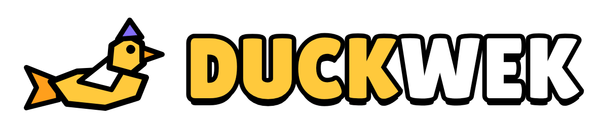
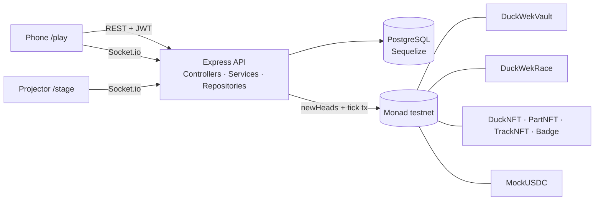
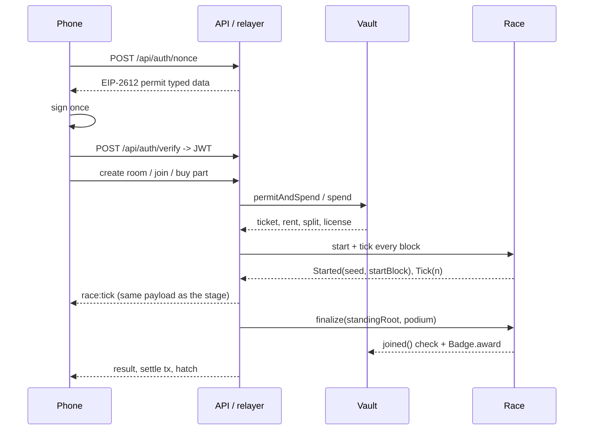

<div align="center">

# 

### Live room-wide duck racing on Monad · one race step per block

[](https://soliditylang.org/)
[](https://book.getfoundry.sh/)
[](https://expressjs.com/)
[](https://sequelize.org/)
[](https://nextjs.org/)
[](https://monad.xyz/)

**DuckWek is a live race for one room. Scan the QR, pay a 0.10 USDC ticket, meet your duck, and race the room. Every Monad block moves every duck one step; the chain records the seed, the ticks and the result, and anyone can replay the race.**

[Live App](https://duckwek-app.vercel.app) · [Demo Video](./docs/demo/duckwek-demo.mp4) · [API](https://duckwek-api.fly.dev) · [Frontend](./frontend) · [Backend](./backend) · [Smart Contracts](./smart-contract) · [Plans](./docs/plans)

<br/>


</div>

---

## Overview

Built for **Monad Blitz Jogja Vol. 2** (24 Oct 2026, GIK UGM). The room is the product: 100 people, one projector, one QR, one race.

- **One block = one step.** `start` fixes `startBlock` and the seed from `prevrandao`; the relayer sends one tick transaction per block. The step is `block.number - startBlock`.
- **One signature.** A player signs an EIP-2612 permit at connect. Every later order is charged under it; the relayer pays gas. Players never hold MON.
- **No betting.** Rent, tickets and part licenses only. Nothing flows from losers to winners; podium titles are soulbound and cannot be bought.
- **Replayable.** The seed, the ordered participants and the published cheer log reproduce every position. The live run matched 27 of 27 pushed ticks.
- **Immutable contracts.** No proxy. A future change is a migration, planned in `docs/plans/0002-mainnet-migration.md`.

The product surface:

- **Phone `/play`** — connect, join, duck profile, part shop, live race, CHEER, result, withdraw.
- **Projector `/stage/[code]`** — QR, grid, canvas race, photo finish, winner.
- **Host** — create a room (1 USDC track rent), start the race, watch the room fill.
- **Assets** — one duck per wallet (egg until the first paid race), part licenses, soulbound podium titles.

`200` is the maximum slot count, never a participant count. The venue population is 100; the demo reports the people who actually joined.

## Architecture



## Flow



## Stack

| Layer | Technology |
|---|---|
| Contracts | Solidity 0.8.26, Foundry, OpenZeppelin 5.1.0 |
| Backend | Express 4, TypeScript, Sequelize, PostgreSQL, Socket.io, viem |
| Frontend | Next.js 16, Tailwind 4, RainbowKit/wagmi, socket.io-client |
| Chain | Monad testnet, chain id `10143` |
| Hosting | Vercel (web), Fly (API, one machine), Supabase (PostgreSQL) |

## Repository

```text
duckwek/
├── smart-contract/   Foundry: src/, test/, script/Deploy.s.sol, export-abi.sh
├── backend/          Express + TypeScript + Sequelize + Socket.io + viem
│   ├── app/Http/     Controllers · Services · Repositories · Requests · Middlewares
│   ├── app/Engine/   Race · Cheers · TrackGeometry
│   ├── app/Chain/    Relayer · JoinBatcher · TypedData · ABIs
│   └── test/         e2e · engine · load
├── frontend/         Next.js 16 phone app and projector stage
├── docs/plans/       approved work plans and the migration playbook
├── docs/design/      design tokens and UI rules
├── FINANCE.md        prices and splits, aligned with the contracts
└── README.md
```

## Contracts

| Contract | Address |
|---|---|
| MockUSDC | `0x65c8b85a3447d2a90cda2c7685066a11f3ef625e` |
| TrackNFT | `0x5bfbbfca7d2acf8d693b70c30f08afd587eb1079` |
| PartNFT | `0x1752f6d71e5a2a2be44dfd1813786df49e297717` |
| DuckNFT | `0xA1B8Ae6C836080AD7cB8b7CCA309C212A8A978EA` |
| Badge | `0x0f479B77B2721d2b0E8fb2c5c45aeB80237Dcc51` |
| DuckWekVault | `0x13D4C18005C8128B404e5F2A66bB944b2d121fDA` |
| DuckWekRace | `0x7522c338d0519aB039bAdcD48Df1d42CC96FdA65` |

Deployment transaction (MockUSDC): `0x10571231ea52998fc37c8cb3775d7149a99989ce0be35685a04c117dd7996719`. The full broadcast is in `smart-contract/broadcast/Deploy.s.sol/10143/`.

All seven contracts are verified on MonadVision (`https://testnet.monadvision.com/address/<address>`) and on Monadscan.

There is no proxy. The contracts are immutable; a future change is a migration (`docs/plans/0002-mainnet-migration.md`).

## Keys

| Role | Address | Can |
|---|---|---|
| Owner | `0x5617007a51331f4e7241DE852cDc4Bbbe723CAE4` | configure, pause, set the welcome mint |
| Operator / relayer | `0x5C0929120E9ecfFc5E684Da1d0f5101e7d2d4B49` | charge orders, tick, finalize, hatch |
| Treasury | `0xD3ABe6Cb5EAe7B9f57C543151F825AD9149Af2D9` | receive protocol fees (pull) |

The deployer is the owner, not the relayer. `WELCOME_ENABLED` is a deploy option: `true` on testnet, `false` on mainnet. The owner can turn it off at any time with `setWelcomeEnabled(false)`.

## Quick Start

### Contracts

```bash
cd smart-contract
forge test
PRIVATE_KEY=... OPERATOR=0x... TREASURY=0x... WELCOME_ENABLED=true \
  forge script script/Deploy.s.sol --rpc-url "$RPC_URL" --broadcast
./script/export-abi.sh
```

### Backend

```bash
cd backend
npm install
cp .env.example .env
# fill JWT_SECRET, RPC_URL, OPERATOR_PRIVATE_KEY, the contract addresses, PostgreSQL
npm run migrate:latest
npm run seed:run
npm run dev
```

### Frontend

```bash
cd frontend
npm install
cp .env.example .env.local
npm run dev
# phone: http://localhost:3000/play
# projector: http://localhost:3000/stage/WEK-XXX
```

## Tests

| Test | Command |
|---|---|
| Contracts | `cd smart-contract && forge test` (60 tests) |
| Engine fairness and cheer | `cd backend && npx ts-node -T test/engine/fairness.test.ts` |
| End to end | `cd backend && npm run test:e2e` |
| Load | `cd backend && N=50 W=200 npm run test:load` |
| Frontend build | `cd frontend && npm run build` |

## Demo

1. Scan the stage QR.
2. Connect once, pay the 0.10 USDC ticket.
3. Race; tap CHEER.
4. Photo finish, podium, soulbound titles.
5. Hatch the duck, withdraw from the Vault.
6. Show one tick transaction, the start transaction and the finalize transaction.

## Proof

Deployment transaction (MockUSDC): `0x10571231ea52998fc37c8cb3775d7149a99989ce0be35685a04c117dd7996719`.

Live race `WEK-J8G` on Monad testnet (explorer: `https://testnet.monadvision.com/tx/<hash>`):

| Step | Transaction |
|---|---|
| Create room | `0x2c1ef557bfc3a072679d16e4d3c8fa884f4ae2a2432dd4dee8311804ec0e4aca` |
| Join batch (2 tickets) | `0x1f8ac114dc3847c2b4f0ef1eb997db183a9635577d0a649a901c66f8f4247405` |
| Start (seed `0x772714905d9ed699506b472e2a4d098ebd16a8e645ebc29cd908a22f1eb2694f`, start block `73723712`) | `0x073008b54a406fa3c0335c27f8ee12fb7f504fb9c6fbc853167844fbf07068e5` |
| Tick step 3 | `0x63150c24447550b98bbd4ab0e8cdc4aa12f650723e8256f2a874f40e048c37d3` |
| Tick step 4 | `0x6565b376278322aa6c254fb63dd3647e3a46fcaa49a088329965140884afa34b` |
| Tick step 6 | `0xdad486ad5ca7ed2b871850e061bd47b882f9c4a7b9bdcfb089d2398fa8307279` |
| Finalize | `0x3dbcba513f310ec85e840d54d803e937d6425e72714510e9592a5bdc5d6e9eba` |
| Hatch duck #1 | `0xeb9f28155b2995254d4ac5dedb950de12dbbb7f5a03099184be521639f049ab4` |

Standing root: `0x5226f30a9abbe27c71d55f89ade57a51b2f8de53dc958d198110c2be30b38600`. Cheer root: `0x9915489080799234d12c818dbd017442406686b38ae33288e035c18102ae4781`.

The replay matched 27 of 27 pushed ticks. Gasless withdraw is covered by the Foundry tests; a live withdraw needs a wallet with Vault earnings (treasury or creator), whose key is not in this repository.
