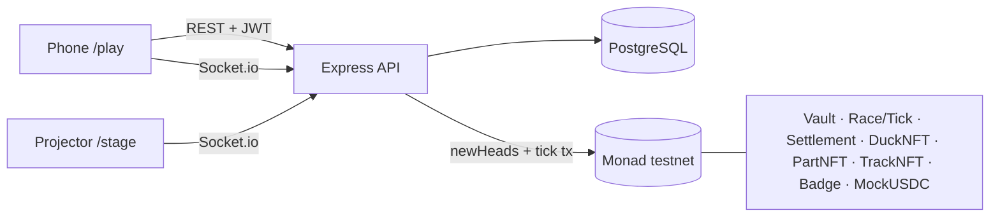

# DuckWek — Theme and Scope

| | |
|---|---|
| **Version** | 1.0 |
| **Status** | Approved |
| **Date Created** | 2026-10-24 |
| **Last Updated** | 2026-10-24 |

---

## 1. Problem Statement

Monad Blitz Jogja Vol. 2 puts 100 people in one room, with one screen and a phone each. The formats available today do not use that room: a raffle or name picker decides the winner before the animation runs, a quiz is not a shared race, and a normal online game trusts its server for the result. On-chain games solve trust but add friction: MON for gas, approvals, and several signatures per action.

DuckWek is a live, room-wide duck race where **one Monad block moves every duck one step**. The race fixes its seed and `startBlock` on-chain at the start (`PREVRANDAO`), every step is derived from that seed and the block number, and the whole race can be replayed by anyone. Players pay a ticket, not a stake; nothing flows from losers to winners. Gas is sponsored by a relayer, so a player signs once and never holds MON.

This repository is the public submission build: written from zero, public from the first commit, and deployed during the Blitz. This plan fixes the theme, the scored scope, the non-goals and the demo before any code is written.

## 2. Definition of Done

The build is done when all of the following are true at the same time:

1. Plans `0001`–`0010` exist, are approved, and no implementation starts before its plan is approved.
2. Public repository `github.com/hafidluqman50/duckwek` contains the build, with a README that states the live URL, the deployed contract addresses and the steps another person needs to run it.
3. All contracts are deployed **during the Blitz** to Monad testnet (chain `10143`) and verified on the explorer; the addresses in the README are this deployment.
4. The web app is publicly hosted (Vercel) and the API is publicly hosted (Fly, exactly one machine because live races and sockets live in memory).
5. The full flow works on the live URL: connect, join a paid room, race with per-block ticks, cheer, finish, settle, hatch/view a Duck NFT, withdraw.
6. At least one race runs with real venue players, and the 3-minute demo shows a live transaction whose hash can be opened in the explorer.
7. Contract tests, engine tests, end-to-end tests and a load test are green on this build. The exact commands are listed in `0010`.
8. Build-in-public assets are posted: a post tagging `@monad`, `@monad_dev`, `@geeky.kartikey`; a demo video of at least 30 seconds; a creative ad; the 5K-view target is tracked.
9. No open P0 defect remains at 16:30 local time, and the demo has been rehearsed end to end once.
10. Mainnet is the ideal goal: the no-proxy deployment and the migration playbook in `0002` are accepted, and a mainnet deployment happens only when it is funded and the real USDC address is verified.

## 3. Feature Description

### 3.1 Theme and one-liner

**Theme:** a live race for one room, where the chain is the clock, not the bookkeeper.

- One-liner for judges: *"We don't take a bet — we take a fee. Every step of the race is one Monad block, the seed is fixed on-chain, and anyone can replay the result."*
- Player-facing line: *"Scan the QR, pay a 0.10 USDC ticket, meet your duck, race the room."*
- The product is the **moment**: 100 people in one room, one projector, phones tapping CHEER, one race that ends in under two minutes.

### 3.2 Why this is only possible on Monad

These numbers are the pitch, and they must be measured on this build before they are repeated:

| Fact | Value used in the pitch | Source |
|---|---|---|
| Block time | ~300 ms, measured median 319 ms, p95 458–684 ms | Monad testnet measurement; re-measured in `0006` |
| Race clock | one tick transaction per block; tick lands in block `startBlock + n` | design target; verified in `0006` |
| Tick cost | 48,264 gas estimated; `TICK_GAS` 53,100 used per tick | Monad testnet measurement; re-measured after deploy |
| Room scale | 100 players at the venue (max slots are not a participant count) | venue population, 2026-10-24 |
| Replay | 25/25 ticks reproduced from the on-chain seed | acceptance check S-11 and `0006` |

The pitch claims only what this build measured. Until a number is measured here, it is marked `UNVERIFIED` in the plans and is not spoken on stage as a result.

### 3.3 What the judges score

The event scores 400 points. This plan deliberately spends effort on the parts that are scored and removes work that is not.

| Block | Item | Points | In scope today |
|---|---|---|---|
| Basic | Public GitHub repository | 25 | yes |
| Basic | README with live page and contract address | 25 | yes |
| Basic | Contracts deployed on Monad testnet | 25 | yes |
| Basic | Publicly hosted app | 25 | yes |
| Advance | Working: all functions | 25 | yes |
| Advance | Working: live transaction during demo | 25 | yes |
| Advance | Working: contracts verified | 25 | yes |
| Advance | Working: another person can run it from the README | 25 | yes |
| Advance | Build in public: X/LinkedIn post with tags | 25 | owner |
| Advance | Build in public: demo video ≥ 30 s | 25 | owner + recording |
| Advance | Build in public: creative ad | 25 | owner |
| Advance | Build in public: 5K+ views | 25 | distribution, not code |
| Bonus | Deploy on Monad mainnet | 25 | yes, ideal goal; architecture in `0002` |
| Bonus | Custom domain | 15 | conditional, see §9 O-5 |
| Bonus | Product-market fit | ≤ 20 | answer with venue data, no invented claim |
| Bonus | Revenue potential | ≤ 20 | answer from `FINANCE.md` |
| Bonus | Innovation and originality | ≤ 20 | answer with the mechanic in §3.2 |

### 3.4 Product rules that cannot change

These come from `AGENTS.md` §6 and are prerequisites, not preferences:

- No prize pool and no betting. Tickets and fees only; no money moves from losers to winners. Podium rewards are soulbound titles.
- Payments are (Mock) USDC only. MON is gas, paid by the relayer. Players never hold MON.
- Pull payout: every receiver withdraws from the Vault.
- One duck per wallet. The duck is an egg until the first paid race, then hatches into a Duck NFT.
- Race and standing are computed off-chain from seed + `startBlock` + participant list. The chain records commits and results only. Computing the race on-chain was benchmarked and rejected.
- 100 is the venue population. 200 is at most a slot limit and is never used as a participant count.
- Gas limits are set deliberately because Monad charges on the limit, not on gas used.

### 3.5 Day-H scope (must ship)

| # | Flow | Acceptance on the live URL |
|---|---|---|
| S-1 | Host creates a room | Host pays 1 USDC track rent from the Vault; a room code and a stage URL exist; the track is one of the seeded platform tracks |
| S-2 | Player connects | One signature at connect; session restored on reload; no MON needed |
| S-3 | Player joins | 0.10 USDC ticket leaves the player's Vault balance; the player appears in the room and on the stage grid in join order |
| S-4 | Player keeps a duck | Name, colors and style persist; one duck per wallet; egg state before the first paid race |
| S-5 | Part shop | One part license for 1 USDC; license is an ERC-721; loadout applied to the duck |
| S-6 | Race runs per block | One tick per Monad block; phones and projector receive the same tick; standings update as a race, not as a random shuffle |
| S-7 | CHEER | Tap boost is rate-limited, capped, and visibly moves the duck; the cheer log is hashed into the standing root |
| S-8 | Finish and settle | Photo finish, final standing, soulbound podium titles; settlement transaction confirms on-chain |
| S-9 | Duck NFT | First paid race hatches the egg; the app has a working My Duck view with `tokenURI` metadata (image may be empty by design) |
| S-10 | Withdraw | A receiver withdraws their Vault balance with a signature; funds arrive without the receiver paying gas |
| S-11 | Proof | The stage/README shows replayable evidence: seed, start block, settlement and hatch transaction hashes |

Anything not in S-1–S-11 is not day-H scope.

### 3.6 Explicit non-goals

- No marketplace, secondary sales, royalties beyond the existing ERC-2981 declaration, tips, season pass, sponsor inventory or track UGC.
- No mainnet deployment without a migration plan in `0002`, a funded relayer and a verified real-USDC address. Testnet remains the submission baseline.
- No redesign of the approved v3 visual. The prototype is implemented 1:1.
- No claim of 200 players. The demo room is the people who actually joined.
- No new admin dashboard, analytics product, or onboarding flow beyond what the demo needs.
- No simulation code in production paths. Simulations stay in tests.

### 3.7 Build policy

- This repository is written from zero. The plans in `docs/plans/` are the only specification.
- The contract sources follow the fixed implementation documented in `0003`–`0005`; the repo does not invent a different contract design.
- The approved visual system is `docs/design/DESIGN_SYSTEM.md`; the frontend implements it, not a reinterpretation.
- The behaviour in §3.5 is the specification: one-signature session, join batching, per-block tick loop, deterministic engine, cheer cap, stage buffer, pull payout.
- ABIs are exported to backend and frontend with `./script/export-abi.sh` after every contract change.
- Tests live only in `smart-contract/test/`, `backend/test/` and `frontend/__tests__/`.

### 3.8 Plan set and gates

| Plan | Content | Gate before implementation |
|---|---|---|
| `0001-theme-and-scope.md` | Theme, scored scope, non-goals, demo script, open decisions | owner approves the scope |
| `0002-mainnet-migration.md` | No-proxy mainnet deployment and future migration playbook | owner approved no proxy; no migration code until triggered |
| `0003-contracts-foundation.md` | Roles, token, Vault, money flows, withdraw, deploy | owner approves the foundation |
| `0004-contracts-race.md` | Room lifecycle, seed/start, tick, finalize, badges | owner approves the race shape |
| `0005-contracts-assets.md` | DuckNFT, PartNFT, TrackNFT, Badge, catalog, metadata, royalties | owner approves the asset shape |
| `0006-backend-engine.md` | Deterministic engine, tick loop, block source, cheer | owner approves the engine shape |
| `0007-backend-api.md` | Database, services, endpoints, sockets, relayer, batching | owner approves the API shape |
| `0008-frontend-phone.md` | `/play`, wallet, contract simulation, race screen | owner approves the phone flow |
| `0009-frontend-stage.md` | `/stage`, QR, canvas renderer, playback buffer | owner approves the stage flow |
| `0010-deploy-and-demo.md` | Env, deploy, verify, evidence, fallback, rehearsal | owner approves the runbook |
| `0011-demo-video.md` | Phone-first demo video, 45–60 s, captions | owner approves the storyboard |
| `0012-pitch-deck.md` | 10-slide pitch deck with a 3-minute script | owner approves the slide order |

### 3.9 Three-minute demo script

| Time | What happens | What the judges see |
|---|---|---|
| 0:00–0:25 | One sentence of problem and theme | "One block = one step. No bet, only a ticket." |
| 0:25–0:45 | Scan the stage QR on a phone | Join screen with the room code; ticket price visible |
| 0:45–1:10 | Connect and join | One signature; Vault balance drops by 0.10 USDC; duck appears on stage |
| 1:10–1:55 | Start the race | Ducks move every block; phones tap CHEER; standings change |
| 1:55–2:20 | Photo finish and result | Podium, soulbound titles, final standing |
| 2:20–2:40 | My Duck | Egg hatched into a Duck NFT; metadata visible |
| 2:40–3:00 | Proof | Open one tick tx, the seed/start block and the settlement tx; show the public repo and README addresses |

### 3.10 Mainnet as the ideal goal

Mainnet is planned, not improvised. The contract decision is **no proxy**: the fixed contracts are deployed as they are. If a feature later cannot fit them, the project migrates to a new deployment, with a published snapshot and a claim or withdraw path.

`0002-mainnet-migration.md` owns that playbook:

- The v1 Vault, Race and assets stay immutable.
- A new season or mechanism deploys a new Race (and a new Badge); the Vault owner authorises the new Race as an operator.
- A change that needs the Vault itself is a full migration; balances move by withdrawal or claim.

This plan does not change the fixed contracts. It fixes the destination and the escape hatch.

## 4. Impacted Files

Everything in this repository is `[NEW]`; there is no existing code. File-level detail is owned by the partial plans; this plan only fixes the skeleton.

```text
duckwek/
├── AGENTS.md                                  [NEW] repository rules (created)
├── .gitignore                                 [NEW] env, build output, deps (created)
├── README.md                                  [NEW] live URL, addresses, run steps (0010)
├── FINANCE.md                                 [NEW] approved values, mode 0600 (0003)
├── docs/
│   ├── plans/0001-theme-and-scope.md          [NEW] this plan
│   ├── plans/0002-mainnet-migration.md        [NEW] 0002
│   ├── plans/0003-contracts-foundation.md     [NEW] 0003
│   ├── plans/0004-contracts-race.md           [NEW] 0004
│   ├── plans/0005-contracts-assets.md         [NEW] 0005
│   ├── plans/0006-backend-engine.md           [NEW] 0006
│   ├── plans/0007-backend-api.md              [NEW] 0007
│   ├── plans/0008-frontend-phone.md           [NEW] 0008
│   ├── plans/0009-frontend-stage.md           [NEW] 0009
│   ├── plans/0010-deploy-and-demo.md          [NEW] 0010
│   ├── plans/0011-demo-video.md               [NEW] 0011
│   ├── plans/0012-pitch-deck.md               [NEW] 0012
│   └── design/
│       └── DESIGN_SYSTEM.md                   [NEW] tokens and UI rules
├── smart-contract/                            [NEW] Foundry project (0002–0005)
│   ├── src/                                   [NEW] production Solidity
│   ├── src/mocks/                             [NEW] MockUSDC
│   ├── test/                                  [NEW] Foundry tests
│   ├── script/Deploy.s.sol, export-abi.sh     [NEW] deploy + ABI export
│   └── lib/                                   [NEW] forge-std, OpenZeppelin (read-only)
├── backend/                                   [NEW] Express + TS (0006–0007)
│   ├── app/Http/{Controllers,Services,Repositories,Requests,Middlewares}
│   ├── app/{DTOs,Interfaces,Models,Exceptions,Engine,Chain,Sockets}
│   ├── config/  routes/  database/{migrations,seeders}/
│   └── test/{e2e,engine,load}/
└── frontend/                                  [NEW] Next.js 16 (0008–0009)
    ├── app/{play,stage,join}/
    ├── components/  contexts/  http/  lib/  public/
    └── __tests__/
```

### Reuse check

| `[NEW]` item | Existing material read | Why it cannot serve as-is |
|---|---|---|
| Whole repository | Nothing exists in this repository yet | From-zero build by instruction; there is no code to reuse |
| `docs/design/DESIGN_SYSTEM.md` | The palette, type and mobile rules in the approved design | New summary of an approved system; no new design decisions |
| `AGENTS.md`, `.gitignore` | None | New repository rules and ignore list; no existing file in this repository |
| `FINANCE.md` | The fixed contract values and the approved business rules | Business rules, not code; written to match the contracts with mode `0600` |
| Plans `0002`–`0010` | None | New documents; no prior plans exist in this repository |

## 5. Code Shape

This plan changes no code. It adds repository rules, the folder skeleton and this document. Code shapes for every new type and function live in the partial plans:

- `0002-mainnet-migration.md` — no-proxy mainnet deployment and future migration playbook.
- `0003-contracts-foundation.md` — roles, token, Vault, money flows, withdraw.
- `0004-contracts-race.md` — room lifecycle, seed, tick, finalize.
- `0005-contracts-assets.md` — duck, part, track, badge.
- `0006-backend-engine.md` and `0007-backend-api.md` — engine, tick loop, relayer, services, endpoints, sockets.
- `0008-frontend-phone.md` and `0009-frontend-stage.md` — screens, state, contract calls, stage renderer.
- `0010-deploy-and-demo.md` — scripts, env keys, deploy and verification commands.
- `0011-demo-video.md` — phone-first demo capture and edit.
- `0012-pitch-deck.md` — 10-slide narrative and 3-minute script.

## 6. UI/UX Changes (Lo-Fi)

The visual source of truth is `docs/design/DESIGN_SYSTEM.md`. All UI copy is English. The Lo-Fi below fixes structure only.

### 6.1 Phone, `/play`

```text
┌─────────────────────────────┐
│  DUCKW EK        [balance]  │
│                             │
│   (duck portrait / egg)     │
│   Name · 0.90 USDC          │
│                             │
│   [ JOIN ROOM — 0.10 USDC ] │
│                             │
│   room: WEK-XXX · 42/100    │
└─────────────────────────────┘
```

States: connect → ticket → keep duck → lobby (grid position by join order) → race (track strip + CHEER dock) → result (standing, title, hatch).

Rules: the CHEER dock never overlaps the track or the back button; tap feedback is immediate; the back action exists on every screen; no horizontal scroll at 390 px width.

### 6.2 Projector, `/stage/[code]`

```text
┌──────────────────────────────────────────────────────────────┐
│  DUCKW EK · KALI CODE SPRINT          LAP 1/1 · 00:41        │
│                                                              │
│   [QR]   ████████████████████████████████████████████████    │
│          ████████████████████████████████████████████████    │
│          ████████████████████████████████████████████████    │
│                                                              │
│  P1  Duck A        P2  Duck B        P3  Duck C              │
└──────────────────────────────────────────────────────────────┘
```

States: waiting (QR + join count), countdown, race, photo finish, winner + podium. The renderer keeps a three-step buffer (`LAG_STEPS = 3`) so the pack moves smoothly against block jitter; the trade-off is a small display delay behind the chain and is stated in `0009`.

### 6.3 `/join/[code]`

A redirect target behind the QR: resolves the room code, then sends the phone to `/play?room=CODE`. No separate visual.

### 6.4 UI rules

- Copy is English, short, and never promises a prize pool.
- The stage is designed at 1920×1080 and must hold 100 ducks without dropping below the measured frame budget.
- The phone shows the same tick as the stage. No client-side race simulation.
- Errors from wallet or contract simulation are shown before any wallet popup.

## 7. Flowchart

```mermaid
flowchart TD
  A[Host opens /play] --> B[Create room: 1 USDC track rent]
  B --> C[Room code + /stage/CODE]
  D[Player scans QR] --> E[/join/CODE -> /play?room=CODE]
  E --> F[Connect: one signature]
  F --> G[Join: 0.10 USDC ticket]
  G --> H[Duck on grid by join order]
  C --> I[Host starts race]
  H --> I
  I --> J[Start fixes seed + startBlock on-chain]
  J --> K[Relayer ticks once per block]
  K --> L[Phones + stage receive the same tick]
  L --> M[CHEER taps modify the step]
  M --> N{Finish}
  N --> O[Settle: standing root on-chain]
  O --> P[Podium titles + Duck NFT hatch]
  P --> Q[Withdraw from Vault]
```



## 8. Verification Plan

### 8.1 Plan-level checks

- This plan is approved before any code is written. Later plans may be drafted in parallel, but implementation waits for the plan that owns it.
- Every later plan carries the required sections and a version/changelog table.
- No code is written before the plan that owns it is approved.

### 8.2 Scope acceptance (mapped to §3.5)

| Check | Method | Pass condition |
|---|---|---|
| S-1 room creation | Live URL, host wallet | Room exists, track rent debited 1 USDC, stage URL opens |
| S-2 one signature | Live URL, fresh browser profile | One signature at connect; reload keeps the session |
| S-3 paid join | Live URL, two phones | Ticket debited; both players visible on stage in join order |
| S-4 duck profile | Live URL | Duck keeps name/colors; second duck for the same wallet is rejected |
| S-5 part license | Live URL | 1 USDC debited; license visible; loadout applies |
| S-6 race ticks | Live URL + explorer | One tick per block; stage and phone show the same tick; tick tx hashes exist |
| S-7 cheer | Live URL, repeated taps | Duck advances beyond its base step; rate limit and cap hold |
| S-8 settle | Live URL + explorer | Final standing matches replay; settlement tx confirms; podium titles are soulbound |
| S-9 Duck NFT | My Duck | Egg hatches after the first paid race; `tokenURI` returns metadata |
| S-10 withdraw | Live URL, receiver wallet | Balance leaves the Vault; receiver pays no gas |
| S-11 proof | README | Seed, start block, settlement and hatch hashes are listed and open in the explorer |

### 8.3 Submission checks

- `github.com/hafidluqman50/duckwek` is public and `isEmpty` is false.
- README contains the live URL and every deployed address.
- Explorer shows each contract verified with the new address.
- A person who has never seen the repo can follow the README to run contracts, backend and frontend locally.
- The demo is rehearsed once with two phones and the stage laptop on venue Wi-Fi.

### 8.4 Risks watched by this plan

| Risk | Check before the demo |
|---|---|
| Relayer out of MON | Balance read and printed in the runbook |
| RPC/WebSocket instability at the venue | `newHeads` watchdog and a manual tick fallback described in `0006` |
| Database latency | API and DB in the same region; join latency measured |
| Stage frame drops | 100-duck test with the three-step buffer |
| Contract verification failure | Verify immediately after deploy, before building the frontend env |
| Time | Scope is frozen by §3.5; anything outside it is refused, not squeezed in |

## 9. Open Decisions for the Owner

No default is assumed for any of these. They block the plans that name them.

| ID | Decision | Blocks | What the owner must provide |
|---|---|---|---|
| O-1 | Monad mainnet: timing and funding | `0002`, `0010` | Real MON for gas, the real USDC address on Monad mainnet, and confirmation that the welcome mint is disabled there |
| O-2 | Room capacity for the venue | `0003`, `0008` | Confirm 100 max slots for the demo room and the default room size shown in the UI |
| O-3 | Duck hatch policy | `0005`, `0008` | Auto-hatch after the first paid race (current behaviour) or hatch only on the podium |
| O-4 | CHEER strength | `0006` | Keep the 20% cap and 5 taps/second limit, or change both numbers |
| O-5 | Custom domain | `0010` | Domain name and DNS access, or "skip" |
| O-6 | Build-in-public ownership | `0010` | Who records and posts the video/ad, and whether the 5K-view target is chased |
| O-7 | MON budget cap | `0010` | Maximum testnet spend for this build and whether mainnet is funded |
| O-8 | Wallet onboarding | `0008` | RainbowKit only, or also a passkey wallet |
| O-9 | Podium definition | `0004` | Top three by final standing; confirm whether a "most cheered" title is included |
| O-10 | Migration policy | `0002` | No proxy; define who triggers a migration and the conditions |
