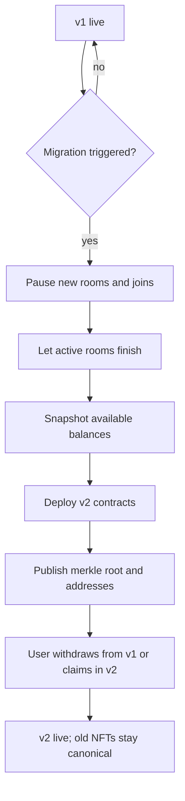

# Mainnet and Future Migration (No Proxy)

| | |
|---|---|
| **Version** | 2.0 |
| **Status** | Approved — no proxy |
| **Date Created** | 2026-10-24 |
| **Last Updated** | 2026-10-24 |

| Version | Date | Change |
|---|---|---|
| 1.0 | 2026-10-24 | Initial draft |
| 1.1 | 2026-10-24 | Renamed to plan 0002; status set to awaiting owner review |
| 1.2 | 2026-10-24 | Room registry row clarified: existing slots and meanings stable |
| 1.3 | 2026-10-24 | Owner decision: NFT versioning, old tokens canonical |
| 2.0 | 2026-10-24 | MAJOR: owner rejected proxies; fixed contracts deploy as-is; future changes go through a full migration |

> **Decision (owner, 2026-10-24):** no proxy. The fixed contracts in `0003`–`0005` are deployed as they are. If a change is needed later, the project migrates to a new deployment. No proxy contract code is written.

---

## 1. Problem Statement

The v1 contracts are immutable. A proxy would allow changing logic at the same address, but it adds an upgrade admin, storage-layout discipline and maintenance that the project does not want for this build.

The owner's position: the economics are settled, the contracts are fixed, and a future change can be handled by a full migration to a new deployment. This plan records that decision and defines what a migration means, what can change without one, and what forces one. It does not add code.

## 2. Definition of Done

1. The fixed contracts documented in `0003`–`0005` are deployed on Monad testnet during the Blitz and verified on the explorer.
2. No proxy contract, no ERC-1967 proxy, no upgradeable OpenZeppelin package and no storage-layout work ships in this build.
3. The deployed addresses are in the README and in the backend and frontend environment.
4. This migration playbook is accepted, so a future change does not reopen the proxy debate by accident.
5. Mainnet, if funded, uses the real USDC address, disables the welcome mint and has no faucet.
6. The real USDC address is verified for EIP-2612 before the one-signature flow is promised on mainnet.

## 3. Feature Description

### 3.1 Decision

No proxy. The v1 Vault, Race and asset contracts are immutable. A future feature that cannot fit the fixed contracts is delivered as a new deployment, not as an in-place upgrade.

Why:

- The economic rules are fixed: rent 1 USDC, ticket 0.10 USDC, part 1 USDC; splits 50/50, 50/50 and 85/15; platform assets credit the protocol alone.
- A proxy would let an admin change custody logic. That weakens the pitch and adds a key to protect.
- The remaining time is better spent on the build, the deployment and the pitch than on proxy storage discipline.
- A migration is possible and honest: new addresses, a published snapshot, and a claim or withdraw path.

### 3.2 What can change without a migration

| Change | How |
|---|---|
| New race season or race mode | Deploy a new `DuckWekRace`; the Vault owner calls `setOperator(newRace, true)`. Old rooms finish on the old Race. |
| New Badge per season | Deploy a new `Badge` paired with the new Race. Old badges stay canonical. |
| New DuckNFT / PartNFT / TrackNFT version | Deploy a new contract; old tokens remain canonical. The app reads `(contract, id)`. |
| Backend, engine, cheer, UI | Off-chain changes; no contract deployment. |
| Part marketplace | A new `PartMarket` contract handles listings, USDC payment, royalty and fee. No PartNFT change. |
| Part enhancement | A new `PartEnhancement` contract keyed by `(partContract, tokenId)`; the engine reads it. Old licenses keep working. |
| New catalog entries | Seed data; no deployment. |

The Vault remains the money ledger for room rent, tickets and primary parts. New standalone contracts either use the Vault's existing kinds or handle their own payments.

### 3.3 What forces a migration

- A new paid kind that must use the Vault ledger (for example a secondary-sale split or a season pass paid into `available`).
- A change to the Vault's price, split or `available` accounting.
- Pointing the Vault at a new `TrackNFT` or `PartNFT` for create-room or buy-part.
- A critical Vault bug that cannot be contained by pausing.
- A mainnet token change that alters the payment path.

If none of these happens, the fixed deployment stays.

### 3.4 Migration playbook (future)

1. **Freeze.** Pause new rooms and joins; let active rooms finish; stop the relayer from new charges.
2. **Snapshot.** Read every `available` balance from Vault events and the database. Publish the snapshot and a merkle root.
3. **Deploy v2.** New Vault, Race, assets and Badge. No proxy.
4. **Move balances.** A user can always withdraw from v1. For a funded v2, a `BalanceClaim` contract lets a user claim their v1 balance against the published root. Unclaimed balances stay in v1 and remain withdrawable.
5. **NFTs.** Old tokens stay canonical. A new asset version handles new mints. A burn-to-mint migration is optional and only for a collection that must move as a whole.
6. **Switch the app.** Backend and frontend support both addresses during the transition; the README lists v1 and v2.
7. **Verify.** Replay the snapshot, test every claim, and run one rehearsal on testnet before announcing.

### 3.5 Mainnet readiness (if funded)

| Check | Requirement |
|---|---|
| USDC | Real address confirmed on Monad mainnet |
| Token shape | `DeployMainnet.s.sol` requires code, 6 decimals, symbol `USDC`, and EIP-2612 `DOMAIN_SEPARATOR`/`nonces` |
| Permit | EIP-2612 support verified before promising one signature |
| Welcome mint | Disabled |
| Faucet | Not deployed |
| Owner | Multisig; no proxy owner and no upgrade timelock |
| Treasury | Separate multisig |
| Verification | Every contract verified on the explorer |
| README | Addresses and chain id listed |

### 3.6 Cost and risk

- A migration changes every address and requires user action for balances.
- The app must support two versions during the transition.
- Unclaimed balances remain in v1; they are not lost, but they are not in v2.
- Old NFTs and new NFTs live on different contracts; the app must aggregate them.
- A Vault bug after launch has no in-place fix. Mitigation: tests, a pause, and the migration plan.
- The exact migration gas is `UNVERIFIED` until it is rehearsed.

### 3.7 What not to do

- No UUPS, no ERC-1967, no `openzeppelin-contracts-upgradeable`, no `initialize` pattern, no storage `__gap` work.
- No migration code until the owner triggers it.
- No silent change to the fixed economics.

## 4. Impacted Files

Today this plan changes no code. It records the decision and the future path.

| File | Status | Purpose |
|---|---|---|
| `docs/plans/0002-mainnet-migration.md` | `[NEW]` | This plan |
| `smart-contract/script/DeployV2.s.sol` | `[FUTURE]` | Only if a migration is triggered |
| `smart-contract/script/DeployMainnet.s.sol` | `[NEW]` | Mainnet deploy against real USDC, with token checks |
| `smart-contract/src/migration/BalanceClaim.sol` | `[FUTURE]` | Merkle claim for v1 balances |
| `smart-contract/test/Migration.t.sol` | `[FUTURE]` | Snapshot and claim tests |
| `backend/script/migrate-snapshot.ts` | `[FUTURE]` | Read `available` and build the root |

### Reuse check

| `[FUTURE]` item | Existing material read | Why it cannot serve as-is |
|---|---|---|
| `DeployV2.s.sol` | `Deploy.s.sol` in `0003` | A migration deploys a new set and funds a claim; the fixed script starts from zero |
| `BalanceClaim.sol` | The Vault `available` and `withdrawWithSig` in `0003` | The fixed Vault has no cross-contract claim; users withdraw per wallet |
| `Migration.t.sol` | The fixed Vault tests in `0003` | The fixed tests do not cover a snapshot or a merkle claim |

## 5. Code Shape

No code is written now. If a migration is triggered, the claim contract is the only new money path:

```solidity
contract BalanceClaim {
    // merkle root of (wallet, amount) from the v1 snapshot
    function claim(address to, uint256 amount, bytes32[] calldata proof) external;
}
```

- Responsibility: let a wallet claim its v1 `available` balance once, against a published root, into the v2 system.
- The v2 Vault (or the claim contract) must be funded before claims open.
- A claimed flag prevents replay; the root is immutable.
- `UNVERIFIED`: whether the claim pays USDC directly or credits v2 `available`; decided when a migration is triggered.

## 6. UI/UX Changes (Lo-Fi)

No screen today. A future migration adds one notice and one action:

```text
┌─────────────────────────────┐
│  DUCKW EK · MIGRATION       │
│  Your v1 balance: 4.90 USDC │
│  [ WITHDRAW FROM V1 ]       │
│  [ CLAIM IN V2 ]            │
│  Old ducks and parts stay   │
│  valid on their contracts.  │
└─────────────────────────────┘
```

Rules: state the address change, never imply that unclaimed funds are lost, and show both versions until the transition closes.

## 7. Flowchart



## 8. Verification Plan

### 8.1 Today

- Deploy the fixed contracts with `Deploy.s.sol`; no proxy artifacts exist.
- Confirm the deployed bytecode contains no proxy and no initializer.
- Verify every contract on the explorer.
- Confirm the README lists the new addresses.
- Run the mainnet readiness checks in §3.5.

### 8.2 Future migration rehearsal

| Check | Pass condition |
|---|---|
| Snapshot replay | Rebuilt `available` totals equal the Vault events |
| Root | Published root matches the snapshot |
| Claim | A wallet claims once; replay reverts |
| Unclaimed | A wallet can still withdraw from v1 |
| NFT | Old tokens still resolve; new version mints separately |
| App | Both versions read correctly during the transition |

### 8.3 What this plan does not verify

- Race behaviour: `0004`.
- Asset behaviour: `0005`.
- The live demo: `0010`.

## 9. Open Decisions

| ID | Decision | Blocks | What the owner must provide |
|---|---|---|---|
| O-1 | Mainnet timing and funding | this plan | MON for gas, real USDC address, confirmation that permit is supported |
| O-10 | Migration trigger | this plan | Who declares a migration and which conditions force it |
| O-24 | Balance move | this plan | Withdraw-first or a funded merkle claim |
| O-25 | NFT migration policy | this plan | Old tokens canonical (default) or burn-to-mint for a collection |
| O-18 | Mainnet audit | this plan | Whether an external audit runs before real money |
