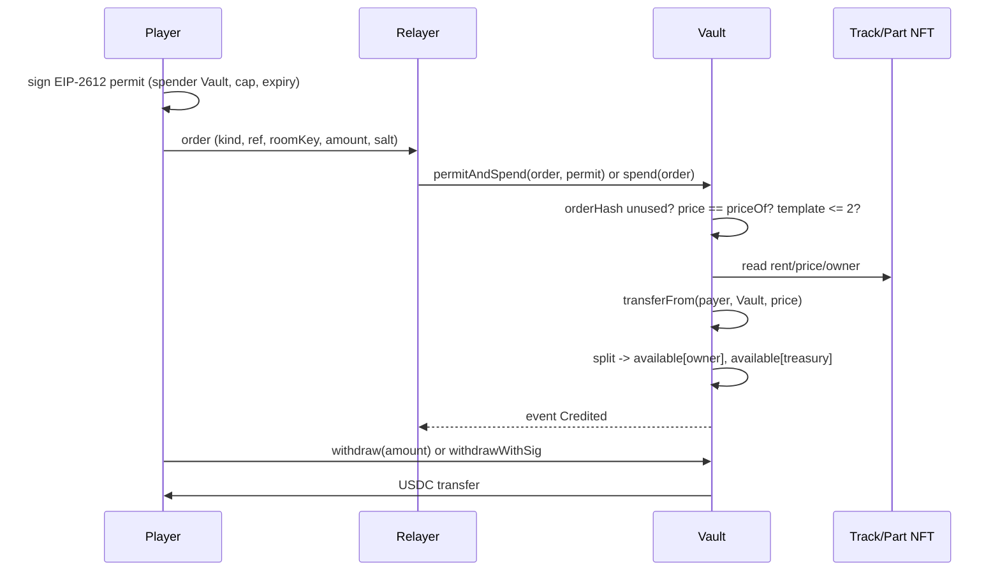

# Contracts Partial 1 — Foundation: roles, token, Vault, money

| | |
|---|---|
| **Version** | 1.2 |
| **Status** | Approved |
| **Date Created** | 2026-10-24 |
| **Last Updated** | 2026-10-24 |

| Version | Date | Change |
|---|---|---|
| 1.0 | 2026-10-24 | Initial draft |
| 1.1 | 2026-10-24 | Renumbered to plan 0003; finance values aligned to the fixed contracts; O-11 removed |
| 1.2 | 2026-10-24 | Approved by owner; contract sources follow the fixed implementation; no proxy |

---

## 1. Problem Statement

Every USDC a player pays, every split, and every payout passes through one contract. If the money layer is wrong, the race, the NFTs and the demo are irrelevant. The foundation must answer four questions on-chain, before any game logic exists:

1. **Who may charge a player?** An operator key (the relayer) and the race contract; never the player's own wallet.
2. **How much may be charged?** Exactly the on-chain price for the action, under a permit the player signed once.
3. **Who receives the money?** Fixed receivers by rule: the track or part owner and the protocol, never a winner.
4. **How does money leave?** Only the receiver withdraws their own balance (pull payout).

The contract set is fixed for this build. This partial documents the foundation exactly as it must be written, so the race and asset partials can depend on stable types and rules. Mainnet differences are deployment-level and are owned by `0002`.

## 2. Definition of Done

1. `DuckWekRoles`, `MockUSDC` and `DuckWekVault` compile with solc `0.8.26` and OpenZeppelin `5.1.0`.
2. The Vault enforces the on-chain price, the fixed splits, the one-signature session, single-use orders, the room registry and pull payout.
3. `script/Deploy.s.sol` deploys the seven-contract set and wires the minters and operators.
4. Foundry tests cover every rule in §3 and every invariant in §8.1, and pass.
5. The ABI is exported to backend and frontend with `script/export-abi.sh`.
6. The mainnet variant is documented: real USDC, welcome mint disabled, no faucet, owner is a multisig; no proxy and no upgrade timelock.
7. No dead contract ships: `Settlement` and `USDCFaucet` are excluded from this build.
8. `FINANCE.md` is rewritten to the fixed contract values (50/50 rent, 50/50 join, 85/15 part, platform assets 100% protocol).

## 3. Feature Description

### 3.1 Fixed contract set

| Contract | Role in this partial | Detail owner |
|---|---|---|
| `DuckWekRoles` | Abstract: owner, operator allowlist, pause | this plan |
| `MockUSDC` | Testnet USDC with EIP-2612 permit and a one-time welcome mint | this plan |
| `DuckWekVault` | Custody, orders, prices, splits, room registry, withdraw | this plan |
| `TrackNFT` | Track owner, rent price, active flag | `0005` |
| `PartNFT` | Part owner, price, license mint | `0005` |
| `DuckNFT` | Duck asset and hatch | `0005` |
| `Badge` | Soulbound podium title | `0005` |
| `DuckWekRace` | Room lifecycle and tick, Vault operator, Badge minter | `0004` |

`Settlement` and `USDCFaucet` are **excluded**. In the fixed design the Badge minter is `DuckWekRace`, not `Settlement`, and the Vault's welcome mint replaces the faucet for onboarding. Keeping either would be dead code with a second source of truth.

### 3.2 Roles and keys

| Key | Can | Cannot |
|---|---|---|
| Owner | set operator, set treasury, set join price, enable/disable welcome, pause/unpause | move a player's balance |
| Operator (relayer) | `permitAndSpend`, `spend`, `withdrawWithSig`, race lifecycle calls | withdraw for itself, change prices, redirect a withdrawal |
| `DuckWekRace` (operator) | charge room rent and tickets through the Vault | touch part sales or withdrawals |
| Treasury | receive protocol fees (pull) | sign transactions |
| Player | sign one permit, withdraw own balance | charge another wallet |

On testnet the deployer is the owner. On mainnet the owner is a multisig; there is no proxy and no upgrade timelock. The relayer key is a hot key with the smallest possible allowance.

### 3.3 Money flows

| Flow | Price | Split | Receiver of the non-protocol share |
|---|---|---|---|
| Create room (track rent) | 1 USDC | 50 / 50 | Track owner; platform track owner is the treasury, so 100% protocol |
| Join room (ticket) | 0.10 USDC | 50 / 50 | Circuit owner; platform track owner is the treasury, so 100% protocol |
| Buy part (primary license) | 1 USDC | 85 / 15 | Part creator; platform part creator is the treasury, so 100% protocol |
| Withdraw | — | — | The balance owner, to an address they choose |

The host's rent also covers the host's own entry: creating a room sets `players = 1` and marks the host as joined.

Nothing flows from a loser to a winner. There is no prize pool, no stake, and no transfer from the Vault to a podium address.

### 3.4 One-signature session

1. At connect, the player signs an EIP-2612 permit: owner = player, spender = Vault, `value` = the session cap, `deadline` = the session expiry.
2. The first paid action calls `permitAndSpend(order, permit)`. The permit is applied in a `try/catch`: if it was already used or expired, the call still proceeds and the transfer reverts only if the allowance is missing.
3. Later actions call `spend(order)` under the same allowance.
4. Each order is single-use: `orderHash` is marked before the charge, so replaying the same order reverts.
5. The operator can only charge the on-chain `priceOf(kind, ref)`, only for the three fixed kinds, and only to the fixed receivers.

The permit is the only signature the player gives. No `approve` transaction, no second signature for a part or a room.

### 3.5 Vault state and room registry

| State | Type | Meaning |
|---|---|---|
| `available` | `mapping(address => uint256)` | Withdrawable balance per receiver |
| `usedOrder` | `mapping(bytes32 => bool)` | An order hash can be charged once |
| `usedNonce` | `mapping(address => mapping(uint256 => bool))` | Gasless withdrawal replay guard |
| `rooms` | `mapping(bytes32 => Room)` | Room key -> host, track, created time, players, circuit owner |
| `joined` | `mapping(bytes32 => mapping(address => bool))` | One entry per wallet per room |

`Room` stores `host`, `trackId`, `createdAt`, `players` and `circuitOwner`. `MAX_PLAYERS` is `200` slots; the venue population is 100 and is never described as 200 participants.

### 3.6 Testnet and mainnet differences

| Item | Testnet | Mainnet |
|---|---|---|
| Token | `MockUSDC` (6 decimals, EIP-2612) | Real USDC address on Monad mainnet |
| Welcome mint | Deploy option `WELCOME_ENABLED`; testnet sets it true | Disabled; real USDC has no `welcomeMint` |
| Faucet | Not shipped | Not shipped |
| Owner | Deployer | Multisig; no proxy and no upgrade timelock |
| Upgrade | Immutable | No proxy; future changes go through a migration (`0002`) |
| Permit support | Mock implements EIP-2612 | `UNVERIFIED` until the real USDC address is checked for EIP-2612 |

### 3.7 Finance values: the contracts are authoritative

The fixed Vault is the source of truth:

- Track rent: 50 / 50 creator / protocol; a platform track is owned by the treasury, so it credits the protocol 100%.
- Join ticket: 50 / 50 circuit owner / protocol; a platform track credits the protocol 100%.
- Part primary sale: 85 / 15 creator / protocol; a platform part credits the protocol 100%.

`FINANCE.md` is outdated. It must be rewritten to these values, not the other way around. There is no separate decision: the contract constants win, and every document, pitch number and unit-economics table must match them. This is a DoD item in §2.

## 4. Impacted Files

| File | Status | Purpose |
|---|---|---|
| `smart-contract/foundry.toml` | `[NEW]` | solc 0.8.26, optimizer, remappings |
| `smart-contract/src/DuckWekRoles.sol` | `[NEW]` | Ownable2Step, Pausable, operator allowlist |
| `smart-contract/src/DuckWekVault.sol` | `[NEW]` | Custody, orders, splits, rooms, withdraw |
| `smart-contract/src/mocks/MockUSDC.sol` | `[NEW]` | Testnet USDC with permit and welcome mint |
| `smart-contract/src/TrackNFT.sol` | `[NEW]` | Track owner, rent price, active flag (full shape in `0005`) |
| `smart-contract/src/PartNFT.sol` | `[NEW]` | Part owner, price, license mint (full shape in `0005`) |
| `smart-contract/src/DuckWekRace.sol` | `[NEW]` | Race operator of the Vault (full shape in `0004`) |
| `smart-contract/src/DuckNFT.sol` | `[NEW]` | Duck asset (full shape in `0005`) |
| `smart-contract/src/Badge.sol` | `[NEW]` | Soulbound title (full shape in `0005`) |
| `smart-contract/script/Deploy.s.sol` | `[NEW]` | Deploy and wire the seven contracts and seed data |
| `smart-contract/script/export-abi.sh` | `[NEW]` | Copy ABIs to backend and frontend |
| `smart-contract/test/DuckWek.t.sol` | `[NEW]` | Foundation tests |
| `FINANCE.md` | `[NEW]` | Business values, mode `0600` |

### Reuse check

| `[NEW]` item | Existing material read | Why it cannot serve as-is |
|---|---|---|
| Everything in `smart-contract/` | Nothing exists in this repository yet | From-zero build; there is no code to reuse |
| `FINANCE.md` | The approved business values supplied by the owner | Business rules, not code; copied unchanged with mode `0600` |
| `script/export-abi.sh` | No prior script in this repository | New file; behaviour is fixed by `AGENTS.md` §2.3 |

## 5. Code Shape

No code exists yet. This section is the shape the foundation must take. Signatures are fixed; bodies follow §3.

### 5.1 `DuckWekRoles` (abstract)

```solidity
abstract contract DuckWekRoles is Ownable2Step, Pausable {
    mapping(address => bool) public isOperator;
    event OperatorSet(address indexed operator, bool allowed);
    error NotOperator();
    modifier onlyOperator();
    function setOperator(address operator, bool allowed) external onlyOwner;
    function pause() external onlyOwner;
    function unpause() external onlyOwner;
}
```

- Responsibility: one owner with two-step transfer, a pause switch, and an operator allowlist shared by every contract.

### 5.2 `MockUSDC`

```solidity
contract MockUSDC is ERC20, ERC20Permit, Ownable {
    uint256 public constant WELCOME_AMOUNT = 5_000_000; // 5 USDC
    address public vault;
    mapping(address => bool) public welcomed;
    event VaultSet(address vault);
    event Welcome(address indexed to, uint256 amount);
    error NotVault();
    function decimals() public pure override returns (uint8); // 6
    function mint(address to, uint256 amount) external onlyOwner;
    function setVault(address vault_) external onlyOwner;
    function welcomeMint(address to) external returns (bool minted); // only vault, once per wallet
}
```

- Responsibility: a 6-decimal EIP-2612 token for testnet, with a one-time 5 USDC welcome mint callable only by the Vault.

### 5.3 `DuckWekVault`

Types:

```solidity
enum Kind { NONE, CREATE_ROOM, JOIN_ROOM, BUY_PART }

struct Order {
    address payer;
    uint8 kind;
    uint256 ref;      // CREATE_ROOM: trackId · JOIN_ROOM: 0 · BUY_PART: partTypeId
    bytes32 roomKey;  // keccak256(roomCode) for CREATE/JOIN, 0 for parts
    uint8 template;   // 0 balanced, 1 sprint, 2 tank
    uint256 amount;   // must equal priceOf(kind, ref)
    uint256 salt;
}

struct Permit { uint256 value; uint256 deadline; uint8 v; bytes32 r; bytes32 s; }

struct Withdrawal { address owner; address to; uint256 amount; uint256 nonce; uint256 deadline; }

struct Room {
    address host;
    uint64 trackId;
    uint64 createdAt;
    uint32 players;
    address circuitOwner;
}
```

Constants and state:

```solidity
uint16 public constant BPS = 10_000;
uint16 public constant TRACK_CREATOR_BPS = 5_000;
uint16 public constant JOIN_CREATOR_BPS = 5_000;
uint16 public constant PART_CREATOR_BPS = 8_500;
uint32 public constant MAX_PLAYERS = 200;

IERC20 public immutable usdc;
TrackNFT public immutable tracks;
PartNFT public immutable parts;
address public treasury;
uint256 public joinPrice = 100_000; // 0.1 USDC
bool public welcomeEnabled;

mapping(address => uint256) public available;
mapping(address => mapping(uint256 => bool)) public usedNonce;
mapping(bytes32 => bool) public usedOrder;
mapping(bytes32 => Room) public rooms;
mapping(bytes32 => mapping(address => bool)) public joined;
```

Functions:

```solidity
constructor(address owner_, address usdc_, address tracks_, address parts_, address treasury_);

// admin
function setTreasury(address treasury_) external onlyOwner;
function setJoinPrice(uint256 price) external onlyOwner;
function setWelcomeEnabled(bool enabled) external onlyOwner;

// views
function domainSeparator() external view returns (bytes32);
function orderHash(Order calldata o) public pure returns (bytes32);
function priceOf(uint8 kind, uint256 ref) public view returns (uint256);

// operator
function permitAndSpend(Order calldata o, Permit calldata p) external onlyOperator whenNotPaused nonReentrant returns (uint256);
function spend(Order calldata o) external onlyOperator whenNotPaused nonReentrant returns (uint256);
function withdrawWithSig(Withdrawal calldata w, bytes calldata sig) external onlyOperator nonReentrant;

// user
function withdraw(uint256 amount) external nonReentrant;

// internal
function _spend(Order calldata o) internal returns (uint256 result);
function _collect(address payer, uint256 amount) internal;
function _split(address owner_, uint256 price, uint16 ownerBps, uint8 kind) internal;
function _credit(address to, uint256 amount, uint8 kind) internal;
function _withdraw(address owner_, address to, uint256 amount) internal;
```

- `_spend` marks the order used, checks the price, rejects `template > 2`, then branches:
  - `CREATE_ROOM`: track active, room key unused, charge, split, register room with the host as player 1.
  - `JOIN_ROOM`: room exists, not already joined, below `MAX_PLAYERS`, charge, split, increment players.
  - `BUY_PART`: charge, split, `parts.mintLicense(payer, ref)`.
- `_collect` calls `welcomeMint` when enabled, then pulls the exact amount with `safeTransferFrom`.
- `_split` credits the treasury alone when the owner is the treasury; otherwise splits by basis points.
- `_withdraw` checks `available`, decrements before transfer, then sends USDC.

Events: `RoomCreated`, `RoomJoined`, `PartPurchased`, `Credited`, `Withdrawn`, `TreasurySet`, `JoinPriceSet`, `WelcomeEnabledSet`, `OperatorSet`.

Errors: `Expired`, `NonceUsed`, `BadSignature`, `WrongAmount`, `BadKind`, `BadTemplate`, `TrackInactive`, `RoomExists`, `RoomNotFound`, `RoomFull`, `AlreadyJoined`, `OrderUsed`, `Insufficient`, `NotOperator`.

### 5.4 Deploy script

```solidity
// env: PRIVATE_KEY, OPERATOR, TREASURY
// deploys: MockUSDC, TrackNFT, PartNFT, DuckNFT, Badge, DuckWekVault, DuckWekRace
// wires: parts.setMinter(vault), badge.setMinter(race), usdc.setVault(vault),
//        vault.setWelcomeEnabled(true), vault.setOperator(operator, true),
//        vault.setOperator(address(race), true), race.setOperator(operator, true),
//        ducks.setOperator(operator, true)
// seeds: Kali Code Sprint (1 USDC, 1 lap, 6 turns, 1800 m),
//        Alpine Ring (1 USDC, 2 laps, 10 turns, 4326 m),
//        Buroq Wings (2,0,-1), Turbo Tail (1,1,0), Iron Bill (-1,1,2)
// mints: 1,000,000 USDC to the deployer
```

### 5.5 Call flow

```text
Player connects -> signs EIP-2612 permit (spender = Vault, cap, deadline)
Host creates room -> Race.createRoom(order, permit)
  -> Vault.permitAndSpend -> _spend(CREATE_ROOM) -> _collect -> _split -> _credit
Player joins -> Race.joinBatch(orders, permits)
  -> Vault.permitAndSpend / spend -> _spend(JOIN_ROOM) -> _split -> _credit
Player buys part -> Vault._spend(BUY_PART) -> PartNFT.mintLicense
Receiver withdraws -> Vault.withdraw or Vault.withdrawWithSig -> USDC transfer
```

### 5.6 Excluded symbols

| Symbol | Reason |
|---|---|
| `Settlement` | Not wired in the fixed design; the Race records the standing root and mints the Badge |
| `USDCFaucet` | Replaced by the Vault's one-time welcome mint; shipping both would create two onboarding paths |

### 5.7 UNVERIFIED

| Claim | Why it is unverified | Resolved by |
|---|---|---|
| Monad mainnet USDC supports EIP-2612 `permit` | The address is not confirmed and the token may differ from Circle's implementation | `0002` mainnet readiness test |
| Gas per `permitAndSpend`, `spend`, `withdrawWithSig` | Not measured on this build | Foundry gas snapshot and testnet measurement in `0010` |
| The final USDC address on Monad mainnet | Owner has not supplied it | O-1 |

## 6. UI/UX Changes (Lo-Fi)

No new screen. The foundation surfaces only as payment states on existing screens:

```text
┌─────────────────────────────┐
│  Connect wallet             │
│  [ Sign once to play ]      │
│  cap: 5 USDC · expires 1h   │
└─────────────────────────────┘

┌─────────────────────────────┐
│  Join room — 0.10 USDC      │
│  balance: 4.90 USDC         │
│  [ PAY TICKET ]             │
└─────────────────────────────┘
```

Rules:

- The signature request is explained before the wallet popup: what is signed, the cap, the expiry, and that it is not a transaction.
- A price mismatch or an expired permit is shown as a short error before any popup, never as a raw revert.
- Withdraw shows the destination address and the amount; the receiver pays no gas.
- Copy never calls the ticket a bet or a stake.

## 7. Flowchart



## 8. Verification Plan

### 8.1 Invariants and tests

| # | Invariant | Test |
|---|---|---|
| T-1 | Only an operator can charge; the owner cannot charge through the Vault | `test_operatorOnly`, `test_ownerCannotSpend` |
| T-2 | The charged amount must equal the on-chain price | `test_wrongAmountReverts` |
| T-3 | The same order cannot be charged twice | `test_orderReplayReverts` |
| T-4 | A player cannot join the same room twice | `test_doubleJoinReverts` |
| T-5 | A room cannot exceed `MAX_PLAYERS` | `test_roomFullReverts` |
| T-6 | Track rent splits 50/50; platform track credits the treasury alone | `test_createRoomSplit`, `test_platformTrackCreditsTreasury` |
| T-7 | Part sale splits 85/15; platform part credits the treasury alone | `test_partSplit` |
| T-8 | A join credits the circuit owner and the treasury; no podium transfer exists | `test_joinSplit`, `test_noPodiumPath` |
| T-9 | Withdraw requires a sufficient balance and moves only the owner's funds | `test_withdraw`, `test_withdrawInsufficient` |
| T-10 | Gasless withdraw rejects a wrong signer, a used nonce and an expired deadline | `test_withdrawSig`, `test_withdrawReplay`, `test_withdrawExpired` |
| T-11 | Pause blocks charges; unpause restores them | `test_pause` |
| T-12 | The welcome mint pays once per wallet and only through the Vault | `test_welcomeOnce`, `test_welcomeOnlyVault` |
| T-13 | A permit that was already used does not block an order when the allowance exists | `test_permitAlreadyUsed` |
| T-14 | The host is player 1 in the room after creating it | `test_hostIsFirstPlayer` |

### 8.2 Deployment verification

1. `forge build` and `forge test` pass.
2. Deploy to a local anvil with 300 ms blocks; print all seven addresses.
3. Create a room, join with two wallets, buy a part, withdraw; reconcile balances against the events.
4. Run `script/export-abi.sh`; confirm backend and frontend can import the ABIs.
5. Deploy the same script to Monad testnet; verify every address on the explorer before any frontend work.
6. Mainnet readiness: real USDC address confirmed, permit checked, `welcomeEnabled = false`, no faucet, owner is the multisig.

### 8.3 What this partial does not verify

- Race behaviour, tick cadence and settlement: `0004`.
- NFT metadata, royalties and hatch: `0005`.
- Mainnet upgrade rehearsal and feature playbook: `0002`.
- End-to-end phone flow: `0010`.

## 9. Open Decisions

| ID | Decision | Blocks | What the owner must provide |
|---|---|---|---|
| O-1 | Monad mainnet funding and USDC address | `0002`, `0010` | MON for gas, real USDC address, confirmation that permit is supported |
| O-10 | Migration policy | `0002` | No proxy; define who triggers a migration and the conditions |
| O-12 | Host entry | this partial, `0004` | Confirm that the rent covers the host's own entry (the fixed Vault sets `players = 1`) |
| O-13 | Testnet faucet | this partial | Confirm the welcome mint is the only onboarding path, or keep `USDCFaucet` for testnet |
| O-14 | Room capacity | this partial, `0008` | Confirm `MAX_PLAYERS = 200` as a slot limit and the default room size shown in the UI |
