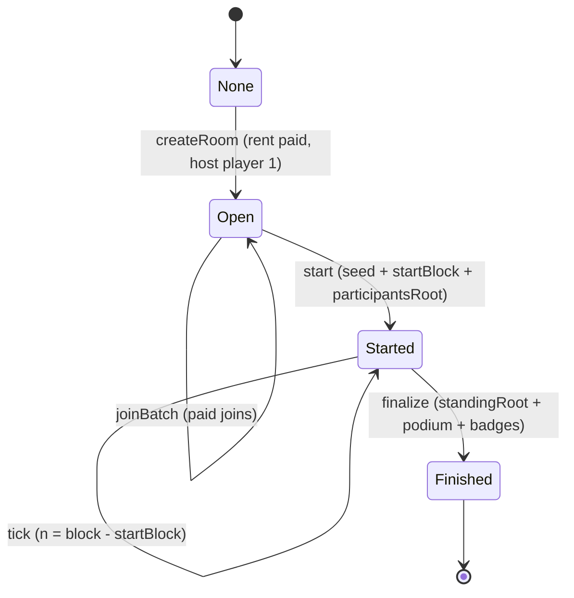

# Contracts Partial 2 — Race: room, seed, tick, finalize

| | |
|---|---|
| **Version** | 1.2 |
| **Status** | Approved |
| **Date Created** | 2026-10-24 |
| **Last Updated** | 2026-10-24 |

| Version | Date | Change |
|---|---|---|
| 1.0 | 2026-10-24 | Initial draft |
| 1.1 | 2026-10-24 | Renumbered to plan 0004; cross-references updated |
| 1.2 | 2026-10-24 | Approved by owner; no proxy; Badge paired per season |

---

## 1. Problem Statement

The race is the product. The chain must answer three questions without ever computing a position:

1. **Who is in the room?** Only wallets that paid a ticket, plus the host whose rent covered entry.
2. **When did the race start and from which seed?** `startBlock` and `seed` are fixed in one transaction.
3. **Which step is the room on?** A tick transaction per block derives `n = block.number - startBlock` at inclusion.

Positions, overtakes, cheer and the finish order stay off-chain. Computing them on-chain was measured as too expensive and rejected. The contract records the inputs and the result root, not the race itself. This partial defines the room state machine, the seed, the tick and the finalize rules that the backend and the stage depend on.

## 2. Definition of Done

1. `DuckWekRace` compiles and is wired as a Vault operator and as the Badge minter.
2. The room state machine only moves `None -> Open -> Started -> Finished`; no transition can be skipped.
3. `createRoom` charges the rent and registers the host as player 1.
4. `joinBatch` charges each ticket independently; one failure emits `JoinFailed` and does not block the rest.
5. `start` fixes `startBlock`, `seed` and `participantsRoot` and emits them.
6. `tick` emits the step derived from the inclusion block; no position is written.
7. `finalize` records the standing root and a podium whose non-zero entries are paid entrants, and awards first-time badges.
8. Every rule in §8.1 has a passing Foundry test.
9. The ABI is exported; backend and stage consume the events, not storage reads.

## 3. Feature Description

### 3.1 Room state machine

```text
None ──createRoom──> Open ──start──> Started ──finalize──> Finished
                         │               │
                         └──joinBatch────┘ (Open only)
```

- `None`: the room key does not exist in the Race.
- `Open`: joins are accepted; the host is player 1.
- `Started`: joins are closed; ticks are accepted; the seed and `startBlock` are fixed.
- `Finished`: ticks stop; the standing root and podium are recorded; badges are awarded.

### 3.2 `createRoom`

Input: a Vault `Order` of kind `CREATE_ROOM` and a `Permit`, plus the room key inside the order.

Checks:

- `order.kind == CREATE_ROOM`.
- `order.ref <= type(uint8).max` (track id fits the room struct).
- `roomIdOf[order.roomKey] == 0` (a room key is used once).
- The Vault accepts the charge (track active, price exact, permit valid).

Effects:

- The Vault registers the room and marks the host joined; the rent covers the host's entry, so `players = 1`.
- The Race stores `Room { status: Open, trackId, startBlock: 0, endBlock: 0, players: 1, standingRoot: 0, seed: 0 }`.
- Emits `RoomCreated(roomId, roomKey, host, trackId, paid)` and `Joined(roomId, host, template)`.

### 3.3 `joinBatch`

Input: `roomId`, arrays of `Order` and `Permit`, same length.

Rules:

- Room status must be `Open`.
- `os.length == ps.length`; length must be `<= MAX_BATCH = 100`.
- Every order must be kind `JOIN_ROOM` with `order.roomKey == keyOf[roomId]`.
- Each charge runs through `this.chargeSelf(order, permit)` inside `try/catch`, so one failure (no allowance, no USDC, already joined, room full) emits `JoinFailed` and does not revert the batch.
- `r.players += paid` after the loop.

Event: `Joined(roomId, player, template)` per success, `JoinFailed(roomId, player, reason)` per failure.

### 3.4 `start`

Input: `roomId`, `players`, `participantsRoot`.

Rules:

- Only the operator; room must be `Open`.
- `seed = keccak256(abi.encode(block.prevrandao, keyOf[roomId], players))`.
- `startBlock = uint32(block.number)`.
- `participantsRoot` is recorded as given. The contract does **not** verify the participant list or the root contents.
- Status becomes `Started`.

Event: `Started(roomId, startBlock, players, participantsRoot, seed)`.

### 3.5 `tick`

Input: `roomId`.

Rules:

- Only the operator; room must be `Started`.
- Emits `Tick(roomId, uint32(block.number) - r.startBlock)`.
- No position, speed, cheer or standing is written. The step is a function of the seed, the participant list and `n`.

One tick transaction per block is the target. A tick may land several blocks late; the step number, not the transaction count, is authoritative.

### 3.6 `finalize`

Input: `roomId`, `standingRoot`, `address[3] podium` (rank 1, 2, 3; `address(0)` for a bot).

Rules:

- Only the operator; room must be `Started`.
- Podium entries cannot duplicate each other.
- Every non-zero podium address must be a paid entrant of the room: `vault.joined(key, player) == true`.
- Status becomes `Finished`; `endBlock = block.number`; `standingRoot` is stored.
- For each non-zero podium entry, `achieved[player]` has one bit per rank. The first time a player reaches a rank, the Race calls `badge.award(player, roomKey, roomId, rank, title)`; later repeats emit only the event.
- Bots receive nothing; `address(0)` is skipped.

Event: `Finalized(roomId, standingRoot, endBlock, podium)` and `AchievementAwarded(roomId, player, kind)`.

### 3.7 Trust model

The contract records the race; it does not prove it.

- The seed is `prevrandao` at `start`. The operator chooses the moment of `start`, and therefore which `prevrandao` becomes the seed.
- The operator posts `participantsRoot`, the standing root and the podium.
- The contract proves that every human on the podium paid to enter that room.
- The contract does not verify that the podium matches the seed. That verification is off-chain, and the published cheer log is part of the replay.

This limit is stated on stage; it is not hidden.

### 3.8 Badge coupling

The Race is the Badge minter. The fixed Badge has a single minter, so a new season deploys a new Race and a new Badge together. Old races finish on their own Badge, and old badges remain canonical; no minter allowlist is needed.

## 4. Impacted Files

| File | Status | Purpose |
|---|---|---|
| `smart-contract/src/DuckWekRace.sol` | `[NEW]` | Room lifecycle, seed, tick, finalize, achievements |
| `smart-contract/test/DuckWekRace.t.sol` | `[NEW]` | State machine, batch, finalize, badge tests |
| `smart-contract/script/Deploy.s.sol` | `[NEW]` | Deploy and authorise the Race |
| `backend/app/Chain/abis.ts` (generated) | `[NEW]` | Race and Vault ABIs |

### Reuse check

| `[NEW]` item | Existing material read | Why it cannot serve as-is |
|---|---|---|
| `DuckWekRace.sol` | The fixed Vault and Badge shapes in `0003` and `0005` | New contract; the race logic does not exist yet in this repository |
| `DuckWekRace.t.sol` | None | New test suite for this contract |
| `Deploy.s.sol` | The wiring rules in `0003` §5.4 | The deploy script is new; this plan adds the Race-specific assertions |

## 5. Code Shape

### 5.1 Types and state

```solidity
enum Status { None, Open, Started, Finished }

struct Room {
    Status status;
    uint8 trackId;
    uint32 startBlock;
    uint32 endBlock;
    uint16 players;
    bytes32 standingRoot;
    bytes32 seed;
}

uint256 public constant MAX_BATCH = 100;

DuckWekVault public immutable vault;
Badge public immutable badge;

uint256 public nextRoomId;
mapping(uint256 => Room) public rooms;
mapping(bytes32 => uint256) public roomIdOf; // roomKey => roomId
mapping(uint256 => bytes32) public keyOf;    // roomId => roomKey
mapping(address => uint8) public achieved;   // bit0 winner, bit1 runner-up, bit2 third
```

### 5.2 Functions

```solidity
constructor(address owner_, address vault_, address badge_);

function createRoom(DuckWekVault.Order calldata o, DuckWekVault.Permit calldata p)
    external onlyOperator whenNotPaused returns (uint256 id);

function joinBatch(uint256 roomId, DuckWekVault.Order[] calldata os, DuckWekVault.Permit[] calldata ps)
    external onlyOperator whenNotPaused;

function chargeSelf(DuckWekVault.Order calldata o, DuckWekVault.Permit calldata p) external; // only self

function start(uint256 roomId, uint16 players, bytes32 participantsRoot)
    external onlyOperator whenNotPaused;

function tick(uint256 roomId) external onlyOperator whenNotPaused;

function finalize(uint256 roomId, bytes32 standingRoot, address[3] calldata podium)
    external onlyOperator whenNotPaused;

function _charge(DuckWekVault.Order calldata o, DuckWekVault.Permit calldata p) internal;
function _title(uint8 kind) private pure returns (string memory);
```

### 5.3 Events and errors

```solidity
event RoomCreated(uint256 indexed roomId, bytes32 indexed roomKey, address indexed host, uint8 trackId, uint256 paid);
event Joined(uint256 indexed roomId, address indexed player, uint8 template);
event JoinFailed(uint256 indexed roomId, address indexed player, bytes reason);
event Started(uint256 indexed roomId, uint32 startBlock, uint16 players, bytes32 participantsRoot, bytes32 seed);
event Tick(uint256 indexed roomId, uint32 n);
event Finalized(uint256 indexed roomId, bytes32 standingRoot, uint32 endBlock, address[3] podium);
event AchievementAwarded(uint256 indexed roomId, address indexed player, uint8 kind);

error WrongStatus(Status current);
error BadKind();
error TrackOutOfRange();
error RoomKeyUsed();
error WrongOrder();
error LengthMismatch();
error BatchTooLarge();
error NotInRoom(address player);
error DuplicatePodium();
```

### 5.4 Call flow

```text
Host -> Race.createRoom(order, permit)
  -> Vault.permitAndSpend -> room registered, host joined
  -> Race stores room, emits RoomCreated + Joined

Players -> Race.joinBatch(roomId, orders, permits)
  -> per order: Race.chargeSelf -> Vault.permitAndSpend/spend
  -> Joined or JoinFailed; players += paid

Host -> Race.start(roomId, players, participantsRoot)
  -> seed = keccak256(prevrandao, roomKey, players)
  -> startBlock = block.number

Relayer -> Race.tick(roomId) every block
  -> Tick(roomId, block.number - startBlock)

Relayer -> Race.finalize(roomId, standingRoot, podium)
  -> Vault.joined checks
  -> Badge.award for first-time ranks
```

## 6. UI/UX Changes (Lo-Fi)

The Race has no screen of its own; it drives two surfaces.

```text
Stage: WAITING ──> GRID ──> RACE ──> PHOTO FINISH ──> WINNER
Phone: LOBBY  ──> RACE ──> RESULT
```

- The stage and the phone both read the same `Tick`. Neither computes a position from a local clock.
- `JoinFailed` is never silent: the phone shows "ticket not charged" and the reason, before any retry.
- `Started` shows the room code and the seed/start block on the proof panel.
- `Finalized` shows the podium and the soulbound titles; a bot podium slot shows no wallet.

## 7. Flowchart



## 8. Verification Plan

### 8.1 Foundry tests

| # | Rule | Test |
|---|---|---|
| T-1 | Only the operator can create, join, start, tick and finalize | `test_onlyOperator` |
| T-2 | A room key can be used once | `test_roomKeyReusedReverts` |
| T-3 | A track id above `uint8` max is rejected | `test_trackOutOfRange` |
| T-4 | The host is player 1 after create | `test_hostIsFirstPlayer` |
| T-5 | A batch rejects a length mismatch and more than 100 orders | `test_batchLength`, `test_batchTooLarge` |
| T-6 | An order with the wrong kind or room key reverts the batch | `test_wrongOrder` |
| T-7 | One failed charge does not block the others | `test_partialJoinFailure` |
| T-8 | Joins are rejected unless the room is `Open` | `test_joinAfterStartReverts` |
| T-9 | `start` records seed, startBlock and participantsRoot and emits them | `test_start` |
| T-10 | `tick` emits `block.number - startBlock` and does not change state | `test_tickStep`, `test_tickNoPosition` |
| T-11 | `finalize` rejects duplicates and non-entrants | `test_duplicatePodium`, `test_podiumNotInRoom` |
| T-12 | A bot slot (`address(0)`) is skipped | `test_botPodium` |
| T-13 | A badge is awarded once per rank per player, not per repeat | `test_badgeOncePerRank` |
| T-14 | No tick is accepted after `Finished` | `test_tickAfterFinalizeReverts` |
| T-15 | Gas per tick is measured and recorded | `test_tickGas` |

### 8.2 Replay verification

- Store the seed and the participant list from `Started`.
- Recompute the race off-chain and compare every `Tick` step with the pushed ticks.
- Store the cheer log; recompute the standing root and compare it with `Finalized`.
- The replay test is owned by `0006` and `0010`, but the contract must expose everything the replay needs.

### 8.3 Live checks

- One room on Monad testnet: create, two joins, start, 25 ticks, finalize.
- Confirm every tick landed in the expected block range and the step is monotonic.
- Confirm the podium addresses are paid entrants and the badges are soulbound.

### 8.4 UNVERIFIED

| Claim | Why | Resolved by |
|---|---|---|
| `prevrandao` behaves as expected on Monad testnet | Must be re-checked against the current chain | Live test in `0010` |
| Tick gas at `TICK_GAS = 53,100` | Target from the fixed design; not measured in this repository | `test_tickGas` and testnet measurement |
| A tick per block is sustainable at 100 players | Load depends on the relayer and RPC | Load test in `0007` |

## 9. Open Decisions

| ID | Decision | Blocks | What the owner must provide |
|---|---|---|---|
| O-9 | Podium definition | this plan | Top three by final standing; confirm whether a "most cheered" title is included |
| O-12 | Host entry | this plan | Confirm the rent covers the host's own entry |
| O-19 | Participant root contents | `0006` | Confirm the ordered participant list includes bots and whether the backend publishes it |
| O-20 | Room capacity behavior | `0008` | Confirm the UI shows joined count, not the 200 slot limit, as the participant count |
| O-21 | Tick transaction policy | `0006` | Confirm one tick per block is the target and whether skipped blocks are backfilled |
