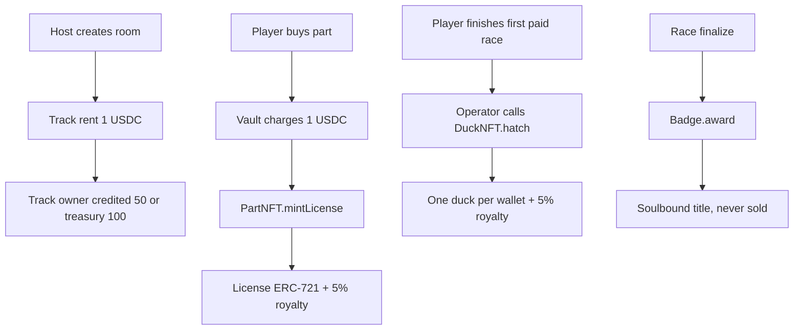

# Contracts Partial 3 — Assets: duck, part, track, badge

| | |
|---|---|
| **Version** | 1.2 |
| **Status** | Approved |
| **Date Created** | 2026-10-24 |
| **Last Updated** | 2026-10-24 |

| Version | Date | Change |
|---|---|---|
| 1.0 | 2026-10-24 | Initial draft |
| 1.1 | 2026-10-24 | Renumbered to plan 0005; O-11 removed after the fixed contract values became authoritative |
| 1.2 | 2026-10-24 | Approved by owner; no proxy; new Badge per season |

---

## 1. Problem Statement

The race needs something to race for and something to race with:

- A **duck** that belongs to one wallet and becomes an asset after the first paid race.
- A **part license** that changes the duck's behaviour and can be sold as a license, never as a stake.
- A **track** that a host rents and that decides the geometry.
- A **badge** that records a podium finish and cannot be bought or transferred.

The assets are fixed for this build. This partial defines their shape, their mint authority, their metadata and their royalties. It also states the one rule that matters for the pitch: a badge is soulbound, a duck is one per wallet, and a part is a license with a trade-off, not a guaranteed win.

## 2. Definition of Done

1. `TrackNFT`, `PartNFT`, `DuckNFT` and `Badge` compile with solc `0.8.26` and OpenZeppelin `5.1.0`.
2. Each contract has a single documented mint authority.
3. The seed catalog creates two platform tracks and three platform parts, owned by the treasury.
4. `tokenURI` returns valid on-chain JSON for every asset, including the empty duck image by design.
5. ERC-2981 royalties are set to 5% for ducks and part licenses.
6. The Badge rejects every transfer and reports ERC-5192 `locked`.
7. Foundry tests cover every rule in §8.1 and pass.
8. The ABI is exported; the frontend reads the metadata without a backend indexer.

## 3. Feature Description

### 3.1 `TrackNFT`

| Field | Type | Meaning |
|---|---|---|
| `name` | `string` | Display name |
| `creator` | `address` | Rent receiver |
| `rentPrice` | `uint96` | 1 USDC for platform tracks |
| `laps` | `uint16` | Race laps |
| `turns` | `uint16` | Turn count for the engine |
| `lengthMeters` | `uint32` | Display and engine scale |
| `platform` | `bool` | Platform track or creator track |
| `active` | `bool` | Renting and racing allowed |

Rules:

- `createPlatformTrack(creator, ...)` is `onlyOwner`; the seeded tracks use the treasury as creator, so the rent and the ticket split credit the protocol.
- `createTrack(...)` is the UGC path and is closed while `ugcOpen == false`.
- `setTrack(id, rentPrice, active)` is callable by the track creator or the owner.
- The creator-track join split is the fixed 50/50; `FINANCE.md` matches the contracts, so there is no separate finance decision.
- `track(id)` requires the token to exist; `tokenURI` returns base64 JSON with laps, turns and length.
- Track ids start at `1`.

### 3.2 `PartNFT`

| Field | Type | Meaning |
|---|---|---|
| `name` | `string` | Display name |
| `creator` | `address` | Primary split receiver and royalty receiver |
| `price` | `uint96` | 1 USDC for platform parts |
| `speed`, `weight`, `boost` | `int8` | Engine stats |
| `platform` | `bool` | Platform part or creator part |
| `active` | `bool` | License mint allowed |

Rules:

- `createPlatformPart(...)` is `onlyOwner` and records the treasury as creator.
- `createPart(...)` is the UGC path, closed while `ugcOpen == false`; when open, the stat budget is `speed + weight + boost <= 2` and each stat `<= 2`.
- `mintLicense(to, typeId)` is callable only by the Vault, only for an active type; each call mints one ERC-721 license.
- The license is permanent; buying the same type twice mints a second token.
- ERC-2981 royalty is 5% to the part creator.
- Part type ids start at `0`; token ids start at `1`.

### 3.3 `DuckNFT`

| Field | Type | Meaning |
|---|---|---|
| `name` | `string` | Player-chosen name |
| `template` | `uint8` | 0 balanced, 1 sprint, 2 tank |
| `bodyColor` | `uint24` | Body colour |
| `billColor` | `uint24` | Bill colour |
| `cosmetics` | `uint8` | Bit 0 hat, bit 1 shades, bit 2 scarf |

Rules:

- `hatch(to, duck)` is `onlyOperator` and `whenNotPaused`.
- One duck per wallet: `duckOf[to] != 0` reverts `AlreadyHatched`.
- The duck is minted after the first paid race; the backend decides eligibility. It is not minted at connect and not minted per race.
- ERC-2981 royalty is 5% to the builder (the wallet that owns the duck).
- `tokenURI` returns base64 JSON with name, template and body colour. The image is intentionally empty in this build; the UI renders the duck from the same fields.
- A duck is transferable, unlike a badge.

### 3.4 `Badge`

| Field | Type | Meaning |
|---|---|---|
| `roomKey` | `bytes32` | Room where the title was won |
| `raceId` | `uint64` | Race id |
| `rank` | `uint16` | 1, 2 or 3 |
| `title` | `string` | "First Time Winner", "First Time Runner-up", "First Time Third" |

Rules:

- `award(to, roomKey, raceId, rank, title)` is callable only by the minter, which is `DuckWekRace`.
- Every token is soulbound: a transfer between two non-zero addresses reverts `Soulbound`.
- `locked(id)` returns `true` and `supportsInterface(0xb45a3c0e)` returns `true` (ERC-5192).
- `tokenURI` returns base64 JSON with the title and rank.
- Badges are free, only won, and never sold. There is no mint price and no approve-and-sell path.

### 3.5 Seed catalog

| Asset | Id | Values |
|---|---|---|
| Kali Code Sprint | track 1 | 1 USDC rent, 1 lap, 6 turns, 1800 m |
| Alpine Ring | track 2 | 1 USDC rent, 2 laps, 10 turns, 4326 m |
| Buroq Wings | part 0 | 1 USDC, speed +2, weight 0, boost -1 |
| Turbo Tail | part 1 | 1 USDC, speed +1, weight +1, boost 0 |
| Iron Bill | part 2 | 1 USDC, speed -1, weight +1, boost +2 |

No part wins on every track. The balance test is owned by `0006`; this plan only fixes the catalog shape.

### 3.6 Hatch policy

The fixed design is **auto-hatch after the first paid race**: the relayer calls `DuckNFT.hatch` once the backend confirms the wallet finished a paid race. The podium condition is not required.

This is tracked as O-3 because the alternative (hatch only on the podium) changes the reward story and the number of mints. The plan does not assume the alternative.

### 3.7 Metadata and royalties

- All metadata is on-chain base64 JSON; no IPFS dependency for the demo.
- Duck images are intentionally empty in `tokenURI`; the frontend draws the duck from the same struct.
- ERC-2981 is advisory: the protocol does not enforce secondary royalties. The marketplace is a roadmap item.
- Badge metadata includes the title and rank; the badge cannot be sold even if a marketplace ignores royalties.

### 3.8 Mainnet

- Assets are versioned per season; old tokens remain valid (`0002`).
- The fixed Badge has one minter, so a new season deploys a new Race and a new Badge together. Old badges remain canonical; no allowlist is needed.
- The duck and part royalties stay at 5% in every version unless a later plan changes them.

## 4. Impacted Files

| File | Status | Purpose |
|---|---|---|
| `smart-contract/src/TrackNFT.sol` | `[NEW]` | Track ownership, rent price, UGC gate, metadata |
| `smart-contract/src/PartNFT.sol` | `[NEW]` | Part types, license mint, royalty, metadata |
| `smart-contract/src/DuckNFT.sol` | `[NEW]` | One duck per wallet, hatch, royalty, metadata |
| `smart-contract/src/Badge.sol` | `[NEW]` | Soulbound podium title |
| `smart-contract/test/DuckWek.t.sol` | `[NEW]` | Asset tests |
| `smart-contract/script/Deploy.s.sol` | `[NEW]` | Seed tracks and parts |
| `smart-contract/src/mocks/MockUSDC.sol` | `[NEW]` | Testnet payment token used by the Vault |

### Reuse check

| `[NEW]` item | Existing material read | Why it cannot serve as-is |
|---|---|---|
| `TrackNFT.sol` | Nothing in this repository | New contract; the fixed shape is defined here |
| `PartNFT.sol` | Nothing in this repository | New contract; the license and UGC rules are defined here |
| `DuckNFT.sol` | Nothing in this repository | New contract; one-duck-per-wallet and hatch rules are defined here |
| `Badge.sol` | Nothing in this repository | New contract; soulbound behaviour is defined here |
| `Deploy.s.sol` seed block | The wiring rules in `0003` §5.4 | The deploy script is new; this plan adds the catalog values |

## 5. Code Shape

### 5.1 `TrackNFT`

```solidity
struct Track {
    string name;
    address creator;
    uint96 rentPrice;
    uint16 laps;
    uint16 turns;
    uint32 lengthMeters;
    bool platform;
    bool active;
}

mapping(uint256 => Track) internal _tracks;
uint256 public nextId = 1;
bool public ugcOpen;

function track(uint256 id) external view returns (Track memory);
function createPlatformTrack(address creator, string calldata name, uint96 rentPrice, uint16 laps, uint16 turns, uint32 lengthMeters)
    external onlyOwner returns (uint256 id);
function createTrack(string calldata name, uint96 rentPrice, uint16 laps, uint16 turns, uint32 lengthMeters)
    external whenNotPaused returns (uint256 id);
function setUgcOpen(bool open) external onlyOwner;
function setTrack(uint256 id, uint96 rentPrice, bool active) external;
function tokenURI(uint256 id) public view override returns (string memory);
```

### 5.2 `PartNFT`

```solidity
struct PartType {
    string name;
    address creator;
    uint96 price;
    int8 speed;
    int8 weight;
    int8 boost;
    bool platform;
    bool active;
}

uint96 public constant ROYALTY_BPS = 500;
PartType[] internal _types;
mapping(uint256 => uint256) public typeOf;
uint256 public nextId = 1;
address public minter;
bool public ugcOpen;

function typeCount() external view returns (uint256);
function partType(uint256 typeId) external view returns (PartType memory);
function createPlatformPart(address creator, string calldata name, uint96 price, int8 speed, int8 weight, int8 boost)
    external onlyOwner returns (uint256);
function createPart(string calldata name, uint96 price, int8 speed, int8 weight, int8 boost)
    external whenNotPaused returns (uint256);
function mintLicense(address to, uint256 typeId) external returns (uint256 id);
function setMinter(address minter_) external onlyOwner;
function setUgcOpen(bool open) external onlyOwner;
function tokenURI(uint256 id) public view override returns (string memory);
```

### 5.3 `DuckNFT`

```solidity
struct Duck {
    string name;
    uint8 template;
    uint24 bodyColor;
    uint24 billColor;
    uint8 cosmetics;
}

uint96 public constant ROYALTY_BPS = 500;
mapping(uint256 => Duck) public ducks;
mapping(address => uint256) public duckOf;
uint256 public nextId = 1;

function hatch(address to, Duck calldata d) external onlyOperator whenNotPaused returns (uint256 id);
function tokenURI(uint256 id) public view override returns (string memory);
```

### 5.4 `Badge`

```solidity
struct Title {
    bytes32 roomKey;
    uint64 raceId;
    uint16 rank;
    string title;
}

mapping(uint256 => Title) public titles;
uint256 public nextId = 1;
address public minter;

function setMinter(address minter_) external onlyOwner;
function award(address to, bytes32 roomKey, uint64 raceId, uint16 rank, string calldata title)
    external returns (uint256 id);
function locked(uint256 id) external view returns (bool);
function tokenURI(uint256 id) public view override returns (string memory);
```

### 5.5 Mint authorities

| Asset | Minter | Rule |
|---|---|---|
| Track | `TrackNFT` owner (platform) or any wallet when UGC is open | One token per track |
| Part license | `DuckWekVault` | Only after a paid order |
| Duck | Operator (relayer) | One per wallet, after the first paid race |
| Badge | `DuckWekRace` | Podium only, first time per rank |

### 5.6 Events and errors

- Track: `TrackCreated`, `TrackUpdated`, `UgcClosed`, `NotCreator`.
- Part: `PartTypeCreated`, `PartLicensed`, `NotMinter`, `UnknownPart`, `UgcClosed`.
- Duck: `DuckHatched`, `AlreadyHatched`.
- Badge: `Locked`, `Soulbound`, `NotMinter`.

### 5.7 UNVERIFIED

| Claim | Why | Resolved by |
|---|---|---|
| Wallet and marketplace rendering of base64 `tokenURI` | Not tested on the target wallets | `0008` metadata test |
| ERC-5192 detection by the explorer | Depends on the explorer | Manual check in `0010` |
| Royalty enforcement | ERC-2981 is advisory | Marketplace plan, not this build |
| Part balance across tracks | Catalog values need the engine test | `0006` balance test |

## 6. UI/UX Changes (Lo-Fi)

### 6.1 My Duck

```text
┌─────────────────────────────┐
│  MY DUCK                    │
│   (duck portrait)           │
│   Name · Balanced           │
│   body #FFC93C · bill #FF8A  │
│                             │
│   EGG → hatches after the   │
│   first paid race           │
└─────────────────────────────┘
```

### 6.2 Part shop

```text
┌─────────────────────────────┐
│  PART SHOP                  │
│  Buroq Wings   +2  0  -1    │
│  1 USDC        [ BUY ]      │
│  Turbo Tail    +1 +1   0    │
│  Iron Bill     -1 +1  +2    │
└─────────────────────────────┘
```

### 6.3 Result

- The result screen shows the rank, the soulbound title and the duck state.
- A badge is shown as "soulbound · cannot be sold"; a duck is shown as "yours · transferable".
- The part shop never claims that a part guarantees a win.

## 7. Flowchart



## 8. Verification Plan

### 8.1 Foundry tests

| # | Rule | Test |
|---|---|---|
| T-1 | Platform track creation is owner-only | `test_createPlatformTrackOnlyOwner` |
| T-2 | UGC track is closed while `ugcOpen == false` | `test_trackUgcClosed` |
| T-3 | Only the creator or owner can update a track | `test_setTrackAuth` |
| T-4 | Track `tokenURI` contains laps, turns and length | `test_trackTokenURI` |
| T-5 | Part UGC is closed while `ugcOpen == false` | `test_partUgcClosed` |
| T-6 | Part stat budget is enforced | `test_partStatBudget` |
| T-7 | Only the Vault can mint a part license | `test_partMinterOnly` |
| T-8 | Inactive parts cannot be minted | `test_partInactive` |
| T-9 | Part royalty is 5% to the creator | `test_partRoyalty` |
| T-10 | Hatch is operator-only and one per wallet | `test_hatchOnlyOperator`, `test_hatchOnce` |
| T-11 | Duck royalty is 5% to the builder | `test_duckRoyalty` |
| T-12 | Duck `tokenURI` returns valid JSON | `test_duckTokenURI` |
| T-13 | Badge award is minter-only | `test_badgeMinterOnly` |
| T-14 | Badge transfer reverts | `test_badgeSoulbound` |
| T-15 | `locked` and ERC-5192 interface are reported | `test_badgeLocked` |
| T-16 | Badge `tokenURI` contains the title and rank | `test_badgeTokenURI` |

### 8.2 Deployment checks

- Seed two tracks and three parts; confirm ids and creator addresses.
- Confirm `parts.minter == vault` and `badge.minter == race`.
- Confirm `duckOf` is empty at deploy and the first hatch sets it.
- Confirm `typeCount() == 3` and `track(1).rentPrice == 1 USDC`.

### 8.3 What this partial does not verify

- Race eligibility for hatch: `0004` and `0006`.
- Royalty marketplace behaviour: roadmap.
- Mainnet versioning: `0002`.

## 9. Open Decisions

| ID | Decision | Blocks | What the owner must provide |
|---|---|---|---|
| O-3 | Hatch policy | this plan | Auto-hatch after the first paid race (current) or podium only |
| O-17 | Badge season strategy | this plan, `0002` | New Badge per season; old badges remain canonical (fixed) |
| O-22 | Duck image | this plan, `0008` | Confirm the empty image in `tokenURI` is acceptable, or supply a renderer |
| O-23 | Part balance | this plan, `0006` | Confirm the three platform parts and their stats |
