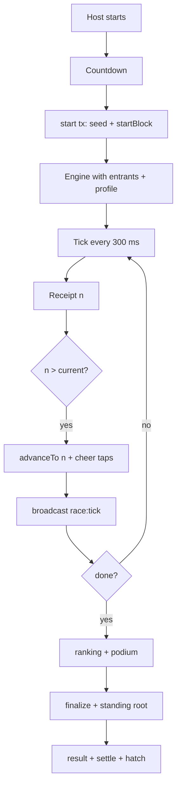

# Backend Partial 1 — Deterministic Race Engine

| | |
|---|---|
| **Version** | 1.1 |
| **Status** | Approved |
| **Date Created** | 2026-10-24 |
| **Last Updated** | 2026-10-24 |

| Version | Date | Change |
|---|---|---|
| 1.0 | 2026-10-24 | Initial draft |
| 1.1 | 2026-10-24 | Approved by the owner; implementation follows the fixed behaviour |

---

## 1. Problem Statement

The race must look alive at 300 ms per block, stay identical for the phone and the projector, and be reproducible from on-chain data. A timer-based simulation would drift from the chain and could not be replayed. Computing the race on-chain was measured as too expensive and rejected.

This partial defines the pure engine, the step formula, the cheer model and the tick loop. It is the only place where a position is computed. The chain records the seed, the step number, the standing root and the podium; the engine turns those inputs into movement.

## 2. Definition of Done

1. `Race` is a pure, deterministic class: the same seed, entrants, profile and cheer log produce identical positions.
2. A step is a pure function of the seed, the participant index, the step number and the participant stats.
3. The tick loop sends at most one tick transaction per interval, tolerates a slow RPC, and fills steps that a receipt skipped.
4. The CHEER cap, energy, decay and rate limit are enforced and recorded in the cheer log.
5. The standing root commits to the ranking and the cheer log.
6. Unit tests cover the formula, fairness, cheer and replay; gas for a tick is measured.
7. The stage and the phone receive the same `race:tick` payload.

## 3. Feature Description

### 3.1 Constants

| Constant | Value | Meaning |
|---|---|---|
| `SCALE` | `1_000_000` | Fixed-point progress; `FINISH` is `1_000_000` |
| `OVERRUN` | `60_000` | Ducks glide past the line for the photo finish |
| `BOOST_ZONE` | `650_000` | The boost stat only applies after 65% of the race |
| `BASE_TICKS` | `35` | Normaliser for the gain formula |
| `POST_FINISH_STEPS` | `3` | Extra steps after the first finish |
| `TUNING.base` | `24_800` | Base speed |
| `TUNING.speedC` | `350` | Speed coefficient |
| `TUNING.weightC` | `200` | Weight coefficient |
| `TUNING.boostC` | `900` | Boost coefficient |
| `TUNING.noiseC` | `40` | Per-step noise |
| `TUNING.splashBase` | `35_000` | Splash probability in ppm |
| `TUNING.catchupDiv` | `20` | Catch-up divisor |
| `CHEER.cheerMax` | `200_000` | Maximum boost, 20% |
| `CHEER.eMax` | `8_000` | Maximum energy |
| `CHEER.decay` | `500` | Energy lost per quiet step |
| `CHEER.tapUnit` | `1_000` | Energy per counted tap |

Templates: balanced `[2,2,0]`, sprint `[4,1,0]`, tank `[1,4,2]` (speed, weight, boost), then the part stats are added.

### 3.2 Step formula

For a duck at `progress` with the leader at `leader`:

```text
dv = base
   + trunc(speed * speedC * pm.speed / 1000)
   - trunc(weight * weightC * pm.weight / 1000)
   + trunc((r - 500_000) * noiseC / 1000)
   + trunc(max(0, leader - progress) / catchupDiv)
   + (progress > BOOST_ZONE ? trunc(boost * boostC * pm.boost / 1000) : 0)
   - (r2 < splashBase ? 12_000 : 0)

gain = trunc(max(0, dv) * BASE_TICKS / (pm.lapTicks * laps))
step = trunc(gain * (SCALE + cheerPpm) / SCALE)
```

- A duck never swims backwards: `dv` is clamped at zero.
- The noise is symmetric around zero.
- The catch-up term is capped at a gap and decays as the duck catches the leader.
- The boost only exists in the final third.
- Splash costs a beat.
- The lap profile scales the gain.

### 3.3 Seed and draws

```ts
drawStep(seed, n, idx) -> { r, r2 }
tieKey(seed, idx) -> bigint
```

- Both draws come from `keccak256(abi.encodePacked(bytes32 seed, uint8 tag, uint32 n, uint16 idx))`.
- `tieKey` orders ducks with identical progress and finish time, so the result is deterministic.
- The seed comes from `DuckWekRace.start` (`prevrandao`, room key, player count). The engine never reads a block.

### 3.4 The `Race` class

```ts
class Race {
  constructor(opts: { raceId: number; seed: Hex; entrants: Entrant[]; profile: Profile; laps: number })
  get expectedSteps(): number
  advanceTo(n: number, cheers?: (step: number) => Taps | undefined): RaceEvent[]
  boost(): number[]
  leader(): DuckState
  ranking(): DuckState[]
  positions(): number[]
}
```

- `advanceTo` computes every step from the current step to `n`; skipped steps are filled by the pure function, so a late receipt never freezes the pack.
- `boost()` returns the energy per duck for the stage meter.
- `ranking()` sorts by progress, then finish time, then `tieKey`.
- `positions()` returns the progress array the socket sends.

### 3.5 CHEER

- A tap is accepted only from a paid human entrant of the room, while the race runs, at most 5 per second.
- Counted taps wait in `pending`; the next computed step consumes them.
- Energy grows by `tapUnit` per tap, capped at `eMax`, and decays by `decay` per quiet step.
- The boost factor is `energy / eMax * cheerMax` in ppm; it never exceeds 20%.
- The cheer log is `Record<step, Record<duckIndex, taps>>`.
- `cheersRoot` hashes the log canonically; `standingRoot = keccak256(resultsRoot, cheersRoot)`.
- Bots never tap and never receive an ambient cheer. Tapping is what lifts a human above a bot.

### 3.6 Tick loop

- Interval: `TICK_INTERVAL_MS = 300`.
- Maximum in-flight ticks: `MAX_INFLIGHT = 8`; a slow RPC must not pile up transactions.
- Tick transaction: fixed `TICK_GAS = 53_100`; no simulate, no estimate on the hot path (Monad charges the limit).
- On a receipt with step `n`: if `n <= current`, ignore the late tick; otherwise advance to `n` and broadcast.
- A tick timeout closes the race with the current standing instead of hanging.
- The stage plays back with a three-step buffer; the phone shows the live tick.

### 3.7 Finish

- The first finish starts a short overrun for the photo finish.
- The final ranking is sorted by progress, finish time, then `tieKey`.
- The podium is the first three human addresses; a bot slot becomes `address(0)`.
- `finalize` is sent with the standing root and the podium after every tick transaction settles.
- First-time podium titles are awarded by the Race; first-time ducks hatch through the relayer.
- The database stores the seed, `startBlock`, `endBlock`, ranking, podium, roots and the cheer log.

### 3.8 Replay

Given the seed, the ordered participant list (humans and bots), the step count and the published cheer log, anyone can recompute every position and the ranking. The engine test and the live replay test must both match.

## 4. Impacted Files

| File | Status | Purpose |
|---|---|---|
| `backend/app/Engine/Race.ts` | `[NEW]` | Templates, stats, step formula, `Race` class, titles, bot names |
| `backend/app/Engine/Cheers.ts` | `[NEW]` | Cheer log hashing and standing root |
| `backend/app/Engine/TrackGeometry.ts` | `[NEW]` | Track path/sector geometry for the stage |
| `backend/app/Http/Services/Race/RaceService.ts` | `[NEW]` | Live room state, countdown, start, tick loop, cheer, finish, hatch |
| `backend/test/engine/cheer.test.ts` | `[NEW]` | Cheer bounds, decay, replay with the log |
| `backend/test/engine/fairness.test.ts` | `[NEW]` | Identical ducks, tie order, catch-up bound |
| `backend/test/engine/montecarlo.script.ts` | `[NEW]` | Part balance search |
| `backend/test/engine/rank.script.ts` | `[NEW]` | Ranking checks |

### Reuse check

| `[NEW]` item | Existing material read | Why it cannot serve as-is |
|---|---|---|
| Engine and cheer files | Nothing exists in this repository | New code; the fixed behaviour is specified here |
| Race service | The fixed flow in `0007` (API) | New service; it depends on the models and relayer from `0007` |
| Engine tests | None | New tests for the formula and replay |

## 5. Code Shape

### 5.1 Types

```ts
type Template = 'balanced' | 'sprint' | 'tank'
interface Entrant { id: string; name: string; color: string; human: boolean; address: string | null; stats: [number, number, number]; build: string }
interface DuckState extends Entrant { idx: number; p: number; step: number; energy: number; finishedAt: number | null }
interface PartStats { speed: number; weight: number; boost: number }
interface Profile { speed: number; weight: number; boost: number; lapTicks: number }
type TapLog = Record<number, Record<number, number>>
```

### 5.2 Functions

```ts
statsFor(template: Template, part: PartStats | null): [number, number, number]
drawStep(seed: Hex, n: number, idx: number): { r: number; r2: number }
tieKey(seed: Hex, idx: number): bigint
stepFor(stats, progress, leader, r, r2, pm, laps, cheerPpm?): number
botName(i: number): string
titleFor(rank: number): string
```

### 5.3 Call flow

```text
POST /api/rooms/:code/start
  -> RaceService.start: load players, add bots, build entrants and looks
  -> countdown
  -> RaceService.go: relayer.start -> seed + startBlock -> new Race
  -> setInterval(300ms): relayer.tick -> receipt n -> Race.advanceTo(n) -> broadcast race:tick
  -> engine.done: ranking -> relayer.finalize -> titles -> hatch -> race:result/settled
```

### 5.4 UNVERIFIED

| Claim | Why | Resolved by |
|---|---|---|
| Step formula fairness at 100 ducks | New build; the constants are fixed but not yet measured here | `fairness.test.ts` and a 100-duck race |
| Tick gas at `TICK_GAS = 53_100` | Target from the fixed design | `forge test` gas and testnet measurement |
| One tick per block under venue Wi-Fi | RPC latency is not controlled | Live cadence test in `0010` |

## 6. UI/UX Changes (Lo-Fi)

The engine has no screen, but it defines what both surfaces show:

```text
Phone:  rank + progress bar + CHEER dock + energy meter
Stage:  pack positions, top three, photo finish, winner + title
```

- Neither surface simulates a position locally; both consume `race:tick`.
- The CHEER dock shows the energy meter and never overlaps the track.
- A cheer that does not count gets no animation; a counted tap shows the duck's glow and the projector feed.

## 7. Flowchart



## 8. Verification Plan

### 8.1 Unit tests

| # | Check | Test |
|---|---|---|
| T-1 | The same inputs produce the same positions | replay test |
| T-2 | A skipped step is filled and never freezes | jump test |
| T-3 | A duck never moves backwards | formula test |
| T-4 | Identical ducks finish in a 50/50 tie order | fairness test |
| T-5 | Catch-up stays within the bound | fairness test |
| T-6 | Cheer never exceeds 20% | cheer test |
| T-7 | Energy decays and caps correctly | cheer test |
| T-8 | The cheer log root is canonical and sensitive | cheer test |
| T-9 | Standing root matches the published ranking + log | replay test |
| T-10 | Gas per tick is measured | `forge test test_gas_tick` |

### 8.2 Live checks

- One 100-player race on Monad testnet: tick cadence, no frozen pack, result matches replay.
- Two phones: one taps at the cap, one never taps; the tapper gains within the cap.
- The stage buffer never stands still on a real trace.

### 8.3 What this partial does not verify

- API and database: `0007`.
- Phone and stage rendering: `0008`, `0009`.
- Deployment: `0010`.

## 9. Open Decisions

| ID | Decision | Blocks | What the owner must provide |
|---|---|---|---|
| O-4 | CHEER strength | this plan | Keep 20% and 5 taps/second, or change both |
| O-19 | Participant root contents | `0007` | Confirm humans by address and bots by id |
| O-21 | Tick policy | this plan | One tick per block; skipped blocks are filled |
| O-26 | Bot fill | `0007`, `0009` | Confirm bots fill the grid visually and are never counted as players |
| O-27 | Countdown | this plan | Confirm 3 seconds |
