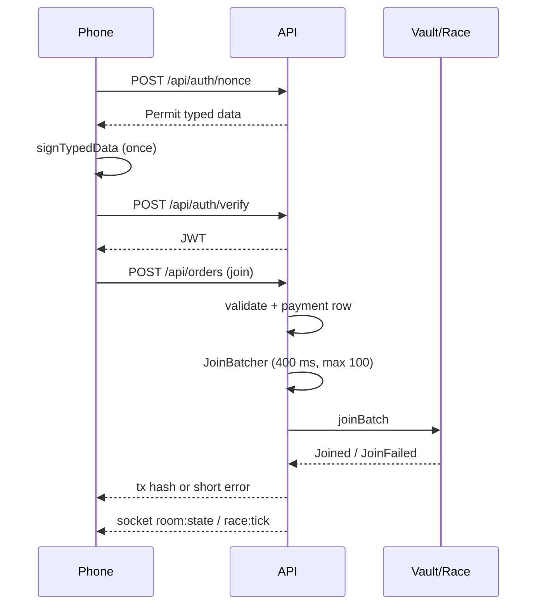

# Backend Partial 2 — API, Database, Relayer and Sockets

| | |
|---|---|
| **Version** | 1.1 |
| **Status** | Approved |
| **Date Created** | 2026-10-24 |
| **Last Updated** | 2026-10-24 |

| Version | Date | Change |
|---|---|---|
| 1.0 | 2026-10-24 | Initial draft |
| 1.1 | 2026-10-24 | Approved by the owner; implementation follows the fixed behaviour |

---

## 1. Problem Statement

The player signs once and pays nothing in gas. The API has to turn that one permit into paid on-chain actions, keep a durable record of every payment and race, and push the same tick to every phone and the projector. It also owns the relayer key, so every endpoint must be narrow: the operator can charge the on-chain price for a known action and can never move a player's balance.

This partial defines the HTTP API, the database, the relayer and the socket gateway. It depends on the engine in `0006` and the fixed contracts in `0003`–`0005`.

## 2. Definition of Done

1. Every endpoint in §3 is implemented with Joi validation and a typed response.
2. The one-signature session works: nonce → EIP-2612 permit signature → JWT; later orders need no signature.
3. Orders charge exactly the on-chain price and record a `payment` row with the transaction hash or the failure reason.
4. Joins are batched, partial failures are reported, and a batch never blocks another room.
5. The relayer simulates and estimates before a normal write; a tick uses the fixed gas limit and no simulation.
6. The database migrations and seeders run from a clean PostgreSQL database.
7. Socket clients receive the same tick, result, settle and hatch events regardless of reconnect.
8. The ABI drift check passes against the exported contract ABIs.
9. The e2e flow and the load test pass.

## 3. Feature Description

### 3.1 Stack and layout

| Layer | Technology |
|---|---|
| HTTP | Express 4, TypeScript, Joi, JWT |
| DB | PostgreSQL, Sequelize, Umzug migrations |
| Realtime | Socket.io |
| Chain | viem: public client plus operator wallet |
| Docs | OpenAPI YAML at `/api-docs` |

Layout follows `AGENTS.md`: controllers, services, repositories, requests, middlewares, DTOs, interfaces, models, exceptions, engine, chain, sockets, config, routes, database, tests.

### 3.2 Session and authentication

| Step | Endpoint | Result |
|---|---|---|
| 1 | `POST /api/auth/nonce` | EIP-712 `Permit` typed data: USDC domain, owner, spender = Vault, cap, nonce, deadline |
| 2 | wallet `signTypedData` | one signature, no transaction |
| 3 | `POST /api/auth/verify` | verifies the signature, stores the session, returns a JWT and `isNew` |

- The session cap defaults to 5 USDC (`SESSION_CAP=5000000`); the lifetime defaults to 24 hours.
- The permit is for the Vault, never for the backend.
- The JWT identifies the address; every paid endpoint uses it.
- A stored `AuthNonce` row is single-use and expires.

### 3.3 Orders

`POST /api/orders` accepts one of three bodies:

| Kind | Body | Price | On-chain call |
|---|---|---|---|
| `create_room` | `trackId`, `roomName`, `maxDucks`, `fillBots` | track rent, 1 USDC on the seeded tracks | `DuckWekRace.createRoom` |
| `join_room` | `roomCode` | 0.10 USDC | `DuckWekRace.joinBatch` |
| `buy_part` | `partTypeId` | 1 USDC | `DuckWekVault.spend` → `PartNFT.mintLicense` |

Rules:

- `roomKey = keccak256(toHex(code.toUpperCase()))`.
- The backend builds the `Order` and submits it under the session permit.
- A unique room code is generated and retried on collision.
- A join is queued in the `JoinBatcher`; the response waits for the batch receipt.
- A part order mints a license and equips it if the player has no part.
- A payment row is created before the chain call and updated with the transaction hash, status and error.
- A repeated order returns the existing result instead of charging twice.

### 3.4 Rooms, catalog and profile

| Method | Path | Purpose |
|---|---|---|
| GET | `/api/catalog/tracks` | Seeded tracks with geometry |
| GET | `/api/catalog/parts` | Active part types |
| GET | `/api/rooms/:code` | Room state, players, track, status |
| PUT | `/api/rooms/:code/loadout` | Choose an owned part for this race |
| POST | `/api/rooms/:code/start` | Host only; starts the countdown and the race |
| GET | `/api/me` | Player, duck, balances, licenses, titles |
| PUT | `/api/me/duck` | Update name, template, colors, cosmetics, equipped part |
| POST | `/api/withdraw/prepare` | Build the withdrawal and the EIP-712 typed data |
| POST | `/api/withdraw/submit` | Relayer submits the signed withdrawal |

- `RoomService.state` returns `code`, `name`, `host`, `hostName`, `track`, `maxDucks`, `fillBots`, `status`, `players`, `count`.
- A loadout is allowed only for a part the player owns.
- `start` is host-only, requires an on-chain room id, and rejects a second race in the same room.
- `withdraw/prepare` reads the Vault balance; `submit` verifies the signature and sends `withdrawWithSig`.

### 3.5 Relayer

| Method | Behaviour |
|---|---|
| `write` | `simulateContract` → `estimateGas × 1.10` → send with explicit fees → wait for receipt → parse events |
| `tick` | fixed `TICK_GAS`, no simulate and no estimate; send one transaction per step |
| `createRoom` | writes the room, returns `chainRoomId` |
| `joinBatch` | sends up to `MAX_BATCH = 100` orders |
| `start` | returns `seed` and `startBlock` from the `Started` event |
| `finalize` | sends the standing root and podium |
| `buyPart` | returns the license token id |
| `hatch` | mints the duck into the player's wallet |
| `withdraw` | submits `withdrawWithSig` |
| `achievements` | reads awarded titles from the finalize receipt |

- One nonce lock serialises sends; a stuck nonce resyncs from the node.
- Fees are explicit: `maxFeePerGas = 150 gwei`, `maxPriorityFeePerGas = 2 gwei`.
- Revert data is decoded into a short message for the API.
- The relayer key is a hot key; it cannot withdraw, upgrade or change prices.

### 3.6 Join batching

- Per-room queue, `JOIN_BATCH_WINDOW_MS = 400`, `JOIN_BATCH_MAX = 100`.
- Each order is charged inside a `try/catch` in the Race; a bad ticket emits `JoinFailed` and does not block the rest.
- `idle(roomId)` waits until every queued join has a receipt; `start` calls it before the countdown.
- A join that fails is recorded on the payment row and returned to the phone.

### 3.7 Database

| Table | Key fields |
|---|---|
| `players` | address, name, first_spend_at |
| `auth_nonces` | address, nonce, deadline, used |
| `tracks` | token_id, slug, name, creator, rent_price, laps, turns, length_m, path, sectors, profile, status |
| `part_types` | type_id, name, rarity, slot, speed, weight, boost, fit, price, creator, platform, status |
| `rooms` | code, room_key, name, host, track_id, max_ducks, fill_bots, status, create_tx, chain_room_id |
| `room_players` | room_id, address, duck_name, template, colors, part_type_id, cosmetics, locked, join_tx, joined_on_chain |
| `races` | room_id, race_id, seed, start_block, end_block, ranking, podium, results_root, cheers, cheers_root, settle_tx, start_tx, status |
| `race_ticks` | room_id, race_id, seq, blk, step, positions, tx_hash, included_block, gas_limit, submit_to_receipt_ms |
| `ducks` | address, name, template, colors, cosmetics, equipped_part_type_id, races, titles, best_rank, status, token_id, tx_hash |
| `part_licenses` | address, type_id, token_id, tx_hash |
| `payments` | kind, payer, amount, ref, room_code, nonce, deadline, tx_hash, status, error, meta |
| `titles` | address, room_code, race_id, rank, title, tx_hash |

- Migrations run with `npm run migrate:latest`; seeders with `npm run seed:run`.
- The pool is `max: 8, min: 2`; `PGSSL=true` for a hosted database.

### 3.8 Socket gateway

Client to server:

| Event | Payload | Purpose |
|---|---|---|
| `auth` | `{ token }` | Identify the player for CHEER |
| `room:watch` | `{ code }` | Join the socket room; server replies with state, grid and a snapshot |
| `race:cheer` | none | One tap; the server counts it only for a paid human entrant under the rate limit |

Server to client:

| Event | Payload |
|---|---|
| `room:state` | Full room state |
| `race:grid` | Entrants, looks, laps, countdown |
| `race:countdown` | `{ n }` |
| `race:go` | `{ raceId, tx, startBlock }` |
| `race:tick` | `{ raceId, b, n, p, en, ev, tx }` |
| `race:cheer` | `{ name }` |
| `race:result` | Ranking, roots, cheer log |
| `race:settled` | `{ tx, url, titles, ok }` |
| `duck:hatched` | `{ address, tokenId, tx, url }` |
| `room:error` | `{ message }` |

- A reconnect re-sends `room:watch` and gets the current snapshot.
- Watching a room needs no identity; only CHEER needs the JWT.

### 3.9 Environment

| Variable | Purpose |
|---|---|
| `PORT`, `CORS_ORIGINS` | HTTP |
| `PGHOST`, `PGPORT`, `PGDATABASE`, `PGUSER`, `PGPASSWORD`, `PGSSL` | PostgreSQL |
| `JWT_SECRET` | Session token |
| `CHAIN_ID` | `10143` testnet, `31337` local |
| `RPC_URL`, `EXPLORER_URL` | Monad RPC and explorer |
| `OPERATOR_PRIVATE_KEY` | Relayer key |
| `RACE`, `VAULT`, `DUCK_NFT`, `MOCK_USDC`, `BADGE` | Contract addresses |
| `USDC_NAME`, `USDC_VERSION` | Permit domain |
| `SESSION_CAP`, `SESSION_TTL_SEC` | One-signature session |
| `WELCOME_USDC` | Welcome mint amount |
| `TICK_GAS`, `TICK_INTERVAL_MS` | Tick loop |
| `JOIN_BATCH_WINDOW_MS`, `JOIN_BATCH_MAX` | Join batching |
| `FILL_BOTS`, `COUNTDOWN_SEC` | Race setup |

## 4. Impacted Files

| Path | Status | Purpose |
|---|---|---|
| `backend/index.ts` | `[NEW]` | Server boot, DB connect, HTTP and socket |
| `backend/config/{env,database}.ts` | `[NEW]` | Env validation and Sequelize |
| `backend/app/Http/Controllers/**` | `[NEW]` | Auth, Profile, Catalog, Order, Room, Withdraw |
| `backend/app/Http/Services/**` | `[NEW]` | Auth, Profile, Catalog, Order, Room, Race, Withdraw |
| `backend/app/Http/Repositories/**` | `[NEW]` | Player, Duck, Catalog, Room, Race, Payment |
| `backend/app/Http/Requests/**` | `[NEW]` | Joi validation |
| `backend/app/Http/Middlewares/**` | `[NEW]` | JWT authentication, error kernel |
| `backend/app/Models/**` | `[NEW]` | Sequelize models in §3.7 |
| `backend/app/Chain/**` | `[NEW]` | Relayer, JoinBatcher, TypedData, Contracts, Prices, ABIs |
| `backend/app/Sockets/RaceGateway.ts` | `[NEW]` | Socket events |
| `backend/routes/**` | `[NEW]` | Route groups |
| `backend/database/{migrations,seeders}/**` | `[NEW]` | Schema and catalog seed |
| `backend/test/e2e/**` | `[NEW]` | Flow, cadence, cheer, withdraw, ABI check |
| `backend/test/load/loadtest.ts` | `[NEW]` | Join and socket load |

### Reuse check

| `[NEW]` item | Existing material read | Why it cannot serve as-is |
|---|---|---|
| API, models, relayer, sockets | Nothing exists in this repository | New implementation; the fixed contracts and engine are the dependencies |
| Migrations and seeders | The model fields in §3.7 | New schema; no prior database in this repository |
| E2E and load tests | None | New harness for this build |

## 5. Code Shape

```ts
class AuthService {
  nonce(dto: AuthNonceDTO): Promise<{ session: SessionTypedData }>
  verify(dto: AuthVerifyDTO): Promise<{ token: string; address: string; isNew: boolean }>
}

class OrderService {
  create(dto: OrderCreateDTO): Promise<OrderResult>
  private createRoom(dto): Promise<OrderResult>
  private joinRoom(dto): Promise<OrderResult>
  private buyPart(dto): Promise<OrderResult>
}

class RoomService {
  mustGet(code: string): Promise<Room>
  state(code: string, liveStatus?: string): Promise<RoomState>
  setLoadout(dto: LoadoutDTO): Promise<void>
}

class RaceService { /* see 0006 */ }

class Relayer {
  write(label, to, abi, functionName, args, extraGas?): Promise<TxResult>
  createRoom(order, permit): Promise<{ tx; chainRoomId }>
  joinBatch(chainRoomId, orders, permits): Promise<TxResult>
  start(chainRoomId, players, participantsRoot): Promise<{ tx; seed; startBlock }>
  tick(chainRoomId): Promise<TickResult | null>
  finalize(chainRoomId, standingRoot, podium): Promise<TxResult>
  buyPart(order, permit): Promise<{ tx; tokenId }>
  hatch(to, duck): Promise<{ tx; tokenId }>
  withdraw(w, signature): Promise<TxResult>
}

class JoinBatcher {
  submit(chainRoomId, order, permit): Promise<TxResult>
  idle(chainRoomId, timeoutMs?): Promise<void>
}
```

## 6. UI/UX Changes (Lo-Fi)

No screen, but the API defines the copy the phone shows:

```text
"Sign once to play"        -> nonce + permit
"Ticket 0.10 USDC"         -> join order
"Part license 1 USDC"      -> buy part
"Withdraw 4.90 USDC"       -> prepare + submit
```

- A failed charge returns a short reason: no session, no USDC, price changed, room full, already joined.
- A join that is still batched shows "charging…", not a success.
- A socket error shows "connection lost, retrying" and never a silent freeze.

## 7. Flowchart



## 8. Verification Plan

| # | Check | Command or method |
|---|---|---|
| T-1 | Clean database migrations and seed | `npm run migrate:latest && npm run seed:run` |
| T-2 | Sign in, create room, two joins, part, loadout, race, settle, hatch | `npm run test:e2e` |
| T-3 | Join batch partial failure and rate limit | `cadence.e2e.ts`, `cheer.e2e.ts` |
| T-4 | Gasless withdraw | `withdraw.e2e.ts` |
| T-5 | ABI drift | `abi.check.ts` against `backend/test/e2e/abi` |
| T-6 | 50 paid joins and 200 sockets | `N=50 W=200 npm run test:load` |
| T-7 | Socket reconnect returns the current snapshot | manual browser test |
| T-8 | Error copy for no session, no USDC, wrong price | e2e negative cases |

### UNVERIFIED

| Claim | Why | Resolved by |
|---|---|---|
| Join latency at the venue | DB region and pool are environment-dependent | Live load test in `0010` |
| A 100-join batch under the block time | RPC and gas are environment-dependent | Load test and a live race |
| Reconnect stability on venue Wi-Fi | Not controlled | Demo rehearsal |

## 9. Open Decisions

| ID | Decision | Blocks | What the owner must provide |
|---|---|---|---|
| O-2 | Room capacity | rooms and UI | Confirm 100 for the demo room and the default max |
| O-13 | Welcome mint | onboarding | Confirm the Vault mint is the only onboarding path |
| O-19 | Participant root | start | Confirm humans by address and bots by id |
| O-26 | Bot fill | start and stage | Confirm bots are visual only |
| O-28 | Session policy | auth | Confirm 5 USDC cap and 24-hour lifetime |
| O-29 | Join batch window | orders | Confirm 400 ms and max 100 |
| O-30 | DB hosting | deploy | Local PostgreSQL or a hosted database; region |
