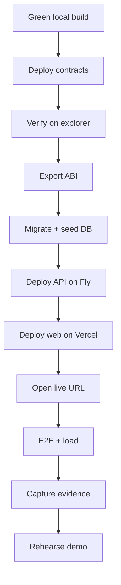

# Deploy and Demo Runbook

| | |
|---|---|
| **Version** | 1.1 |
| **Status** | Approved |
| **Date Created** | 2026-10-24 |
| **Last Updated** | 2026-10-24 |

| Version | Date | Change |
|---|---|---|
| 1.0 | 2026-10-24 | Initial draft |
| 1.1 | 2026-10-24 | Approved by the owner; implementation follows the fixed behaviour |

---

## 1. Problem Statement

The submission is judged on a live URL, a public repository, verified contracts and a working demo. A local build is not enough. This runbook takes a green local build to the public deployment, produces the evidence the judges ask for, and rehearses the three-minute demo.

The contracts are immutable and there is no proxy (`0002`). A deployment produces new addresses; every environment must be updated and the README must list them.

## 2. Definition of Done

1. All contracts are deployed on Monad testnet (chain `10143`) and verified on the explorer.
2. The backend is live on Fly with exactly one machine, and the frontend is live on Vercel.
3. The database is migrated and seeded from a clean state.
4. The README contains the live URL, every contract address, the chain id and the run steps.
5. The e2e flow, a load test and the stage harness pass against the live URL.
6. Evidence is captured: create, join, start, tick, finalize, hatch and withdraw transaction hashes; stage and phone screenshots.
7. The demo is rehearsed once end to end with two phones and the stage laptop.
8. The relayer balance is known and funded for the demo.

## 3. Feature Description

### 3.1 Preflight

| Item | Check |
|---|---|
| Deployer key | Funded with MON; owner of the deployment |
| Operator key | Relayer address; funded with MON |
| Treasury | Protocol fee receiver |
| RPC | A dedicated endpoint, not the public RPC |
| Explorer | Monad testnet explorer reachable |
| Database | PostgreSQL reachable; `PGSSL=true` when hosted |
| Domain | Vercel URL and API URL decided |
| Time | Freeze scope before the runbook starts |

### 3.2 Contract deployment

```bash
cd smart-contract
forge build
forge test
PRIVATE_KEY=... OPERATOR=0x... TREASURY=0x... \
  forge script script/Deploy.s.sol --rpc-url "$RPC_URL" --broadcast
./script/export-abi.sh
```

Capture from the broadcast output:

- `MOCK_USDC`
- `TRACK_NFT`
- `PART_NFT`
- `DUCK_NFT`
- `BADGE`
- `VAULT`
- `RACE`

Then verify every contract on the explorer with the chain id `10143`. The verification key is an environment value; it is never committed.

Seed data is part of the deploy script: Kali Code Sprint, Alpine Ring, Buroq Wings, Turbo Tail, Iron Bill. Confirm the ids and prices after deployment.

### 3.3 Backend environment

| Variable | Value |
|---|---|
| `PORT` | `8080` |
| `CORS_ORIGINS` | The Vercel URL |
| `PGHOST`, `PGPORT`, `PGDATABASE`, `PGUSER`, `PGPASSWORD`, `PGSSL` | Hosted PostgreSQL |
| `JWT_SECRET` | Random 32-byte hex |
| `CHAIN_ID` | `10143` |
| `RPC_URL`, `EXPLORER_URL` | Monad testnet |
| `OPERATOR_PRIVATE_KEY` | Relayer key |
| `RACE`, `VAULT`, `DUCK_NFT`, `MOCK_USDC`, `BADGE` | From the deploy |
| `USDC_NAME`, `USDC_VERSION` | `Mock USDC`, `1` |
| `SESSION_CAP`, `SESSION_TTL_SEC` | `5000000`, `86400` |
| `WELCOME_USDC` | `5000000` |
| `TICK_GAS`, `TICK_INTERVAL_MS` | `53100`, `300` |
| `JOIN_BATCH_WINDOW_MS`, `JOIN_BATCH_MAX` | `400`, `100` |
| `FILL_BOTS`, `COUNTDOWN_SEC` | `true`, `3` |

Run `npm run migrate:latest && npm run seed:run` once, then start the API.

### 3.4 Backend deployment

- Fly app in `sin`, exactly one machine: sockets and live races are in memory (`fly.toml`).
- Set secrets with `fly secrets set`; never bake a key into the image.
- `fly deploy`; confirm the health of `/api/catalog/tracks`.
- The database and the API should be in the same region; measure join latency after deploy.

### 3.5 Frontend deployment

| Variable | Value |
|---|---|
| `NEXT_PUBLIC_API_URL` | The Fly API URL |
| `NEXT_PUBLIC_APP_URL` | The Vercel URL |
| `NEXT_PUBLIC_CHAIN_ID` | `10143` |
| `NEXT_PUBLIC_RPC_URL` | Monad testnet |
| `NEXT_PUBLIC_EXPLORER_URL` | Monad testnet explorer |
| `NEXT_PUBLIC_WALLETCONNECT_PROJECT_ID` | Optional; injected wallets work without it |

Deploy to Vercel. Open `/play` and `/stage/WEK-XXX` on the public URL. A phone on mobile data must be able to join.

### 3.6 README requirements

The README must contain:

1. One-paragraph product description and the live URL.
2. The chain id and every contract address.
3. The key pair model: owner, operator, treasury.
4. Local run steps for contracts, backend and frontend.
5. The test commands and the observed result.
6. The proof section: transaction hashes for create, join, start, tick, finalize, hatch and withdraw.

### 3.7 Evidence

For one complete race, capture:

- Room creation transaction.
- Two join transactions (or the batch hash).
- Start transaction with the seed and `startBlock`.
- Three tick transactions.
- Finalize transaction with the standing root.
- Hatch transaction and the Duck NFT token id.
- Withdraw transaction and the receiver balance.
- Stage screenshot at lobby, race and winner.
- Phone screenshot at join, race and result.

The hashes go in the README; the screenshots stay with the pitch material.

### 3.8 Three-minute demo

| Time | Action | Proof |
|---|---|---|
| 0:00–0:25 | Theme and one-liner | "One block = one step. No bet, only a ticket." |
| 0:25–0:45 | Scan the stage QR | Join screen, room code, 0.10 USDC |
| 0:45–1:10 | Connect and join | One signature, ticket debit, duck on stage |
| 1:10–1:55 | Race and CHEER | Pack moves every block; energy and lead change |
| 1:55–2:20 | Photo finish and result | Podium, soulbound titles |
| 2:20–2:40 | My Duck | Hatch and metadata |
| 2:40–3:00 | Proof | Tick, start, finalize hashes; repo and README |

Rehearse once with the actual phones and the venue Wi-Fi. Prepare a room and a wallet before the pitch; do not debug during the demo.

### 3.9 Rollback

- A failed contract deploy is replaced by a new deploy; update every env and the README.
- A failed API deploy is rolled back to the previous Fly release; the database migration is forward-only.
- A failed frontend deploy is rolled back in Vercel.
- If the live chain is unhealthy, the demo can run on a prepared room; never fake a transaction.

## 4. Impacted Files

| File | Status | Purpose |
|---|---|---|
| `README.md` | `[NEW]` | Live URL, addresses, run steps, proof |
| `smart-contract/script/Deploy.s.sol` | `[NEW]` | Deploy and seed |
| `smart-contract/script/export-abi.sh` | `[NEW]` | ABI export |
| `backend/.env.example` | `[NEW]` | Backend env template |
| `backend/fly.toml` | `[NEW]` | One machine, `sin` |
| `backend/Dockerfile` | `[NEW]` | API image |
| `frontend/.env.example` | `[NEW]` | Frontend env template |
| `docs/plans/0010-deploy-and-demo.md` | `[NEW]` | This runbook |

### Reuse check

| `[NEW]` item | Existing material read | Why it cannot serve as-is |
|---|---|---|
| README | The product and contract plans | New submission page with this deployment's addresses |
| Env templates | The env tables in `0007` and `0008` | New files; values match this build |
| Fly/Vercel config | The fixed single-machine requirement in `AGENTS.md` | New deployment files |

## 5. Code Shape

No product code. The runbook is a sequence of commands and checks.

```text
deploy contracts -> export ABI -> migrate/seed DB -> deploy API -> deploy web
  -> open live URL -> run e2e -> run load -> capture evidence -> rehearse demo
```

## 6. UI/UX Changes (Lo-Fi)

No new screen. The public README is the only new surface:

```text
DUCKW EK — live duck racing on Monad
Live: https://...
Chain: 10143
Vault: 0x...   Race: 0x...   USDC: 0x...
Duck: 0x...    Part: 0x...   Track: 0x...   Badge: 0x...
[How to play] [Run locally] [Proof]
```

## 7. Flowchart



## 8. Verification Plan

| # | Check | Pass condition |
|---|---|---|
| T-1 | Contracts verified | Every address has a verified source |
| T-2 | API live | `/api/catalog/tracks` returns the seeded tracks |
| T-3 | Web live | `/play` and `/stage/CODE` open on the public URL |
| T-4 | E2E | `npm run test:e2e` against the live API |
| T-5 | Load | 50 paid joins, 200 sockets, every tick delivered |
| T-6 | Frontend build | `npm run build` |
| T-7 | Stage harness | Screenshots and a frame trace |
| T-8 | README | A person can run the repo from it |
| T-9 | Demo | One full rehearsal under 3 minutes |
| T-10 | Relayer | Balance covers the demo with margin |

### UNVERIFIED

| Claim | Why | Resolved by |
|---|---|---|
| Venue Wi-Fi stability | Not controlled | Rehearsal |
| Projector FPS | Hardware dependent | On-site trace |
| Join latency | DB/RPC dependent | Live measurement |

## 9. Open Decisions

| ID | Decision | Blocks | What the owner must provide |
|---|---|---|---|
| O-1 | Mainnet | this plan | MON, real USDC address, permit check |
| O-5 | Custom domain | this plan | Domain and DNS, or skip |
| O-6 | Build-in-public | this plan | Who posts, tags and tracks 5K views |
| O-7 | MON budget | this plan | Testnet spend cap and top-up |
| O-30 | Database host | this plan | Hosted PostgreSQL and region |
| O-36 | Demo room | this plan | Pre-created room code and host wallet |
