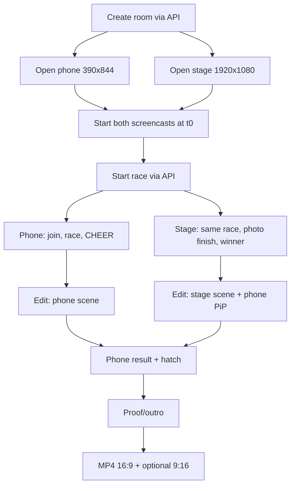

# Demo Video — Phone First, Then the Stage

| | |
|---|---|
| **Version** | 2.0 |
| **Status** | Approved — social cut |
| **Date Created** | 2026-10-24 |
| **Last Updated** | 2026-10-24 |

| Version | Date | Change |
|---|---|---|
| 1.0 | 2026-10-24 | Initial draft after the owner rejected the stage-only cut |
| 2.0 | 2026-10-24 | Owner requirements: X/LinkedIn/Reels; start at sign; full phone flow; stage scene; 9:16 master + 16:9 cut |

---

## 1. Problem Statement

The current `docs/demo/duckwek-demo.mp4` is stage-only with abstract cards. The owner rejected it: a demo of a phone-first product must show the phone first, then cut to the projector to show the same race from the room's point of view. The current cut does not show the player joining, cheering, or getting a result, so it does not prove the product.

This plan defines the replacement: a 45–60 second video recorded from the real phone app and the real stage during the same live race. It is a build-in-public asset (the event scores a demo video at 30 seconds or more) and the visual proof for the pitch.

## 2. Definition of Done

1. A 16:9 master, 1920×1080, 30 fps, H.264 MP4, 45–60 seconds, at most 50 MB.
2. The first 3–5 seconds show the **phone**, not a title card or a logo animation.
3. The phone flow is real: connect, one signature, join 0.10 USDC, duck, race, CHEER, result, hatch.
4. The stage scene shows the **same room and the same race** on the projector: pack movement, top three, photo finish, winner.
5. Captions are readable with the sound off; no private key, JWT or signature appears.
6. One clear call to action: the live URL and the repo; the contracts are verified on MonadVision.
7. The file replaces `docs/demo/duckwek-demo.mp4`; the poster and `docs/demo/README.md` are updated; the root README links the video.
8. The owner reviews the cut and approves it. Optional: a 9:16 cut for social.

## 3. Feature Description

### 3.1 Research findings

General demo-video guidance used here:

- Lead with the product or the problem, not a long branded intro; the hook must land in the first 3 seconds.
- Keep a demo under 90 seconds; 30–60 seconds is right for a hackathon and social.
- Record the real app, with realistic data; show a complete flow, not a feature list.
- Assume sound off: captions and on-screen text carry the story; one CTA at the end.
- Mobile demos are strongest when the screen recording is the main footage; a stage or dashboard shot is a cutaway that proves the same action from the room's side.

The previous cut failed because it inverted the order: cards and stage first, phone absent.

### 3.2 Concept

**The phone is the controller. The stage is the room.**

| Scene | What the viewer sees | Why |
|---|---|---|
| A. Phone join | `/play?room=CODE`, connect, one signature, duck, pay 0.10 USDC | The player's first 15 seconds |
| B. Phone race | lobby, countdown, race strip, CHEER taps, rank | The interaction that changes the race |
| C. Stage | full projector: pack per block, top three, photo finish, winner | The room-wide scale and the shared tick |
| D. Phone result | rank, soulbound title, hatch, settle tx | The payoff for the player |
| E. Proof/outro | seed, start block, one tick per block, replay, verified contracts, live URL | Why the result can be trusted |

The video cuts **phone → stage → phone**, not stage-only. A short phone picture-in-picture during the stage scene shows the CHEER taps that drive the race.

### 3.3 Storyboard (target 48 seconds)

| Time | Shot | Caption |
|---|---|---|
| 0:00–0:05 | Phone, `/play?room=CODE`, join screen | "Scan. Join. 0.10 USDC." |
| 0:05–0:10 | Phone, connect + one signature + duck | "One signature. Gas sponsored." |
| 0:10–0:15 | Phone, paid join, lobby | "The ticket is a fee, not a bet." |
| 0:15–0:22 | Phone, race + CHEER taps | "Every tap pushes your duck." |
| 0:22–0:34 | Stage, full frame: pack moves every block, top three, photo finish, winner; phone PiP for the first 3 s | "One Monad block = one step." |
| 0:34–0:40 | Phone, result, title, hatch | "Podium titles are soulbound. The duck is yours." |
| 0:40–0:48 | Stage still / proof card | "Seed on-chain. 27/27 ticks replay. Contracts verified." + live URL |

No abstract intro longer than one second. The first frame is the real phone.

### 3.4 Capture setup

- **Room:** create via the API with a host wallet on Kali Code Sprint. Join three human wallets via the API and let bots fill the rest, so the stage has a real pack. The recorded phone is one of the humans.
- **Phone:** Playwright context 390×844 (device scale 2 for crisp frames), `/play?room=CODE`. Use the device wallet or a pre-seeded session:
  - Preferred: click the real "Device wallet" / "Connect" flow so the video shows the one signature.
  - Fallback: create the session via the API, set the JWT in `localStorage`, and open `/play`; the app restores the session.
- **Stage:** Playwright context 1920×1080, `/stage/CODE`.
- **Recording:** Chrome CDP `Page.startScreencast` for both pages, started at the same `t0`, JPEG frames at the native viewport. Save a `meta.json` with `t0`, room code, fps estimate and frame count.
- **Race start:** after both screencasts are running, call `POST /api/rooms/CODE/start` as the host. Record 30 seconds; the race plus photo finish fits.
- **Alignment:** both frame sequences share `t0`; the edit picks the phone segment and the stage segment by elapsed time, so the stage shows the same race the phone just played.

### 3.5 Edit

- **16:9 master:** dark `#120B2E` background. Phone scenes use a rounded phone frame with a black outline and the 390×844 recording inside, scaled to about 480×1040; captions at the bottom. Stage scenes are full-frame 1920×1080 with captions at the bottom and a small phone PiP (about 280×600) for the first 3 seconds of the stage scene.
- **Captions:** English, 32–40 px, white with a black box, sound-off readable. Use the design font.
- **Transitions:** hard cuts or a 6-frame push; no slow fades over the app.
- **Proof/outro:** use a clean stage still, not a long card; show the live URL and the verified contract count. Keep it under 8 seconds.
- **Audio:** optional. Use a track the owner provides or a CC0 track; do not use copyrighted music. If no track, ship silent with captions.

### 3.6 Deliverables

- `docs/demo/duckwek-demo.mp4` — 16:9 master, 45–60 s.
- `docs/demo/duckwek-demo-poster.png` — a real phone frame (not an abstract card).
- `docs/demo/duckwek-demo-vertical.mp4` — optional 9:16 cut for X/TikTok.
- `docs/demo/README.md` — storyboard, room code, capture notes.
- Root README — demo link.

## 4. Impacted Files

| File | Status | Purpose |
|---|---|---|
| `docs/plans/0011-demo-video.md` | `[NEW]` | This plan |
| `docs/demo/duckwek-demo.mp4` | `[REPLACE]` | New 16:9 master |
| `docs/demo/duckwek-demo-poster.png` | `[REPLACE]` | Phone-first poster |
| `docs/demo/README.md` | `[MODIFY]` | Storyboard and capture notes |
| `README.md` | `[MODIFY]` | Link the new cut |
| `frontend/__tests__/demo/record.mjs` | `[NEW]` | Playwright capture of phone + stage |
| `frontend/__tests__/demo/render.mjs` | `[NEW]` | ffmpeg assembly and overlays |

### Reuse check

| `[NEW]` item | Existing material read | Why it cannot serve as-is |
|---|---|---|
| `record.mjs` | The existing stage harness in `frontend/__tests__/stage/` and the live `/play`, `/stage` pages | The existing harness captures stage stills only; the new one records phone + stage with a shared t0 |
| `render.mjs` | The first cut's ffmpeg commands | The first cut is stage-only and card-heavy; the new edit is phone-first with cutaways |
| Poster | The design system and logo | The old poster is an abstract intro card; the new one is a phone frame |

## 5. Code Shape

No product code. The capture and render scripts are test tooling:

```ts
// frontend/__tests__/demo/record.mjs
createRoom(): Promise<{ code: string; token: string }>
openPhone(code: string): Promise<Page>      // 390x844, device wallet or seeded session
openStage(code: string): Promise<Page>      // 1920x1080
startScreencast(page: Page, dir: string): Promise<void>
startRace(code: string, token: string): Promise<void>
```

```text
# frontend/__tests__/demo/render.mjs
frames + t0 -> phone segment, stage segment
phone segment + frame -> 16:9 scene with captions
stage segment -> full-frame scene + PiP
proof still -> outro
concat -> duckwek-demo.mp4 (H.264, yuv420p, faststart)
```

No private key or JWT is written into the video or the repo.

## 6. UI/UX Changes (Lo-Fi)

```text
PHONE SCENE (16:9)
┌──────────────────────────────────────────────────────────────┐
│  dark purple background                                      │
│      ┌──────────────┐   JOIN THE ROOM                        │
│      │ phone screen │   0.10 USDC · one signature             │
│      │  /play       │   gas sponsored                         │
│      └──────────────┘                                        │
│  caption: "The phone is the controller."                     │
└──────────────────────────────────────────────────────────────┘

STAGE SCENE (16:9)
┌──────────────────────────────────────────────────────────────┐
│  full projector: track, pack, top 3, photo finish            │
│                                                ┌───────────┐ │
│                                                │ phone PiP │ │
│                                                │ CHEER     │ │
│                                                └───────────┘ │
│  caption: "The stage is the room."                            │
└──────────────────────────────────────────────────────────────┘
```

The phone frame is a real recording, not a mockup. The stage scene is the same race; the room code and the tick are visible.

## 7. Flowchart



## 8. Verification Plan

| # | Check | Pass condition |
|---|---|---|
| V-1 | Duration | 45–60 s |
| V-2 | Format | 1920×1080, 30 fps, H.264, yuv420p, faststart |
| V-3 | Phone first | The first 3–5 s show the phone app |
| V-4 | Real interaction | Connect, signature, join, CHEER, result, hatch are visible |
| V-5 | Same race | The stage room code and race match the phone race |
| V-6 | Stage scene | Pack movement, top three, photo finish and winner are visible |
| V-7 | Sound off | Captions tell the story without audio |
| V-8 | Privacy | No private key, JWT or signature; only public addresses |
| V-9 | Proof | Seed, start block, tick, finalize and verified contracts appear or are linked |
| V-10 | Files | Poster, README link and demo README updated |
| V-11 | Playback | Opens in QuickTime/Chrome and plays on a phone |
| V-12 | Size | ≤ 50 MB |

## 9. Open Decisions

| ID | Decision | Blocks | What the owner must provide |
|---|---|---|---|
| O-37 | Aspect ratio | capture/edit | 16:9 master only, or also a 9:16 cut |
| O-38 | Audio | edit | Provide a track, or ship silent with captions |
| O-39 | Humans in the room | capture | One recorded phone + two API joins + bots (recommended), or three phone contexts |
| O-40 | Opening shot | capture | Join screen (recommended) or the Connect screen |
| O-41 | Host flow | capture | Show creating a room, or start from a room created by the API |
| O-42 | Room | capture | Use a fresh live testnet room for the video |

## Sources

- [Demo Video Best Practices: What Actually Works in 2026](https://demoscope.app/blog/posts/demo-video-best-practices-2026.html)
- [How to Create Product Demo Videos for Mobile Apps](https://www.videobud.io/blog/product-demo-videos-mobile-apps)
- [Product Demo Video Best Practices: 2026](https://videoeditingcompany.com/product-demo-video-best-practices/)
- [App Demo Video: The Ultimate Guide](https://demoscope.app/blog/posts/app-demo-video-ultimate-guide.html)
- [App Demo Video: A Simple Workflow That Actually Ships](https://mockup.60fps.design/blog/app-demo-video)

---

## 10. Revision 2.0 — Social cut

This section supersedes the storyboard, capture and edit in §3.2–§3.6 where they differ.

### 10.1 Formats

| Cut | Size | Use |
|---|---|---|
| Vertical master | 1080×1920, 30 fps | Instagram Reels, TikTok, X, LinkedIn |
| Horizontal cut | 1920×1080, 30 fps | X, LinkedIn, projector, README |

Both are 45–60 seconds and share the same audio and captions.

### 10.2 Storyboard (start at sign)

| Time | Shot | Caption |
|---|---|---|
| 0:00–0:03 | Phone splash with the room invite; tap "Connect to play" | "One room. One race. Every block." |
| 0:03–0:08 | Connect screen; tap Face ID / fingerprint; signature sheet; tap Sign | "Sign once. No gas. No MON." |
| 0:08–0:13 | Join screen; pay 0.10 USDC; the ticket confirms | "0.10 USDC ticket. Not a bet." |
| 0:13–0:18 | Meet the duck; keep it; lobby fills | "Your duck is your profile." |
| 0:18–0:24 | Phone race screen; tap CHEER | "Every tap pushes your duck." |
| 0:24–0:34 | Stage full-frame: same race, pack per block, top three, photo finish, winner | "One Monad block = one step." |
| 0:34–0:40 | Phone result: rank, soulbound title, duck hatched | "Titles are soulbound. The duck is yours." |
| 0:40–0:48 | Proof/outro: seed, start block, 27/27 replay, verified contracts, live URL | "Replayable. Verified. Live now." |

The first frame is the phone, not a logo card. The sign sheet is visible around 0:05; the ticket around 0:10; the stage after the phone race.

### 10.3 Capture (as tested)

- Host room via API on Kali, 20 slots, bots on; two API joins plus the recorded phone join make four humans; bots fill the rest.
- Phone: Playwright 390×844, device scale 2, `/play?room=CODE`. Use the real Connect screen:
  - "Connect to play" → "Use Face ID / fingerprint" → virtual WebAuthn authenticator / device wallet fallback → "Sign" → "Join · 0.10 USDC" → "Keep this duck · to the lobby".
- Stage: Playwright 1920×1080, `/stage/CODE`.
- Record both with CDP screencast, storing the CDP `metadata.timestamp` for every frame. Start the race via `POST /api/rooms/CODE/start` after the phone reaches "Waiting for the host"; tap CHEER for ~5 s; capture until the result and hatch.
- The same race is used for both; the stage room code and winner must match the phone result.

### 10.4 Edit

- **Vertical 9:16:** phone recording fills the frame with a small top/bottom safe area; stage 16:9 is scaled to 1080×608 and centered on a dark background; captions at the bottom. The phone PiP is optional; the stage is the hero of that scene.
- **Horizontal 16:9:** phone recording in a rounded phone frame on the left with a caption panel on the right; stage full-frame; same captions.
- Speed up the sign/join/duck steps (1.3–1.6×) where no action is happening; keep the race and photo finish at real speed.
- Captions: English, 36–42 px, white on a black box, sound-off readable.
- Audio: optional; use an owner-provided or CC0 track. If none, ship silent.

### 10.5 Deliverables

- `docs/demo/duckwek-demo-vertical.mp4` — 1080×1920 master.
- `docs/demo/duckwek-demo.mp4` — 1920×1080 cut.
- `docs/demo/duckwek-demo-poster.png` — phone sign/join frame.
- `docs/demo/README.md` and root README updated.

### 10.6 Verification (additions)

| # | Check | Pass condition |
|---|---|---|
| V-13 | Vertical format | 1080×1920, 30 fps, captions inside safe area |
| V-14 | Horizontal format | 1920×1080, 30 fps |
| V-15 | Starts at sign | The first 3 s show the phone splash/connect |
| V-16 | Full flow | Sign, join, duck, race, CHEER, result, hatch |
| V-17 | Same race | Stage room code and winner match the phone result |
| V-18 | Social | Plays on Reels, X and LinkedIn without cropping the captions |
