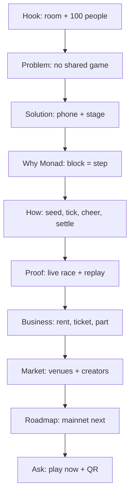

# Pitch Deck — DuckWek

| | |
|---|---|
| **Version** | 1.0 |
| **Status** | Draft |
| **Date Created** | 2026-10-24 |
| **Last Updated** | 2026-10-24 |

| Version | Date | Change |
|---|---|---|
| 1.0 | 2026-10-24 | Initial draft: slide order, narrative, build and verification |

---

## 1. Problem Statement

DuckWek has a README, a 37-second demo video and twelve plans, but no deck. A judge, a partner or a host cannot understand the mechanic, the trust model and the business in the three minutes they give us.

The event rewards a **live build**, not slides. The deck is a leave-behind and a narrative spine: it is used after the live demo, in follow-up conversations, and as the social/partner asset. If the organizer enforces "no slides", the deck does not replace the demo; the stage script stays the live product.

The deck must fit the room: 16:9, readable from the back, one idea per slide, and every claim traceable to the running product or `FINANCE.md`.

## 2. Definition of Done

1. Ten main slides plus an appendix, 16:9, 1920×1080.
2. A 3-minute spoken script with a target time per slide; total rehearsal under 3:00.
3. One idea per slide; body text at least 28 px at 1920×1080; headlines 72–120 px.
4. Every number is traceable to the README, `FINANCE.md`, a measured race or a contract, and labelled as measured or assumption.
5. No claim of 200 participants, no "trustless", no prize pool, no live mainnet claim, no token.
6. The live URL and a scannable QR are on the cover and the ask; the demo video poster is used, not a generic stock image.
7. The deck is a self-contained HTML file with keyboard navigation, plus a PDF export; it works offline with local fonts and assets.
8. Contract addresses, chain, gas and the migration plan are in the appendix, not the main narrative.
9. The owner approves the slide order and the script; the deck is rehearsed once on the projector.

## 3. Feature Description

### 3.1 Audience and goal

| Audience | What they need | What the deck gives them |
|---|---|---|
| Hackathon judges | The new mechanic, the Monad limit, a working build, a business | A 3-minute story with live numbers and proof |
| Venue / event host | A reason to book the room moment | The 10-second pitch, the price, the QR |
| Partner / creator | A reason to make tracks or parts | The creator split and the roadmap |
| Social viewer | A hook they understand without sound | The cover, the demo video, the CTA |

The single sentence the deck must leave behind:

> **DuckWek turns one room into a live race where every Monad block moves every duck one step — no bet, just a ticket, and anyone can replay the result.**

### 3.2 Narrative arc

`Hook → Problem → Solution → Why Monad → How it works → Proof → Business → Market → Roadmap → Ask`

The deck spends the first third on the problem and the mechanic, the second third on proof and business, and the last third on the roadmap and the ask. It does **not** open with a team slide or a logo animation.

### 3.3 Slide order

| # | Slide | Headline (on screen) | Content | Visual | Time |
|---|---|---|---|---|---|
| 1 | Cover | **DuckWek. One block. One step.** | Live room-wide duck racing on Monad. Live URL + QR. | Logo, phone + stage split, app URL | 10 s |
| 2 | Problem | **100 people. One room. No shared game.** | Raffles decide before the animation; on-chain games ask for MON and many signatures. | Big "100", three pain lines, a faded raffle screen | 20 s |
| 3 | Solution | **Scan. Pay 0.10 USDC. Race.** | Phone is the controller; the stage is the room; one signature; gas sponsored; no bet. | Phone frame + stage still, 3-step strip | 25 s |
| 4 | Why Monad | **The chain is the clock.** | ~300 ms blocks; one tick per block; 100 players; 48,264 gas per tick; replay. | Three big numbers and a single tick trace | 20 s |
| 5 | How it works | **Seed on-chain. Race off-chain. Settle on-chain.** | Phone → API → Vault/Race; `start` fixes seed + `startBlock`; ticks; CHEER; standing root. | One flow diagram, no code | 30 s |
| 6 | Proof | **It already ran.** | A real room: joins, ticks, finalize, hatch; 27/27 replay; 7 verified contracts; 0.33 MON for a 20-duck race; no proxy. | Explorer hashes, replay check, contract count | 30 s |
| 7 | Business | **We don't take a bet. We take a fee.** | Rent 1 USDC; ticket 0.10; part 1 USDC (85/15); no prize pool; platform assets credit the protocol. | Three flow arrows with splits; one unit-economics line | 30 s |
| 8 | Market | **The room is the market.** | Venue and event racing, creator tracks and parts; competitors are animated raffles; our wedge is a verifiable live race. | Comparison: raffle vs DuckWek; event/venue icons | 20 s |
| 9 | Roadmap | **Live today. Mainnet next.** | Today: testnet race + demo. Next: mainnet (migration plan), creator tracks/parts, tips, season pass, venue circuit. | 3-step timeline with "live" and "next" | 20 s |
| 10 | Ask | **Your duck is waiting.** | Play now at duckwek-app.vercel.app; scan the QR; bring DuckWek to your room. | Large QR, URL, "No bet. Only a ticket." | 15 s |

Appendix (not counted): contract addresses, chain, gas table, key roles, security model, migration plan, repo link.

### 3.4 Copy rules

- Use "ticket", "rent", "license", "title"; never "bet", "stake", "jackpot".
- Say "replayable", not "trustless". The operator posts the result; the race can be replayed.
- Say "100 people in the room"; the live demo used 20 ducks; `200` is a slot limit and never a participant count.
- Label assumptions: the unit-economics table is an assumption, not a measured revenue.
- Say "mainnet next" only as a roadmap; do not claim a mainnet deployment.
- No repo URL on the main slides; website only. The repo can live in the appendix for judges.
- No "Monad testnet" on the main slides; if the appendix needs the chain, state it once.

### 3.5 Design

- Use `docs/design/DESIGN_SYSTEM.md`: `#120B2E`, `#1E1446`, `#FFC93C`, `#836EF9`, Lilita One + Rubik + JetBrains Mono.
- 16:9, 100 px side margins, 80 px top/bottom; one idea per slide.
- Phone frame and stage stills from the real app; no generic stock.
- Motion: a 200–300 ms slide transition and a subtle reveal; no 3D gimmick, no spinning logo.
- Charts: only three numbers per slide; no dense tables. The appendix holds the dense data.
- QR: generated from the live URL; tested on a phone.

### 3.6 Presentation build

- Single `duckwek-pitch-deck.html`, self-contained: local fonts, local images, inline CSS/JS.
- Keyboard: `←/→`, `Space`, `Home/End`; `?slide=N` deep link; `F` full screen; progress bar.
- Print CSS: one slide per page, 16:9, no navigation; export to PDF with Chrome/Playwright.
- The demo video is linked or embedded muted on slide 6; the deck does not autoplay audio.
- The deck opens from `file://` with no network.

## 4. Impacted Files

| File | Status | Purpose |
|---|---|---|
| `docs/plans/0012-pitch-deck.md` | `[NEW]` | This plan |
| `docs/pitch/duckwek-pitch-deck.html` | `[NEW]` | Self-contained 16:9 deck |
| `docs/pitch/duckwek-pitch-deck.pdf` | `[NEW]` | Export for the judges and follow-up |
| `docs/pitch/assets/` | `[NEW]` | Logo, poster, stage/phone stills, QR |
| `docs/pitch/README.md` | `[NEW]` | How to present, export and update |
| `README.md` | `[MODIFY]` | Link the deck |

### Reuse check

| `[NEW]` item | Existing material read | Why it cannot serve as-is |
|---|---|---|
| Deck HTML | `README.md`, `FINANCE.md`, `docs/plans/0001`–`0011`, demo video | The README is long-form; the deck is a 10-slide narrative |
| Deck assets | `frontend/public/logo.png`, `docs/demo/duckwek-demo-poster.png`, stage/phone captures | Existing assets are reused; only the QR and crops are new |
| PDF | The HTML deck | The PDF is an export, not a second source |

## 5. Code Shape

No product code. The deck is a static artifact:

```text
duckwek-pitch-deck.html
├── <section class="slide"> ... </section> × 10 + appendix
├── inline CSS (design tokens, 1920×1080 canvas, print rules)
├── inline JS (keyboard, hash, fullscreen, progress)
└── local assets (fonts, logo, screenshots, QR)
```

- No framework, no CDN, no build step.
- A small script or Playwright prints the PDF.
- Deep link examples: `?slide=6`, `#6`; print uses `@media print`.

## 6. UI/UX Changes (Lo-Fi)

```text
COVER                                   PROBLEM
┌───────────────────────────────┐       ┌───────────────────────────────┐
│ DUCKW EK                      │       │ 100 people. One room.         │
│ One block. One step.          │       │ No shared game.               │
│ [phone]        [stage]        │       │ • raffle decides early        │
│ live URL + QR                 │       │ • MON + signatures            │
└───────────────────────────────┘       └───────────────────────────────┘

PROOF                                   ASK
┌───────────────────────────────┐       ┌───────────────────────────────┐
│ It already ran.               │       │ Your duck is waiting.         │
│ 27/27 replay · 7 verified     │       │ [ QR ]  duckwek-app.vercel.app│
│ 0.33 MON · no proxy           │       │ Play now · race the room      │
└───────────────────────────────┘       └───────────────────────────────┘
```

Rules: one headline, at most three supporting lines, one visual; no slide with a paragraph longer than two lines at 28 px.

## 7. Flowchart



## 8. Verification Plan

| # | Check | Pass condition |
|---|---|---|
| V-1 | Slide count | 10 main + appendix |
| V-2 | Timing | Rehearsal under 3:00; each slide within ±20% of its target |
| V-3 | Readability | Body ≥28 px; headline ≥72 px; readable at 1920×1080 from the back |
| V-4 | Offline | Opens from `file://` with no network; fonts and images load |
| V-5 | Navigation | Arrows, Space, Home/End, `?slide=N`, full screen |
| V-6 | Print/PDF | 10 pages + appendix; no clipped text; 16:9 |
| V-7 | QR | Scans to the live app |
| V-8 | Claims | No 200 participants, no "trustless", no prize pool, no live mainnet, no token |
| V-9 | Numbers | Each number labelled measured or assumption and traceable |
| V-10 | Owner | Slide order and script approved before the build |

### UNVERIFIED

| Claim | Why | Resolved by |
|---|---|---|
| 100-player race cost | The live proof is a 20-duck race; the 100-player number is not measured on this build | Mark as a target or measure a 100-player race |
| Revenue per venue | Unit economics use an assumption (20% part attach) | State the assumption on the slide |

## 9. Open Decisions

| ID | Decision | Blocks | What the owner must provide |
|---|---|---|---|
| O-43 | Deck language | build | English (recommended for Monad judges) or Indonesian |
| O-44 | Use at the event | build | Confirm the deck is a leave-behind; the stage remains the live demo |
| O-45 | Testnet/chain mention | build | Keep "Monad" on main slides; put chain `10143` only in the appendix, or omit |
| O-46 | Repo mention | build | Website only on main slides; repo only in the appendix for judges |
| O-47 | Demo video audio | build | The current app-SFX mix is “rada nabrak”; mute it in the deck or fix the mix first |
| O-48 | Team slide | build | Cover credit only, or a dedicated team slide (would make 11) |
| O-49 | Mainnet wording | build | “Next” roadmap only, or a dated target |
