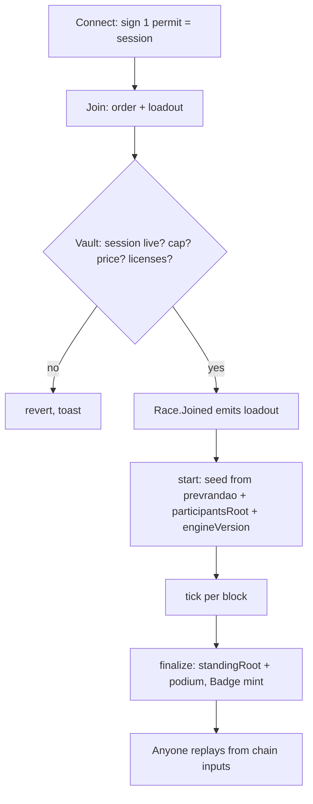

# MVP v2 — Contracts Redeploy and Trust Model

| | |
|---|---|
| **Version** | 1.15 |
| **Status** | Draft — awaiting owner approval. The "Approved" status written in v1.2 was set by the agent, not by the owner, and is withdrawn. |
| **Date Created** | 2026-11-16 |
| **Last Updated** | 2026-11-17 |

| Version | Date | Change |
|---|---|---|
| 1.0 | 2026-11-16 | Initial draft from the owner review session (findings F1–F9, decisions D1–D12) |
| 1.1 | 2026-11-16 | §3 D5: edit limit confirmed as 3 per track lifetime (Q1 closed). §3 D9: Layangan Wings confirmed. §4.7 and §7: design source moved to `docs/design/v2/`. §4.8: related plans 0014, 0015. |
| 1.2 | 2026-11-16 | Owner approved the on-chain SVG approach (D12) and testnet work; each part NFT must render a different image from its own traits. New §12 records the review against the v1 code (G1–G11) and the testnet answers to Q2–Q5. §4.4: `color` trait per part type. §4.5: payee resolved at every order; `Room.circuitOwner` removed. §4.6: Badge stores `trackId`. §4.7: art traits and the segment encoding. IPFS / Pinata is not used for NFT art. |
| 1.3 | 2026-11-17 | Contracts, renderers, `DeployV2` / `CheckDeploy` implemented and tested locally (104 Foundry tests). §4.2: a permit that was front-run and consumed is adopted as the session when its signature is proven to be the payer's (new G12). §4.6: `Badge` is `Ownable2Step`. §12: G12–G14 and measured results for U1, U2, U5-partial. v1 scripts `Deploy.s.sol`, `DeployMainnet.s.sol` and `DuckNFT.sol` removed (kept in git history). |
| 1.4 | 2026-11-17 | §12.3 added: testnet (10143) deployment record, `CheckDeploy` result, Sourcify verification (U3 resolved for testnet), the out-of-gas finding for transaction gas limits, art read back from the chain, and the explorer check (U5 still open). New helper script `script/SmokeV2.s.sol`. |
| 1.5 | 2026-11-17 | §12.3 U3: verification redone through the Monad verification API (`https://agents.devnads.com/v1/verify`, the route the monskills `scaffold` skill prescribes). All nine testnet contracts verified on MonadVision ("perfect match") and Monadscan ("Pass - Verified"). Socialscan was not in the API response. Mainnet uses the same call with `chainId` 143. |
| 1.6 | 2026-11-17 | §12.4: backend and frontend adapted to v2 and verified end to end on testnet; staging environment (Fly app, Vercel project, staging DB) deployed from branch `stage`. Behaviour changes: the loadout is committed at join and locked; the hatch is a UI moment (no transaction); circuit path, sectors and engine profile are derived from the on-chain layout. |
| 1.7 | 2026-11-17 | New §13: mainnet plan with the roles kept apart (owner, treasury, relayer, deployer), every address left OPEN for the owner, the sequence, and the open questions. §12.3 gets a correction: the staging deploy used one key for several roles, which §4.1 does not allow. |
| 1.8 | 2026-11-17 | Status returned to Draft. v1.2 marked the plan Approved without the owner setting it. The contracts, the testnet deployment and the staging environment built under that status are unreviewed by the owner. |
| 1.9 | 2026-11-17 | Testnet redeployed with the roles apart, using the same three wallets as the v1 mainnet contracts (owner, treasury, relayer). §12.3 addresses replaced. §13.1 roles filled from the v1 mainnet contracts and confirmed by the owner. Ownership of the five testnet contracts is offered to the owner wallet and waits for the owner to accept. |
| 1.10 | 2026-11-17 | §12.5: Slither audit of the production contracts (53 findings, 0 after the fixes and the reasoned annotations). The testnet contracts deployed before the fixes do not contain them. |
| 1.11 | 2026-11-17 | §12.6: audit extended to every source file including `MockUSDC`, ERC-721 conformance, real invariant tests for the Vault, and a mutation check of those tests. |
| 1.12 | 2026-11-17 | §12.7: testnet redeployed from the cleaned and audited code (no comments except parameter docblocks, full-word names, ABI parameter names spelled out, Slither fixes included); roles checked on chain before and after; Fly and Vercel staging updated. The §12.3 table is superseded by the §12.7 addresses. |
| 1.13 | 2026-11-17 | §12.8: testnet redeployed with the owner wallet `0x5617` as the deployer and owner (no pending ownership); the §12.7 deploy by the relayer key is superseded. The smart-contract env had a duplicate `RPC_URL` (public RPC) that was removed. |
| 1.14 | 2026-11-17 | §13.1: Deployer row set to the owner wallet `0x5617` (the owner stated the deployer must be `0x5617`). §13.4: mainnet redeploy agenda with its blockers (Alchemy mainnet not enabled for the app, contract decisions, USDC check). `smart-contract/.env` now separates `TESTNET_*` and `MAINNET_*` addresses. |
| 1.15 | 2026-11-17 | §13.4 A2 and A3 resolved: the owner supplied a working Alchemy mainnet URL (chain id 143 read through it) and the canonical USDC was verified on chain (name `USDC`, version `2`, 6 decimals, `DOMAIN_SEPARATOR` equals the one computed for name USDC, version 2, chain 143). |

> **Handoff to Claude Code.** Read `AGENTS.md` first. This plan is a **Draft**. Do not write code until the owner sets Status to Approved. When approved, implement in the order of §10. Every item marked `UNVERIFIED` must be resolved by the test or source named next to it before the code depends on it. Ask the owner about anything in §11 instead of deciding it.

---

## 1. Problem Statement

The v1 contracts were deployed to Monad mainnet (chain 143) on 2026-10-24. A review on 2026-11-16 (read-only: repository source, broadcast files and monadscan) found problems that cannot be fixed in the immutable v1 contracts. Mainnet v1 is still empty: the Vault has only its 3 setup transactions, so a full redeploy costs gas only and moves no user funds.

### 1.1 Findings

| # | Finding | Evidence |
|---|---|---|
| F1 | `Vault.spend()` checks no payer signature per order. The operator key can charge any order kind for any payer, up to that payer's remaining allowance. The README says "EIP-712 order" but no such check exists. | `DuckWekVault.sol` `spend`, `_spend` (only `orderHash` replay guard) |
| F2 | An EIP-2612 allowance does not expire at the permit deadline. Unspent allowance (≤ `SESSION_CAP`, 5 USDC) stays chargeable by the operator after the session ends. | `AuthService.ts` permit value = `sessionCap`; ERC-20 allowance semantics |
| F3 | Owner powers are unbounded: `TrackNFT.setTrack` on any track (including creator tracks), `setJoinPrice` without bounds, `setTreasury`, `setOperator`, `PartNFT.setMinter` / `Badge.setMinter` at any time (the owner can mint soulbound titles). | `onlyOwner` functions in all contracts |
| F4 | Mainnet part type ids do not match the backend. On chain: 0 Turbo Tail, 1 Buroq Wings, 2 Turbo Tail (duplicate), 3 Iron Bill. Backend seeder: 0 Buroq, 1 Turbo, 2 Iron. `DuckSvg` draws parts by numeric id. | monadscan input data of the 4 `createPlatformPart` txs; `20261021000002_platform_parts.ts` |
| F5 | Names and geometry are permanent on chain: "Buroq Wings" (a religious creature; owner rejected the name), "Alpine Ring" with 4,326 m (the Red Bull Ring length; owner rejected the likeness). No setter exists for name or length. | `PartNFT._types`, `TrackNFT._tracks` |
| F6 | `tokenURI` of every NFT has no `image` / `animation_url`. Wallets show text only. | `tokenURI` in DuckNFT, PartNFT, TrackNFT, Badge |
| F7 | Rent and tickets pay `track.creator` (fixed at mint), not the NFT holder. Selling a track NFT would not move its income. | `Vault._spend` CREATE_ROOM / JOIN_ROOM |
| F8 | `participantsRoot` hashes addresses only. The loadout (template, part) that drives the engine is not committed, so a race cannot be replayed from the chain alone. The engine reads part stats from PostgreSQL, not from the chain. | `RaceService.ts` line ~170 |
| F9 | Ops: the 6 mainnet contracts are not verified on monadscan; `broadcast/DeployMainnet.s.sol/143/run-latest.json` has 6 receipts for 18 txs (the setup was finished manually); `.env` files still point at chain 10143. | monadscan `#code` tabs; broadcast file |

Not a finding: `DuckWekRace` holds no part or stat logic, so engine changes (new stats, stacking) never need a contract change.

---

## 2. Definition of Done

1. v2 contracts below are implemented, tested (§9) and deployed to Monad testnet (10143), then mainnet (143), and **verified** on the explorer.
2. Owner of every v2 contract is a **Safe multisig** on Monad mainnet.
3. No `DuckNFT` in v2. The duck is an off-chain profile; "hatch" is a UI moment only.
4. No rarity anywhere (contracts, DB, API, UI).
5. Every race input is on chain or committed on chain before the seed is known: seed, start block, ordered participants **with loadout**, part stats, track layout version, engine version, cheer log root.
6. The backend reads part stats, part type ids and track data **from the chain** (indexed), never from hardcoded seeds.
7. A post-deploy check script reads every role, minter, operator, catalog entry and price from the chain and fails on any mismatch with the expected config.
8. The v1 mainnet contracts are paused and documented as retired in the README. No user funds exist there to migrate (verify `available` and USDC balance = 0 before retiring).

---

## 3. Owner Decisions (2026-11-16)

| # | Decision |
|---|---|
| D1 | **Redeploy v2 on mainnet.** Gas cost is not a constraint. No proxy (plan 0002 stands). |
| D2 | **Remove DuckNFT.** Duck = off-chain profile. Vault and Race never depended on it. |
| D3 | **No rarity.** Parts are shown by slot (Wings / Tail / Bill) and stat profile. |
| D4 | **Creator track rent is free for the creator to set** (any time; applies to new rooms only). Platform tracks: 1 USDC, fixed. The owner cannot change a creator's price. |
| D5 | **Track layout edits go through review; max 3 edits per track, lifetime** (owner confirmed). Each edit is a new version; old versions stay. Rooms lock the version they were created on. |
| D6 | **One part equipped at a time** for now. Data model, order format and engine must already support one part per slot (stacked stats) in a later version without a contract change. |
| D7 | **Keep the single signature at connect** (EIP-2612 permit = the session). No per-order wallet prompt. |
| D8 | **Owner = Safe multisig** (Safe is listed for Monad mainnet in the Monad docs). |
| D9 | **Final names:** part `Buroq Wings` → **`Layangan Wings`**; track `Alpine Ring` → **`Merapi Ring`** with an original layout built from segments (no real-circuit likeness). `Kali Code Sprint`, `Turbo Tail`, `Iron Bill` keep their names. |
| D10 | **Parts can be discontinued** (`active = false`). Sold licenses stay valid forever. A price change = a new type ("edition"), never an edit of an existing type's price. |
| D11 | **Part resale (Q4, not in this plan):** free price; **one license per part type per wallet** (blocks hoarding). |
| D12 | **NFT art:** on-chain SVG renderer contracts (`image` + `animation_url`), replaceable by the owner until `lockRenderer()`. Designs: `docs/design/v2/nft-part.dc.html`, `nft-circuit.dc.html`, `nft-title.dc.html`, `nft-part-slots.dc.html` (read `docs/design/v2/README.md`). |

---

## 4. Feature Description

### 4.1 Trust model (what each role can do in v2)

| Role | Can | Cannot |
|---|---|---|
| Player | sign the session permit; withdraw own balance; (creator) set own track rent, discontinue own part, request a layout edit | — |
| Operator (relayer hot key) | submit orders inside a live session; start, tick, finalize; publish a reviewed layout carrying the holder's signature | charge a payer after `sessionEnd[payer]`; charge more than the permit value; set any price; mint titles outside `finalize`; change a published loadout |
| Owner (Safe) | add/remove operators; pause; create platform tracks/parts; discontinue any part (moderation); deactivate any track (moderation); set/lock renderers; add stat keys; set join price within [0.01, 1] USDC | change a creator's rent; change a part type's price, stats or name; take any balance; set a minter after it is locked; mint titles |

Residual trust, stated in README and landing: the operator chooses the podium at `finalize`; anyone can replay the race from on-chain inputs and prove a wrong result, but the contract does not reject it.

### 4.2 Session (D7, fixes F1/F2 within the one-signature UX)

- `permitAndSpend` records `sessionEnd[payer] = p.deadline` and `sessionCap[payer] = p.value`, `sessionSpent[payer] = 0` when a permit is applied.
- `spend` / `permitAndSpend` revert if `block.timestamp > sessionEnd[payer]` or `sessionSpent + price > sessionCap`.
- Effect: the operator can still choose which orders to submit inside a live session (bounded by cap and time), but leftover allowance is dead after the session. This is the accepted residual risk of D7.

### 4.3 Loadout committed before the seed (fixes F8)

- JOIN / CREATE orders carry `Loadout { uint8 template; uint16[3] partBySlot; }` (slot 0 Wings, 1 Tail, 2 Bill; `0xFFFF` = empty). D6: the Vault rejects more than one non-empty slot for now (`MAX_EQUIPPED = 1`, a constant in v2; raising it is a future redeploy of the Vault only if stacking ships — UNVERIFIED alternative: make it an owner-settable cap ≤ 3; ask owner, Q2).
- The Vault checks `parts.licenseOf(payer, typeId) != 0` for every equipped part.
- `Race.Joined` emits the full loadout. Joins happen before `start`, and `start` fixes the seed from `prevrandao`, so loadouts are fixed before the seed is known.
- `start(roomId, players, participantsRoot, engineVersion)`; the leaf is `keccak256(abi.encode(address|botId, template, partBySlot))`.
- The engine reads stats via the PartNFT stat registry (indexed), sums stats over equipped slots (with one slot today the sum equals the single part).

### 4.4 PartNFT v2

- Stat registry: `statKeys` (owner adds keys, never removes); `statOf[typeId][key]` (int8) written once at type creation; new keys default to 0 for old types.
- Budget per type: each stat ≤ +2, sum ≤ +2 (kept from v1), checked at creation for platform and creator parts alike.
- `active` per type: platform part → owner; creator part → creator or owner.
- One license per type per wallet: `licenseOf[owner][typeId]` maintained in `_update`; mint or transfer into a wallet that already holds that type reverts.
- Price, name, stats immutable per type. Price change = new type.
- `minter` set once (`setMinter` reverts after the first call).
- `tokenURI` → `renderer.partURI(...)`.

### 4.5 TrackNFT v2

- Platform tracks: rent fixed 1 USDC (immutable). Creator tracks: `setRent(id, price)` by `ownerOf(id)` only.
- Income goes to `ownerOf(trackId)` at order time (fixes F7). Treasury-held tracks credit the protocol as one entry.
- Layout: `layouts[id][v]` = segment bytes (1 byte per segment) + `laps`; `version[id]`; `editsUsed[id] ≤ 3` (D5).
- `publishLayout(id, bytes segments, uint16 laps, sig)` by operator only, after off-chain review; `sig` = holder's EIP-712 `LayoutUpdate(id, keccak256(segments), laps, nonce, deadline)`. Creation of a creator track uses the same pattern (creator never needs MON).
- Turns and length are derived from segments by the engine and renderer; not stored.
- The Vault records `layoutVersion` in the room at CREATE_ROOM.
- `active` by holder or owner (moderation). Name immutable.

### 4.6 Badge v2

- Soulbound as v1. `minter` (Race) set once. `tokenURI` → renderer.

### 4.7 Renderers (D12)

- `PartRenderer`, `TrackRenderer`, `BadgeRenderer`: pure view contracts returning `data:application/json;base64` with `image` (static SVG) and `animation_url` (animated SVG, CSS/SMIL, no JS).
- Each NFT has `setRenderer(address)` (owner) and `lockRenderer()` (one way).
- Track art draws the latest layout version and a duck following the path (`animateMotion`).

### 4.8 Out of scope (separate plans)

- `0014-landing-responsive-grid.md`: landing page, responsive `/play`, MotoGP grid. Independent of v2; can ship first.
- `0015-market-ui.md`: Market UI (parts, circuit rental, creator submit, review queue). Depends on this plan.
- PartMarket resale contract: Q4 (D11), not planned yet.
- Track editor UI (segment kit). The contract side (§4.5) ships here.

---

## 5. Impacted Files

| Path | Change |
|---|---|
| `smart-contract/src/DuckWekVault.sol` | MODIFY: session fields, loadout in Order, license check, pay `ownerOf`, `layoutVersion` in Room, join price bounds |
| `smart-contract/src/DuckWekRace.sol` | MODIFY: `start(..., engineVersion)`, loadout in `Joined` |
| `smart-contract/src/PartNFT.sol` | MODIFY: stat registry, `licenseOf`, one-per-type, `setActive`, minter-once, renderer; remove fixed stat fields |
| `smart-contract/src/TrackNFT.sol` | MODIFY: layouts/versions, `publishLayout`, `setRent` by holder, platform rent fixed, renderer |
| `smart-contract/src/Badge.sol` | MODIFY: minter-once, renderer |
| `smart-contract/src/DuckNFT.sol` | DELETE |
| `smart-contract/src/DuckWekRoles.sol` | MODIFY: helper for set-once roles if shared |
| `smart-contract/src/render/{PartRenderer,TrackRenderer,BadgeRenderer}.sol` | [NEW] on-chain SVG. Reuse check: no renderer exists in v1 (tokenURI is inline JSON). |
| `smart-contract/script/DeployV2.s.sol` | [NEW] deploy + config + catalog; owner transferred to Safe last. Reuse check: `DeployMainnet.s.sol` cannot be extended because its catalog/order caused F4. |
| `smart-contract/script/CheckDeploy.s.sol` | [NEW] read-only post-deploy assertions (DoD 7) |
| `smart-contract/test/*.t.sol` | MODIFY + new invariant/fuzz suites (§9) |
| `backend/app/Chain/{abis,TypedData,Relayer,Contracts,Prices}.ts` | MODIFY: v2 ABIs, Order + Loadout types, `start` args, remove hatch |
| `backend/app/Engine/Race.ts` | MODIFY: stats from registry, sum over slots, `ENGINE_VERSION` |
| `backend/app/Http/Services/{Order,Race,Profile,Catalog}/*` | MODIFY: loadout in join, new participant leaf, equip by slot, catalog from chain index |
| `backend/database/seeders/*platform_parts*`, `*platform_tracks*` | MODIFY: ids from the deploy output, no rarity, new names |
| `backend/database/migrations/` | [NEW] drop `rarity`; add loadout columns; remove duck NFT fields |
| `frontend/components/duck/DuckSvg.tsx` | MODIFY: draw by slot, not by type id |
| `frontend/lib/{config,types}.ts`, `frontend/lib/abi/*` | MODIFY: v2 addresses, remove rarity / DuckNFT |
| `README.md`, `FINANCE.md` | MODIFY: v2 addresses, trust model §4.1, retire v1 |

---

## 6. Code Shape

All signatures below are targets; types and names may be refined during implementation but behaviour may not change without a plan bump.

```solidity
// DuckWekVault v2
struct Loadout { uint8 template; uint16[3] partBySlot; }            // 0xFFFF = empty slot
struct Order { address payer; uint8 kind; uint256 ref; bytes32 roomKey; Loadout loadout; uint256 amount; uint256 salt; }
mapping(address => uint64) public sessionEnd;
mapping(address => uint256) public sessionCap;
mapping(address => uint256) public sessionSpent;
uint8 public constant MAX_EQUIPPED = 1;                            // D6; see Q2
function permitAndSpend(Order calldata o, Permit calldata p) external onlyOperator whenNotPaused nonReentrant returns (uint256);
function spend(Order calldata o) external onlyOperator whenNotPaused nonReentrant returns (uint256);
function setJoinPrice(uint256 price) external onlyOwner;           // 10_000 ≤ price ≤ 1_000_000
// Room gains: uint32 layoutVersion; payee resolved via tracks.ownerOf(trackId) at order time.

// DuckWekRace v2
event Joined(uint256 indexed roomId, address indexed player, DuckWekVault.Loadout loadout);
function start(uint256 roomId, uint16 players, bytes32 participantsRoot, bytes32 engineVersion) external onlyOperator whenNotPaused;

// PartNFT v2
function addStat(bytes32 key) external onlyOwner;                  // append-only
function createPlatformPart(string calldata name, uint96 price, uint8 slot, bytes32[] calldata keys, int8[] calldata values) external onlyOwner returns (uint256 typeId);
function createCreatorPart(address creator, string calldata name, uint96 price, uint8 slot, bytes32[] calldata keys, int8[] calldata values) external onlyOperator returns (uint256 typeId); // after review
function setActive(uint256 typeId, bool active) external;          // platform: owner; creator: creator or owner
function statOf(uint256 typeId, bytes32 key) external view returns (int8);
function licenseOf(address owner, uint256 typeId) external view returns (uint256 tokenId); // 0 = none
function setMinter(address) external onlyOwner;                    // reverts if already set
function setRenderer(address) external onlyOwner; function lockRenderer() external onlyOwner;

// TrackNFT v2
function createPlatformTrack(string calldata name, bytes calldata segments, uint16 laps) external onlyOwner returns (uint256 id); // rent fixed 1 USDC
function createCreatorTrack(address creator, string calldata name, bytes calldata segments, uint16 laps, uint96 rent, bytes calldata creatorSig) external onlyOperator returns (uint256 id);
function publishLayout(uint256 id, bytes calldata segments, uint16 laps, uint256 deadline, bytes calldata holderSig) external onlyOperator; // editsUsed < 3
function setRent(uint256 id, uint96 rent) external;                // ownerOf(id) only; creator tracks only
function rentOf(uint256 id) external view returns (uint96);
function layoutOf(uint256 id, uint32 v) external view returns (bytes memory segments, uint16 laps);

// Badge v2: setMinter once; tokenURI via renderer.
```

**Call flow (join):** phone → API `POST /orders` (loadout from profile) → `OrderService` builds `Order{loadout}` → Relayer `permitAndSpend`/`spend` (via Race `joinBatch`) → Vault checks session, price, licenses → Race emits `Joined(loadout)` → `start` commits root + `engineVersion` → engine replays from indexed chain data.

**Deleted:** `DuckNFT` (contract, ABI, `Relayer.hatch`, hatch calls in `RaceService`/`ProfileService`), all `rarity` fields, `PartType.speed/weight/boost` fixed fields.

**UNVERIFIED (resolve before depending on it):**
- U1 Contract size of on-chain renderers vs Monad's max code size → measure with `forge build --sizes`; split renderers if needed.
- U2 Gas of `joinBatch` with loadout for 100 joins vs Monad per-tx 30M limit → forge gas report; size batches.
- U3 `forge verify-contract` against monadscan for chain 143 (API and key) → run on the first testnet/mainnet deploy.
- U4 Safe contract addresses on Monad mainnet → `github.com/monad-crypto/protocols/blob/main/mainnet/safe.jsonc` (linked from docs.monad.xyz multisig page).
- U5 SVG `animateMotion` / CSS animation rendering in target wallets/marketplaces on Monad → test on the real marketplace before launch; `image` stays static so lists render regardless.

---

## 7. UI/UX Changes (Lo-Fi)

Designs: `docs/design/v2/` (index in its README). Changes in this plan only:
- Remove "Duck NFT" copy; hatch is an animation.
- Part cards show slot + stats, never rarity.
- Wallet sheet / landing show the trust model in one line: "Prices and stats can be added, never changed. Results are replayable from the chain."

---

## 8. Flowchart



---

## 9. Verification Plan

**Foundry (must pass):**
1. Session: spend after `sessionEnd` reverts; spend beyond `sessionCap` reverts; new permit resets.
2. Loadout: equipping a part without a license reverts; 2 equipped parts revert while `MAX_EQUIPPED = 1`.
3. One license per type per wallet: mint and transfer into a holder revert.
4. Track income goes to `ownerOf` after a transfer.
5. `setRent` only by holder, only creator tracks; platform rent immutable.
6. `publishLayout`: bad holder sig reverts; 4th edit reverts; rooms keep their `layoutVersion`.
7. Set-once minters; renderer lock is one way.
8. Owner cannot change part price/stats/name or a creator's rent (no such function; assert via interface).
9. Invariant: `sum(available) == usdc.balanceOf(vault)` across random orders and withdraws.
10. Fuzz: stat budget (each ≤ 2, sum ≤ 2) for any input.

**Backend:** `test/engine/*` pass with stats read from the registry; new test: replay a race from indexed chain data only and match the stored standing.

**Testnet rehearsal:** `DeployV2` on 10143 → `CheckDeploy` → full e2e (`test/e2e/flow.e2e.ts`, `cheer`, `withdraw`) → a real room with ≥ 10 phones.

**Mainnet:** `DeployV2` → `CheckDeploy` → verify all contracts → transfer ownership to Safe → pause v1 → smoke test with real USDC: create room (1), join (0.10), buy part (1), withdraw.

---

## 10. Implementation Order (for Claude Code, after approval)

1. Contracts + Foundry tests (§9 items 1–10). Stop and report gas/size numbers (U1, U2).
2. Renderers + art from the canvas designs.
3. `DeployV2.s.sol` + `CheckDeploy.s.sol`; testnet deploy; resolve U3, U4.
4. Backend: ABIs, Order/Loadout, participant leaf, engine stats from chain, remove hatch/rarity, migrations, seeders from deploy output.
5. Frontend: v2 addresses, `DuckSvg` by slot, remove rarity/Duck NFT copy, session handling.
6. Testnet rehearsal. Report to the owner before mainnet.
7. Mainnet deploy only on the owner's explicit go.

---

## 11. Open Questions (ask the owner; do not decide)

| # | Question |
|---|---|
| Q2 | Stacking later: keep `MAX_EQUIPPED` a constant (stacking = Vault redeploy) or an owner setting capped at 3 (no redeploy)? |
| Q3 | Creator track rent: any bounds at all (e.g. ≤ 10 USDC) to protect hosts from typos? Draft: none (D4). |
| Q4 | Safe signers and threshold (e.g. 2-of-3) and who holds them. |
| Q5 | Timelock on operator/renderer changes, or multisig only? Draft: multisig only (D8). |

---

## 12. Review against the v1 code (v1.2, 2026-11-16)

Each row is a mismatch between this plan and `smart-contract/src` as deployed, with the resolution used for the testnet build.

| # | Mismatch | Resolution |
|---|---|---|
| G1 | §6 `createPlatformPart` / `createPlatformTrack` drop the `creator` argument, but the Vault credits the protocol alone only when the owner equals `treasury`, and the NFT contracts do not know the treasury. | Keep the `creator` argument on both platform creators (as v1). |
| G2 | §4.5 says income goes to `ownerOf(trackId)` at order time, but v1 `Room.circuitOwner` is copied once at `CREATE_ROOM`, so tickets after a track sale would pay the old holder (F7 again). | Remove `Room.circuitOwner`; every CREATE and JOIN reads `tracks.ownerOf(trackId)`. Gas measured in U2. |
| G3 | `DuckWekRace.Room.trackId` is `uint8` and `createRoom` reverts above 255, but track ids grow with creator tracks. | `uint64`. |
| G4 | No segment encoding exists. §4.5 says "1 byte per segment", the editor plan does not exist, and the v1 tracks are polylines (`TrackGeometry.ts`). The renderer and the engine need one shared format. | Testnet format (UNVERIFIED until the engine reproduces it): turtle code, 1 byte per segment: high nibble = turn (0 straight, 1 left 45°, 2 right 45°, 3 left 90°, 4 right 90°, 5 left 135°, 6 right 135°), low nibble = length in 20-unit steps (1–15). The path is closed when it ends within one step of the start. Frozen before mainnet; owner confirms. |
| G5 | The part art needs traits that do not exist on chain: a fill colour per part (design: Layangan white, Turbo Tail orange, Iron Bill grey). The circuit art needs the layout hash; the title art needs the track name and a player. "Best on (fit data)" and "Duck name" in the designs are off-chain. | `PartType.color` (uint24, immutable, set at creation). Title shows the short winner address and the track name (Badge stores `trackId`). "Best on" and "Duck name" are UI only (plan 0015), never in the NFT. |
| G6 | `Order` gains a nested `Loadout`. EIP-712 needs the exact type string `Order(...,Loadout loadout,...)Loadout(uint8 template,uint16[3] partBySlot)`; the backend `TypedData.ts` must hash the nested struct. | Typehash declared in the Vault; backend updated in step 4 with a test that signs in TS and verifies on chain. |
| G7 | The `salt` comment in `Order` mentions two copies of one part; D11 (one license per type per wallet) makes that unreachable. | Comment removed; `salt` stays for replay separation. |
| G8 | DoD 2 (Safe) has no testnet equivalent. | Testnet owner = the deployer EOA. Mainnet Safe is Q4. |
| G9 | `TrackNFT` is not `EIP712`; §4.5 needs `LayoutUpdate` signatures. | `TrackNFT` inherits `EIP712("DuckWekTrack","1")`. |
| G10 | Deploy order: set-once minters need the Race and Vault addresses first, and the Race constructor needs the Badge. | Badge → Parts → Tracks → Vault → Race → minters (once) → renderers → catalog → ownership. |
| G11 | The v1 mainnet catalog (F4) is permanent; nothing in v2 may read type ids from it. | v2 ids come from the `DeployV2` output only. |

**Testnet answers to the open questions (owner confirms the mainnet values later):**

| # | Testnet value |
|---|---|
| Q2 | `MAX_EQUIPPED` stays a constant (D6). Stacking later = Vault redeploy. |
| Q3 | No bounds on creator rent in the contract. The UI warns on large values (plan 0015). |
| Q4 | Testnet owner = deployer EOA. Mainnet signers and threshold: owner decides. |
| Q5 | Multisig only, no timelock. |

**NFT art rules (D12, owner confirmed 2026-11-16):** every NFT image is built by the renderer from that token's own on-chain traits, so two different parts never render the same image. Part: slot geometry, frame colour by slot, fill `color`, name, the stat bars, the build label (the highest stat). Circuit: the path from the segments, laps, turns, length, rent, layout hash. Title: rank, race id, track, winner. No file is uploaded anywhere (no IPFS, no Pinata).

### 12.1 Added during implementation (v1.3)

| # | Finding | Resolution |
|---|---|---|
| G12 | With v2 sessions opened only when the Vault applies the permit, anyone could submit a player's permit first (front-run) and make the order revert (`SessionExpired`). v1 tolerated this because only the allowance mattered. | `_adoptConsumedPermit`: if applying the permit reverted, the permit is adopted as the session only when its signature recovers to the payer for this Vault with `nonce - 1` (the one just consumed). An already open session with the same value and deadline is never reset. Tests: front-run, foreign signature, replay. |
| G13 | `Badge` used plain `Ownable`, so a transfer to the Safe would be immediate and unconfirmed (all other contracts are `Ownable2Step`). | `Badge` is `Ownable2Step`. |
| G14 | `Deploy.s.sol` and `DeployMainnet.s.sol` (v1) cannot compile against v2 contracts. | Removed; the v1 mainnet deployment stays documented in git history and `README.md`. |

### 12.2 Measured results

| Item | Result |
|---|---|
| U1 contract size | Largest runtime is `TrackRenderer` at 12,717 B (`forge build --sizes`). No split needed. |
| U2 `joinBatch` gas | 99 new players with permit + welcome mint, empty loadouts: 23.69M gas on the local EVM (limit 30M per transaction). Margin is thin and a local EVM understates Monad cold-access costs: size batches below 99 (start at 50) until the testnet run gives the real figure. |
| `tokenURI` gas (view) | part 1.68M, circuit 1.82M, title 2.58M. Far below any `eth_call` cap. |
| U5 marketplace rendering | NOT resolved. Images were checked in headless Chrome as `` (the way wallets load them): static and SMIL animated drawings render, fonts fall back to Impact / Arial because wallets block external fonts. A real marketplace on Monad testnet still has to be checked. |

### 12.3 Testnet deployment record (2026-11-17, chain 10143)

**Superseded by v1.9.** The first testnet deploy used the relayer as owner and a wrong treasury; it was redone. Deployer (temporary): the relayer key `0x5C09…4B49`. Owner: `0x5617…CAE4` (pending: it must call `acceptOwnership` on the five contracts). Treasury: `0xD3AB…F2D9`. Operator: `0x5C09…4B49`. All 27 deploy transactions succeeded and `CheckDeploy` printed `OK`.

| Contract | Address |
|---|---|
| MockUSDC (new) | `0xEB3420564A2E74B4CA481b3C55841ba6699a0cbD` |
| TrackNFT | `0xEf8042D1d189aEfC470808baBcD19E50890A9426` |
| PartNFT | `0xDaf31eDC4ab0dAEc14dB50DFb2Fd19Fee8e2f31F` |
| Badge | `0x14D4D2F1D0422Ed792f1D3aCBA8a756343658bee` |
| DuckWekVault | `0xF5D521704D4e33Df7020a896542dF4759AC75D86` |
| DuckWekRace | `0xE1E44FF2be91F1FbB447De2dece7E7d75a72705a` |
| PartRenderer | `0xD0e04b71B1Aad1a1dE4EC1Ccf66Fd5Dd37A7E1B2` |
| TrackRenderer | `0x947D61ddFce95661Ce7E2582Bfea26AF05961325` |
| BadgeRenderer | `0xeA465570033d2e1cCF863c27B623BC79cAE5bf2c` |

Ids: tracks 1 Kali Code Sprint, 2 Merapi Ring; parts 0 Layangan Wings, 1 Turbo Tail, 2 Iron Bill.

| Item | Result |
|---|---|
| U3 verification | All nine contracts verified through the Monad verification API (one POST per contract with the standard JSON input, the Foundry metadata and the ABI-encoded constructor args): MonadVision "Verified with perfect match" and Monadscan "Pass - Verified" for every contract. An earlier Sourcify-only run (`forge verify-contract --verifier sourcify`) had covered MonadVision alone. Socialscan was not part of the API response. |
| Real licences | `SmokeV2.s.sol` bought the three platform parts with one permit (tokens 1–3). `licenseOf` returns 1, 2, 3 for types 0, 1, 2. |
| Art from the chain | `tokenURI` read over RPC for parts 1–3 and circuits 1–2 returned JSON with `image` and `animation_url`; the images rendered in headless Chrome as `` and match the local test output. The animated circuit shows the duck at a different point on the path. |
| Gas limit finding | The first smoke `spend` ran out of gas: its gas limit (317,150) equalled the gas used. The default local estimate is too low on Monad, which charges the gas limit. The retry with `--gas-estimate-multiplier 300` succeeded. The backend relayer must set gas limits with explicit headroom per call type (AGENTS.md §6), measured on testnet. |
| U5 explorer rendering | NOT resolved. MonadVision (`/nft/<contract>/<id>`) opened but showed N/A with no metadata in a headless screenshot, which is inconclusive (indexing delay or a page that needs more than headless Chrome loads). Check by hand in a browser before relying on it. |

### 12.4 Backend and frontend v2, staging environment (2026-11-17)

**Backend (`backend/`)**
- `abis.ts`, `Relayer.ts`, `env.ts`: nested `Loadout` in `Order`, `Joined` carries the loadout, `start(..., engineVersion)`, `trackId` as `uint64`; `hatch` and the Duck NFT ABI removed; new env `PART_NFT`, `TRACK_NFT`, `ENGINE_VERSION`. `test/e2e/abi.check.ts` passes against the built contracts.
- `Engine/Segments.ts`: reads the turtle layout (G4) and derives turns, length, the smoothed centreline, sectors and the engine profile (`profileOf`: speed = 1.1 − 0.09·d, weight = 0.07 + 0.1·d, d = turns per km, ticks per lap = length / 51.4). Calibrated so the 1800 m / 6 turn sprint keeps the profile the engine was tuned on (0.8 / 0.403 / 1 / 35).
- `Chain/CatalogSync.ts`: reads part types, stats, circuits, layouts and holders from the chain at boot and every 5 minutes into the database (DoD 6). The v1 seeders are removed.
- Migration `20261117000001_v2_catalog_and_loadout`: drops `rarity` and the duck token fields; adds `color`, `stats`, `segments`, `layout_version`, `layout_hash`, `holder`, and `engine_version`, `participants_root`, `layout_version` on `races`.
- Orders carry the loadout (template and the one equipped part in its slot). `room_players` stores exactly what was committed. `PUT /rooms/:code/loadout` now answers 409 and the lobby follows the committed loadout. The participant leaf is `keccak256(abi.encode(bytes32 who, uint8 template, uint16[3] partBySlot))` and the root is `keccak256(concat(leaves))`.
- First race: the duck is marked `hatched` in the database and the phone plays the hatch moment; nothing is minted.

**Frontend (`frontend/`)**: no rarity or Duck NFT copy (copy lint passes on every surface), the part is drawn by slot and its own colour (`DuckSvg`), the lobby shows the locked loadout, bot and duck name prefix `Buroq` replaced by `Kite`, and the default circuit is Merapi Ring.

**Verified on testnet (real contracts, staging DB)**: `test/e2e/flow.e2e.ts` passes both against a local backend and against the deployed Fly app: connect with one signature, buy and equip a part, create a room, two joins, locked loadout, start, 27–31 tick transactions, replay from the on-chain seed identical for every tick, finalize, title minted and readable from the chain. About 0.36–0.40 MON per race.

**Staging environment (branch `stage`, created from `main`)**

| Piece | Value |
|---|---|
| Chain | Monad testnet 10143, contracts in §12.3 |
| Database | the staging Supabase project (separate from prod) |
| API | Fly app `duckwek-stage-api`, `backend/fly.stage.toml`, region `sin`, 1 machine, 1 GB shared CPU, `https://duckwek-stage-api.fly.dev` |
| Web | Vercel project `duckwek-stage`, `https://duckwek-stage.vercel.app` (deployed from an isolated copy; the local `frontend/.vercel` link points to the prod project `duckwek-app` and is never used for staging) |
| Cost control | `auto_stop_machines = "stop"`, `auto_start_machines = true`, `min_machines_running = 0`; deploy with `--ha=false`; the machine is stopped by hand after every test session (`fly machine stop <id> -a duckwek-stage-api`) |
| Secrets | in Fly secrets and in the git-ignored `backend/.env.staging`; `.dockerignore` now excludes every `.env.*` so no env file enters an image |

Prod is untouched: `backend/fly.toml` still describes `duckwek-api` (always on, one machine) and `backend/.env` was not changed.

**Known gaps**: the stage screen has no numbered corner markers on v2 circuits (the old table was keyed by the Alpine Ring slug); Market UI and creator submit are plan 0015; the explorer image check (U5) still needs a manual look at a real marketplace; the relayer gas margin (estimate × 1.1) held in every measured run but has not been stress tested at 100 joins.

---

## 13. Mainnet plan (v1.7)

> **Correction to §12.3.** The staging deploy used one key (the relayer) as deployer, owner and operator, and filled the treasury with an address nobody confirmed. §4.1 keeps these roles apart. That was wrong. Nothing below is decided until the owner gives the addresses. Nothing is deployed to mainnet until the owner says go.

### 13.1 Roles

| Role | What it is | What it can do | What it must never do | Address |
|---|---|---|---|---|
| **Owner** | contract admin | pause, add or remove operators, set or lock renderers, create platform parts and circuits, moderation, add stat keys, set the join price inside its bounds | change a creator's price, a part's price, stats or name, take any balance, mint titles | `0x5617007a51331f4e7241DE852cDc4Bbbe723CAE4` (owner of the five v1 mainnet contracts; confirmed by the owner 2026-11-17) |
| **Treasury** | the protocol's income address (the `creator` of every platform part and circuit) | withdraw its own earnings from the Vault | be a key the owner does not hold | `0xD3ABe6Cb5EAe7B9f57C543151F825AD9149Af2D9` (treasury of the v1 mainnet Vault; confirmed by the owner 2026-11-17) |
| **Relayer (operator)** | hot key that pays gas | submit orders, ticks, start, finalize, publish reviewed layouts | move funds, set prices, charge outside a live session | `0x5C0929120E9ecfFc5E684Da1d0f5101e7d2d4B49` (operator of the v1 mainnet Vault, on chain) |
| **Deployer** | the owner wallet signs the deployment (the relayer never deploys) | deploy, set the once-only minters, create the catalog | be any wallet other than the Owner | `0x5617007a51331f4e7241DE852cDc4Bbbe723CAE4` (stated by the owner 2026-11-17) |

The owner, the treasury and the relayer are three different addresses on mainnet. On staging they are three different addresses as well (the staging deploy has to be redone to follow this).

### 13.2 Sequence (each step only on the owner's explicit go)

1. Owner reviews the contract changes (the nine decisions listed in the chat on 2026-11-17) and answers §13.3.
2. Redeploy testnet with the roles apart and the owner's treasury. Run `CheckDeploy` with `EXPECTED_OWNER`, the e2e flow, and a treasury withdraw.
3. Production database: back it up, print the connected host and user, check it is the production project, then run migration `20261117000001`.
4. Mainnet: `DeployV2` with the real USDC address, the welcome mint off, `FINAL_OWNER` = the owner address; the owner accepts ownership; `CheckDeploy`; verify every contract through the verification API with `chainId` 143.
5. Production API (`duckwek-api`) and web (`duckwek-app`): secrets and variables point to the v2 addresses and chain 143, deployed from `main` after the pull request.
6. Smoke test with real USDC and a small amount: create a room, join, buy a part, withdraw.
7. Pause the v1 contracts after checking `available` and the USDC balance are zero; update README and FINANCE.md.

If something is wrong before step 7, v1 keeps running and the v2 contracts are redeployed (gas only, no user funds exist in them).

### 13.3 Open questions for the owner

| # | Question |
|---|---|
| M1 | Owner on mainnet: the Safe address, its signers and its threshold. |
| M2 | Treasury address (a wallet the owner holds). The same as the Owner or a different one? |
| M3 | Relayer key on mainnet: who generates it. It only needs MON; the key never goes to a chat. |
| M4 | Deployer: which wallet pays for the deployment. |
| M5 | The nine contract decisions: layout format, `color` trait, adopting a consumed permit as the session, no upper bound on creator rent, `MAX_EQUIPPED` fixed at 1, no timelock, join price bounds 0.01 to 1 USDC, `Ownable2Step` on the Badge, stat budget without a lower bound. Which ones change. |
| M6 | The real USDC address on Monad mainnet, checked against the Monad address list, and whether it supports EIP-2612 `permit` (the one-signature flow depends on it, plan 0002 DoD 6). UNVERIFIED until checked on chain. |
| M7 | Staging: redo the testnet deploy with the roles apart and which addresses to use. |

### 13.4 Mainnet redeploy agenda (added v1.14)

The testnet contracts of §12.8 are the rehearsal. Mainnet needs its own deploy from the final code. Nothing in this list runs until the owner says go for that step.

| # | Item | State |
|---|---|---|
| A1 | Contract decisions of M5, plus keeping or removing `sessionCap` and `sessionSpent` (§12.6 mutation finding). Any change to a contract means a testnet redeploy first, then the mainnet deploy from that same commit. | waiting for the owner |
| A2 | RPC for chain 143: the first Alchemy URL answered HTTP 403 (`MONAD_MAINNET is not enabled for this app`); the owner supplied a working mainnet URL, now in `RPC_MAINNET_URL`. No public RPC is used. | done |
| A3 | M6: `symbol` USDC, `name` USDC, `version` 2, `decimals` 6 read on chain 143 through Alchemy; `DOMAIN_SEPARATOR` equals the value computed for (USDC, 2, 143), so EIP-2612 permit works with these domain values. | done |
| A4 | Deployer is the owner wallet `0x5617`; `FINAL_OWNER` stays empty; `USDC` is the real address; `WELCOME_ENABLED=false`. The script prints and checks the signer, the RPC host and the chain id before it sends anything. | ready after A1 |
| A5 | `CheckDeploy` with `EXPECTED_OWNER`, then the nine verifications with `chainId` 143, then the smoke test with real USDC (§13.2 step 6). | after A4 |
| A6 | Production database backup, migration `20261117000001`, production Fly and Vercel secrets with the new addresses and chain 143, deploy from `main` after the pull request. | after A5 |

The addresses of the finished mainnet deploy go into `MAINNET_*` in `smart-contract/.env` and into the production secrets. The `TESTNET_*` block is never reused for mainnet.

### 12.5 Slither audit (2026-11-17)

`slither . --foundry-out-directory out --filter-paths "lib|test|script|src/mocks"` (Slither 0.11.3) on the production contracts: **53 findings before, 0 after.**

**Fixed in the code**
- `missing-zero-check`: `Vault.setTreasury`, the `Vault` constructor (usdc, tracks, parts, treasury), `PartNFT.setMinter`, `Badge.setMinter` now revert on the zero address (`ZeroAddress`). Test: `test_zero_addresses_are_refused`.
- `reentrancy-no-eth` in `Vault._spend`: the order now follows checks, then state, then the token transfer last (the order reverts as a whole if the transfer fails).
- `reentrancy-no-eth` in the Race: `createRoom`, `joinBatch` and `finalize` are `nonReentrant`.
- `uninitialized-local` (6): explicit initial values.
- `missing-inheritance`: `ITrackNames` moved to `render/IRender.sol`, and `TrackNFT` implements it.

**Kept by design, annotated in the code with the reason (`slither-disable-start/next-line`)**
- `arbitrary-send-erc20` in `Vault._collect`: the payer is chosen by the operator because the owner chose the one-signature session (D7). What can be charged is bounded by the payer's own permit and by the session end and cap (`_checkSession`).
- `encode-packed-collision` (5, renderers): `abi.encodePacked` only concatenates picture text; it is never hashed or compared.
- `timestamp` (5): deadlines and the session end are compared with `block.timestamp` on purpose.
- `calls-loop` (7): at most 3 slots, one `try/catch` charge per ticket (batch capped by `MAX_BATCH`), a loop of 3 podium places; callees are our own contracts.
- `unused-return` (6), `divide-before-multiply` (4, pixel layout), `reentrancy-benign` and `reentrancy-events` (guarded by `nonReentrant`, operator only, callees are our own contracts and the payment token), `assembly` (1, trimming a buffer with `mstore`).

105 Foundry tests pass after the changes. **The testnet contracts deployed earlier today were built before these fixes**: redeploying them (and verifying again) is needed to test the fixed code on chain.

### 12.6 Audit extended (2026-11-17)

| Check | Result |
|---|---|
| Slither on every file in `src` including `MockUSDC` | 0 findings (the mock got a zero-address check and a reasoned annotation) |
| `slither-check-erc` ERC-721 conformance, `PartNFT`, `TrackNFT`, `Badge` | 48 of 48 checks pass for each |
| Foundry invariant tests, `test/Invariants.t.sol` (5 wallets, random paid orders, time jumps and withdrawals; 128 runs x 60 calls) | 4 invariants hold: the Vault holds exactly what it owes; a session never spends past its cap; no charge goes through after the session ended; no wallet holds two licences of one part type |
| Mutation check of those tests (a rule broken on purpose, then restored) | session end not enforced: caught. Sale not credited: caught. **Session cap not enforced: NOT caught** |

**Finding from the mutation check.** The cap in `Vault._checkSession` is redundant today: the permit sets the token allowance to the same value as `sessionCap`, so the token already refuses a charge past it. The value of the session in the Vault is the **end time** (an allowance has none). `sessionCap` and `sessionSpent` could be removed to save gas and code; kept for now because removing them is a contract change that needs the owner's decision.

Still not done: a review by another person, a formal verification, an external audit. `0` findings from tools and 109 own tests do not replace them.

### 12.7 Testnet redeploy from the cleaned code (2026-11-17, chain 10143)

Source: commit `b9e97e8` plus the Slither fixes of §12.5 and §12.6. 109 Foundry tests pass, Slither reports 0 findings, selectors and EIP-712 typehashes are identical to the previous build (only parameter names changed).

| Role | Wallet | Check |
|---|---|---|
| Deployer (temporary owner) | `0x5C09…4B49` (relayer key) | key derives this address; the same key is the backend operator |
| Owner (pending) | `0x5617…CAE4` | `pendingOwner()` of Vault, Race, TrackNFT, PartNFT and Badge returns this address; it must call `acceptOwnership` |
| Treasury | `0xD3AB…F2D9` | `vault.treasury()` returns this address |
| Operator | `0x5C09…4B49` | `CheckDeploy` printed `OK` |

Owner and treasury were also read from the v1 mainnet Vault and Race and match. The three roles are distinct addresses.

| Contract | Address |
|---|---|
| MockUSDC | `0x91C3f5D846B428170a7f6A0EAF0635107c88a494` |
| TrackNFT | `0x38849b58B69a2975A2Ffb3cE1F84120D6E7546B8` |
| PartNFT | `0xa731c5E7F2bc0ab401EF01e9E909eE7d08f84d3c` |
| Badge | `0x4Ae41Da270fcF763Dc10d4369E7a3e0eF7B51aB1` |
| DuckWekVault | `0x99d5Bb0cb2AD58939ceB0A886195E0dD5be5eD8c` |
| DuckWekRace | `0xF43465Ccde6aa5736561BEA507e09B0BCF3Ba543` |
| PartRenderer | `0x7cBC5173dd0A8D72B2D30441d739c5249A65c973` |
| TrackRenderer | `0xE2Aa8732c107eD62b0f7C3Ca0421B29b22968B15` |
| BadgeRenderer | `0xd809970E70B2428965A57902Bd51fa45b723dF38` |

| Item | Result |
|---|---|
| Deploy | 32 transactions, gas estimate multiplier 150 (about 6.5 MON charged on the limit) |
| Verification | All nine contracts verified through the Monad verification API: MonadVision "perfect match" and Monadscan success |
| Fly staging | secrets for the six addresses and `CHAIN_ID` set, deployed to `duckwek-stage-api`; boot synced the catalog from the new contracts (3 parts, 2 tracks); machine stopped afterwards |
| Vercel staging | the six `NEXT_PUBLIC_*_ADDRESS` variables replaced in project `duckwek-stage`; production deployment Ready |
| E2E on the real deployment | PASS: 31 ticks, replay from the on-chain seed identical 31 of 31, total 0.38 MON |
| Art | `tokenURI` of parts 1 and 2 and tracks 1 and 2 read from chain: closed SVG with drawn shapes and an `animation_url` |
| Still open | owner `acceptOwnership` on the five contracts, then `CheckDeploy` with `EXPECTED_OWNER` set to the owner; Vercel production branch of `duckwek-stage` set to `stage` in the dashboard |

### 12.8 Testnet redeploy by the owner wallet (2026-11-17, chain 10143)

**Supersedes §12.7.** The §12.7 contracts were deployed with the relayer key, which is not allowed: the relayer is operator only. This deploy was signed by the owner wallet `0x5617…CAE4`; the script derived the signer address and stopped on any mismatch. RPC: Alchemy testnet (`monad-testnet.g.alchemy.com`). The smart-contract `.env` had a second `RPC_URL` line pointing at the public RPC (the last line wins when the file is sourced); it was removed.

| Role | Wallet | Evidence from the chain |
|---|---|---|
| Deployer and owner | `0x5617…CAE4` | `owner()` of Vault, Race, TrackNFT, PartNFT, Badge and MockUSDC returns it; `pendingOwner()` is zero; `FINAL_OWNER` was left empty on purpose |
| Treasury | `0xD3AB…F2D9` | `vault.treasury()` returns it |
| Operator | `0x5C09…4B49` | `CheckDeploy` printed `OK` with `EXPECTED_OWNER` = `0x5617…` |

| Contract | Address |
|---|---|
| MockUSDC | `0x13c1E35Da2A4fD71Bc04EB06B67c8a2D49239eFb` |
| TrackNFT | `0x80b70243490Ca3313489eaCE2ED2fe5e49ED46c1` |
| PartNFT | `0x7D81e6C022E071e4cA09ca540F8EBd8Ab32BD1f6` |
| Badge | `0x2fADFccA6aa14179B77a7637B993C19BcE9FD5Be` |
| DuckWekVault | `0xB6A3d1a707073624f89FAB584Ae061559aBB9e34` |
| DuckWekRace | `0x8aAbC84D47034587337E10502A3E508B2a143802` |
| PartRenderer | `0x715d992B2613998E33738D0149688A87B0c7fB2B` |
| TrackRenderer | `0x5f869E2903da959d6A62FC44164E996240887AC3` |
| BadgeRenderer | `0x4893e6BAa3805C16B1D370a863AfD35A32DdE9Ea` |

| Item | Result |
|---|---|
| Deploy | 27 transactions (nonce 345 to 371). The first run stopped after 5 transactions: Alchemy answered `Block requested not found` while sending. The chain showed 5 receipts, no pending, and `forge script --resume` sent the remaining 22 with the same addresses. Cost 3.56 MON from the owner wallet (77.80 to 74.23). |
| Verification | MonadVision "perfect match" for all nine; Monadscan pass or "Already Verified" (same bytecode) for all nine |
| Fly staging | secrets for the six addresses replaced; boot synced the catalog from the new contracts (3 parts, 2 tracks); machine stopped afterwards |
| Vercel staging | the six `NEXT_PUBLIC_*_ADDRESS` variables replaced in `duckwek-stage`; production deployment Ready; the RPC variable is Alchemy testnet |
| E2E on the real deployment | PASS: replay from the on-chain seed identical 26 of 26, 0.40 MON for the relayer |
| Art | `tokenURI` of parts 1 and 2 and tracks 1 and 2 read from chain: closed SVG with drawn shapes and an `animation_url` |
| MockUSDC | a new one was deployed again, owned by `0x5617…`, with 1,000,000 USDC minted to it; welcome mint on |
