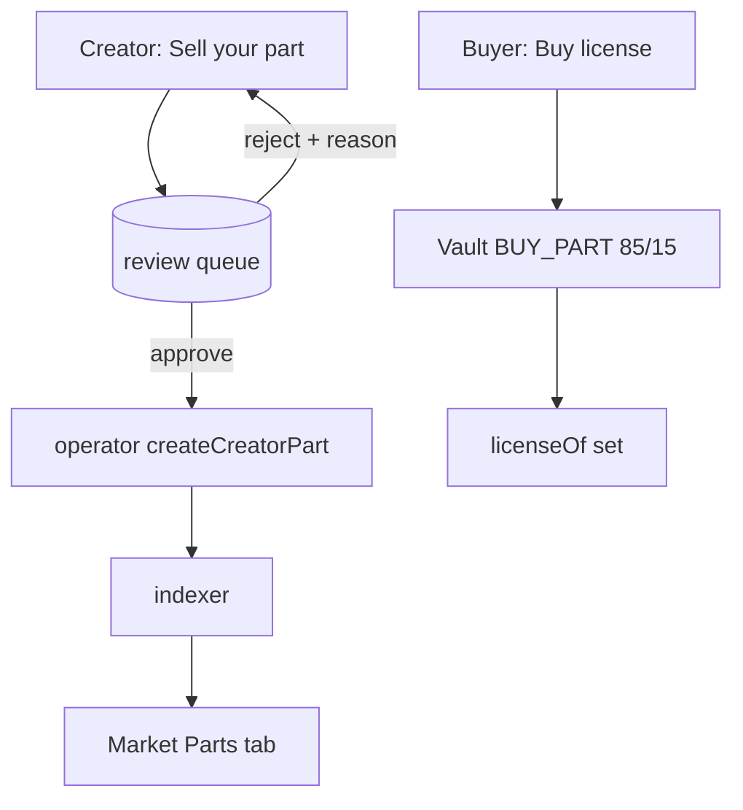

# Market: Parts, Circuit Rental, Creator Submissions

| | |
|---|---|
| **Version** | 1.0 |
| **Status** | Draft — awaiting owner approval |
| **Date Created** | 2026-11-16 |
| **Last Updated** | 2026-11-16 |

| Version | Date | Change |
|---|---|---|
| 1.0 | 2026-11-16 | Initial draft from the approved canvas designs and decisions D3–D11 of `0013` |

> **Handoff to Claude Code.** Read `AGENTS.md`, `docs/plans/0013-mvp-v2-contracts.md` and `docs/design/v2/README.md` first. Draft: no code until Approved. This plan **depends on `0013`** (v2 contracts: `licenseOf`, `setActive`, `setRent`, `createCreatorPart`, `createCreatorTrack`, `publishLayout`). Implement after `0013` reaches the testnet rehearsal.

---

## 1. Problem Statement

The Garage only sells the 3 platform parts and hosts only pick from platform tracks. The v2 contracts allow creator parts, creator circuits with their own rent, discontinued parts and layout versions, but there is no UI or review flow for any of it.

## 2. Definition of Done

1. "Garage" nav item becomes **Market** with tabs **Parts · Circuits · Resale (Q4, disabled with a "coming" label)**, matching `market-parts-*.dc.html` and `market-circuits-*.dc.html`.
2. Parts tab: all active part types from the chain index (platform + creator), filter All / Platform / Creator and "Best on: <track>", card = slot + stats + price + creator; detail panel with stats, track fit, split note, **Buy license**. Owned parts show "Owned"; a second license of the same type is not offered (D11).
3. Discontinued parts are not sold; owners still see and equip them.
4. Circuits tab: active tracks with layout art, laps / turns / length (derived), rent, owner, **Rent & open room** (existing create-room flow with the chosen track).
5. **Sell your part** (`creator-submit-phone.dc.html`): name, slot, stat steppers with live budget (each ≤ +2, sum ≤ +2), price; submits to a review queue. Approve → operator calls `createCreatorPart` (no MON for the creator).
6. **Submit / edit a circuit** (contract side in `0013`): segment layout from the editor (separate plan) or JSON for now, review queue, max 3 edits per track (lifetime), holder signs `LayoutUpdate`.
7. Admin review page (owner-only, behind an allowlist): approve/reject part and circuit submissions with a reason.
8. No rarity, no "investment" copy, no prices above the on-chain price shown anywhere.

## 3. Feature Description

- Catalog = chain index (events `PartTypeCreated`, `ActiveSet`, `TrackCreated`, `LayoutPublished`, `RentSet`) stored in PostgreSQL by the backend; the API never serves hardcoded catalog data.
- Submission states: `pending → approved → minted` or `rejected`. Stored off-chain; only the approved result goes on chain.
- Creator earnings appear in the existing wallet sheet "EARNINGS" (Vault `available`).

## 4. Impacted Files

| Path | Change |
|---|---|
| `frontend/components/play/Profile.tsx` | MODIFY: `Garage` → `Market` with tabs; reuse part cards |
| `frontend/components/play/Shell.tsx` | MODIFY: nav label Market |
| `frontend/components/market/*` | [NEW] PartsTab, CircuitsTab, PartDetail, CircuitCard, SubmitPart, ResaleTab (disabled). Reuse check: Garage list exists but has no tabs/filters/detail. |
| `frontend/app/admin/review/page.tsx` | [NEW] review queue (allowlisted addresses) |
| `backend/app/Chain/Indexer.ts` | [NEW] event indexer for v2 catalog. Reuse check: `RpcStats`/`Relayer` only write; no indexer exists. |
| `backend/app/Http/Services/Catalog/*` | MODIFY: serve from index; include active, creator, slot, stats map, fit |
| `backend/app/Http/Services/Submission/*`, `routes/submissions/api.ts`, `app/Http/Requests/*` | [NEW] create/list/approve/reject (Joi validation) |
| `backend/database/migrations/` | [NEW] `part_submissions`, `track_submissions`; catalog tables gain `active`, `creator`, `slot`, `stats jsonb`; drop `rarity` |

## 5. Code Shape

```ts
// backend
interface PartSubmissionDTO { creator: Address; name: string; slot: 'wings'|'tail'|'bill'; stats: Record<string, number>; priceUsdc6: bigint }
class SubmissionService {
  submitPart(dto: PartSubmissionDTO): Promise<{ id: number }>          // validates budget, name length, profanity list
  approvePart(id: number, reviewer: Address): Promise<{ tx: Hex }>     // operator createCreatorPart
  reject(id: number, reviewer: Address, reason: string): Promise<void>
  submitLayout(trackId: number, segments: Hex, laps: number, holderSig: Hex): Promise<{ id: number }> // editsUsed < 3
  approveLayout(id: number, reviewer: Address): Promise<{ tx: Hex }>   // operator publishLayout
}
// frontend
export function Market(p: { tab: 'parts'|'circuits'|'resale' }): JSX.Element
```

## 6. UI/UX Changes (Lo-Fi)

`docs/design/v2/market-*.dc.html`, `creator-submit-phone.dc.html`. Resale screen (`market-resale-laptop-q4.dc.html`) is reference for Q4 only; ship the tab as disabled.

## 7. Flowchart



## 8. Verification Plan

1. API tests: budget validation (fuzz the same rule as the contract), duplicate license refusal, reject path.
2. Indexer test on testnet: catalog matches chain reads (`CheckDeploy` values).
3. E2E on testnet: submit → approve → buy by a second wallet → creator earnings visible → withdraw.
4. Visual check against the design files at 390 and 1440 px.

## 9. Open Questions

| # | Question |
|---|---|
| Q1 | Creator part price range (e.g. 0.10–5 USDC)? |
| Q2 | Who reviews (owner only, or more addresses)? |
| Q3 | Circuit editor UI: in this plan or its own plan (`0016`)? Draft: own plan. |
