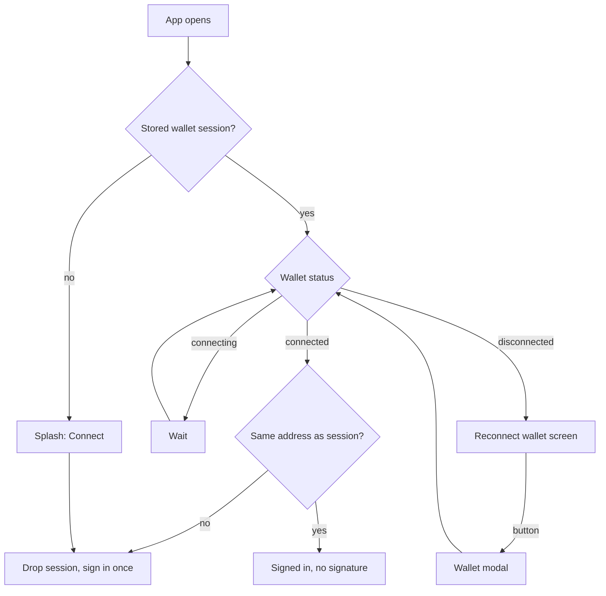

# Wallet Connect and Session

| | |
|---|---|
| **Version** | 1.0 |
| **Status** | Draft |
| **Date Created** | 2026-11-18 |
| **Last Updated** | 2026-11-18 |

| Version | Date | Change |
|---|---|---|
| 1.0 | 2026-11-18 | Initial draft after the owner's report on staging: after disconnecting the site in MetaMask the app still looked signed in and then asked for a signature. |

## 1. Problem Statement

Reported on staging by the owner: the wallet was disconnected in MetaMask, and the app still behaved as signed in, then asked for a signature. The app must detect the wallet connection through MetaMask first, and offer a reconnect.

Findings, read from `frontend/contexts/SessionContext.tsx`, `frontend/http/client.ts` and `frontend/app/play/ui.tsx` (no browser reproduction was possible without a wallet):

| # | Finding | Where |
|---|---|---|
| P1 | The session is a JWT in `localStorage` (`duckwek.token`) plus `duckwek.signer` = `wallet`. Not a cookie. The server accepts the token for 24 hours. | `http/client.ts:3-8`, `SessionContext.tsx:194` |
| P2 | On load the app calls `/me` with the token alone and shows the signed-in app (`me` is set). It never checks whether the wallet is connected. A MetaMask disconnect is not observed once `me` exists. | `SessionContext.tsx:146-158`, `app/play/ui.tsx:36-47` |
| P3 | With no wallet connected the wallet signer is `null`. Any paid action ends with the toast `Connect first`: a dead end, with no reconnect button. | `SessionContext.tsx:259-263` |
| P4 | When the wallet connects again, `connectWallet` always opens the "Sign in to DuckWek" sheet and asks for a signature, even when a valid session for the same address is still stored. | `SessionContext.tsx:225-233` |

P1 and P2 are why the app looked signed in. P3 is the missing reconnect option. P4 is the unnecessary signature. UNVERIFIED: which of these produced the exact prompt the owner saw; the Verification Plan resolves it with a scripted wallet test.

## 2. Definition of Done

1. For a wallet session, the wallet connection is the source of truth. If the wallet is not connected, the app does not show the signed-in screens.
2. When the wallet is disconnected (on load, or while the app is open), a **Reconnect wallet** screen shows with one button that opens the wallet connect modal. The stored token is not deleted.
3. After the wallet reconnects with the **same address** as the stored session, the app resumes without any signature.
4. After the wallet reconnects with a **different address**, the stored session is dropped and the normal sign-in (one signature) runs for the new address.
5. A signature is requested only when there is no valid session for the connected address.
6. A paid action with no connected wallet opens the Reconnect screen instead of the `Connect first` toast.
7. Passkey and device wallets are not affected.
8. No contract or backend change.

## 3. Feature Description

State of a wallet session, from the wallet's point of view:

| Wallet (wagmi `status`) | Stored session | Result |
|---|---|---|
| connecting / reconnecting | any | wait; show the existing loading state; never sign |
| disconnected | none | Splash with Connect (as today) |
| disconnected | valid token, kind `wallet` | **Reconnect wallet** screen |
| connected, same address as the token | valid | signed in, no signature |
| connected, other address | token of another address | drop the token, sign in once |
| connected | none or expired (401) | sign in once |

Sign out stays as it is: it clears the token and disconnects the wallet.

## 4. Impacted Files

| File | Change | Reuse check |
|---|---|---|
| `frontend/contexts/SessionContext.tsx` | [MODIFY] expose a `walletState` (`ready`, `reconnect`, `signedIn`) derived from wagmi `status` and the stored session; resume without a signature on same address; drop the token on another address | The connect logic already lives here; no new context |
| `frontend/app/play/ui.tsx` | [MODIFY] route to the Reconnect screen when `walletState` is `reconnect` | Screen routing already lives here |
| `frontend/components/play/Onboarding.tsx` | [MODIFY] add the Reconnect screen next to Connect, same button component | Same file as the Connect screen; no new file |

## 5. Code Shape

Before (`SessionContext.tsx`): `me` comes from the token alone; `connectWallet` always calls `signIn`.

After:

- New state in `SessionState`: `walletState: 'ready' | 'reconnect' | 'signedIn'`. Responsibility: tell the screens whether the wallet is connected for a stored wallet session.
- Changed `connectWallet`: if the wallet is connected and `me.address` equals the connected address, set the signer and return without `signIn`; otherwise as today.
- Changed boot effect: when `kind === 'wallet'` and the wallet status is `disconnected`, set `walletState` to `reconnect` and keep `me` unset for routing (the token stays in storage).
- Changed account effect: on connect with another address than the stored session, clear the token before `signIn`.

Call flow: boot → read token and kind → wait for wagmi status → table in §3.

Deleted: nothing.

## 6. UI/UX Changes (Lo-Fi)

```
Reconnect wallet
+---------------------------------+
|  [duck]                         |
|  Wallet disconnected            |
|  Connect your wallet to keep    |
|  playing.                       |
|  [ Reconnect with wallet ]      |
|  Sign out                       |
+---------------------------------+
```

Copy is English. The button opens the same wallet modal as Connect. `Sign out` clears the stored session.

## 7. Flowchart



## 8. Verification Plan

| # | Test | Resolves |
|---|---|---|
| V1 | Browser test with a scripted EIP-1193 wallet: sign in, then make the wallet report no accounts; expect the Reconnect screen and no signature request | DoD 1, 2, P2 |
| V2 | Same test, reconnect with the same address; expect the home screen and zero `eth_signTypedData_v4` calls | DoD 3, P4 |
| V3 | Reconnect with another address; expect exactly one sign-in prompt and a new session | DoD 4 |
| V4 | Tap a paid action with no wallet; expect the Reconnect screen, no `Connect first` toast | DoD 6, P3 |
| V5 | Passkey and device sign-in still reach home; the Reconnect screen never shows for them | DoD 7 |
| V6 | `tsc --noEmit`, lint count not higher than the baseline, `next build` | regressions |
| V7 | On staging, with real MetaMask: disconnect the site in MetaMask and reload | the owner's report, UNVERIFIED P1–P4 |

## 9. Decision for the owner

After the wallet reconnects with the same address, should the app resume without a new signature (recommended: the stored session was already signed and is valid for 24 hours), or ask for a signature on every reconnect?
