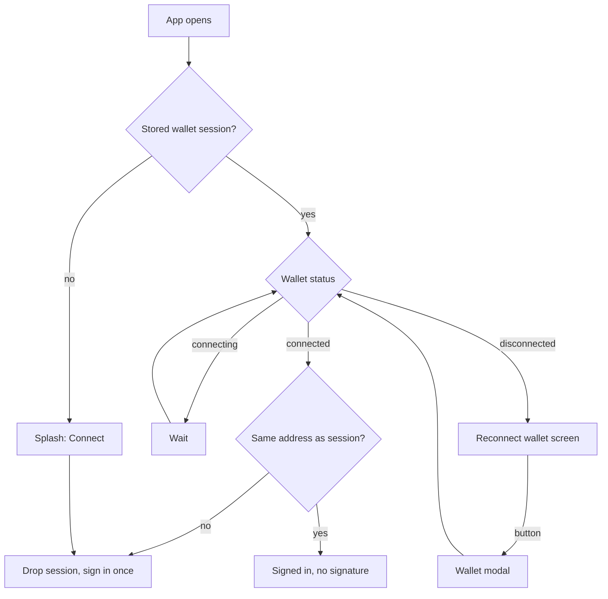
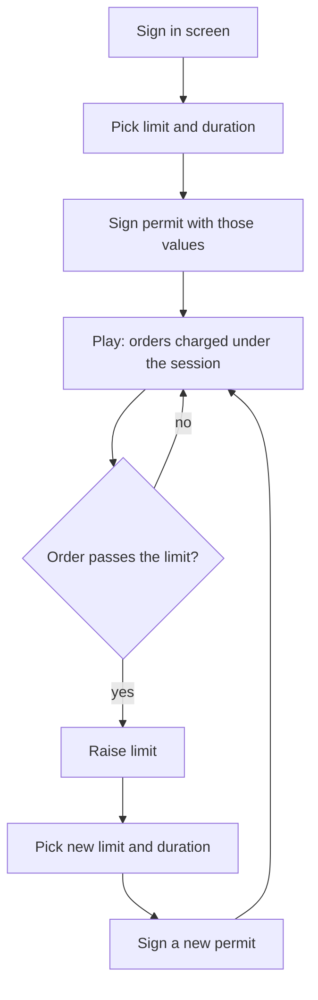

# Wallet Connect, Session, and Limit

| | |
|---|---|
| **Version** | 1.4 |
| **Status** | Draft |
| **Date Created** | 2026-11-18 |
| **Last Updated** | 2026-11-18 |

| Version | Date | Change |
|---|---|---|
| 1.0 | 2026-11-18 | Initial draft after the owner's report on staging: after disconnecting the site in MetaMask the app still looked signed in and then asked for a signature. |
| 1.1 | 2026-11-18 | §1 P5 and P6, §2 DoD 9 and 10, §8 V8 and V9, §9: second report from the owner, MetaMask on Android: after signing in the wallet app the session is gone. WalletConnect project id missing; sign-in intent kept only in memory. |
| 1.2 | 2026-11-18 | §1 P5 corrected: on a phone the RainbowKit MetaMask button uses the MetaMask SDK connector, not WalletConnect (RainbowKit 2.2.11, `metaMaskWallet`: `shouldUseMetaMaskConnector = isMetaMaskInjected \|\| isMobile()`), so the missing WalletConnect project id is not the cause of the Android failure. The project id stays needed for the WalletConnect option. The cause of the Android failure is OPEN. |
| 1.3 | 2026-11-18 | §1 P7 to P9, §2 DoD 11 to 14, §3, §5, §6, §8 V10 to V13: the owner reported on a phone with native MetaMask that the sign step is forced right after connecting, the sign sheet has no way out while waiting for the wallet, and `/play` has no visible connect or disconnect control. Connect and sign are now separate steps; the header always shows a wallet control; the pending sign sheet has Cancel; the automatic sign-in and the stored sign-in intent of v1.1 are removed. |
| 1.4 | 2026-11-23 | Plan 0017 (adjustable spending limit) merged into this plan at the owner's request and 0017 deleted. §1 P11, §2 DoD 15 to 21, §3, §4, §5, §6, §7, §8 V14 to V21, §9 D3 to D5: the player sets the spending limit and the session duration (maximum 2 days); a new permit replaces the session; the backend upper bound of the limit is 100,000 USDC (owner decision); a new limit means the amount available from now on (owner decision). |

## 1. Problem Statement

Reported on staging by the owner: the wallet was disconnected in MetaMask, and the app still behaved as signed in, then asked for a signature. The app must detect the wallet connection through MetaMask first, and offer a reconnect.

Findings, read from `frontend/contexts/SessionContext.tsx`, `frontend/http/client.ts` and `frontend/app/play/ui.tsx` (no browser reproduction was possible without a wallet):

| # | Finding | Where |
|---|---|---|
| P1 | The session is a JWT in `localStorage` (`duckwek.token`) plus `duckwek.signer` = `wallet`. Not a cookie. The server accepts the token for 24 hours. | `http/client.ts:3-8`, `SessionContext.tsx:194` |
| P2 | On load the app calls `/me` with the token alone and shows the signed-in app (`me` is set). It never checks whether the wallet is connected. A MetaMask disconnect is not observed once `me` exists. | `SessionContext.tsx:146-158`, `app/play/ui.tsx:36-47` |
| P3 | With no wallet connected the wallet signer is `null`. Any paid action ends with the toast `Connect first`: a dead end, with no reconnect button. | `SessionContext.tsx:259-263` |
| P4 | When the wallet connects again, `connectWallet` always opens the "Sign in to DuckWek" sheet and asks for a signature, even when a valid session for the same address is still stored. | `SessionContext.tsx:225-233` |

| P5 | (corrected in v1.2) `NEXT_PUBLIC_WALLETCONNECT_PROJECT_ID` was missing in `duckwek-stage` and now is set. It matters for the WalletConnect option and desktop QR. It does NOT affect the MetaMask button on a phone, which uses the MetaMask SDK connector. | `lib/config.ts:5`, RainbowKit `metaMaskWallet` |
| P6 | The intent "sign in after the wallet connects" is a React ref (`wantWalletSignIn`), held in memory only. A phone browser can reload or restore the tab when it returns from the wallet app; the ref is then false and nothing signs in, so the app looks as if the sign-in vanished. UNVERIFIED. | `SessionContext.tsx` (`wantWalletSignIn`) |

| P7 | Connecting a wallet opened the sign sheet automatically (`wantWalletSignIn`), so connect and sign could not be separated. | `SessionContext.tsx` (before v1.3) |
| P8 | While the wallet was asked to sign, the sheet showed only a blinking label: no Cancel. If the wallet never answered the user was stuck. | `components/play/Shell.tsx` `SignSheet` |
| P9 | The header had no connect or disconnect control; the wallet button existed only after sign-in. | `components/play/Shell.tsx` `Header` |
| P10 | The phone error `-32602 invalid parameter, must provide an Ethereum address` on sign comes from the MetaMask app itself (the text exists in no dependency of the frontend). The cause is OPEN; the owner can read the console on the phone. | search of `node_modules` |

| P11 | The spending limit of a session is fixed at 5 USDC for everyone (`SESSION_CAP`, `backend/config/env.ts:27`, put into the permit in `AuthService.ts:21`, checked in `OrderService.ts:75`) and the duration is fixed at 24 hours (`SESSION_TTL_SEC`, `env.ts:28`, `AuthService.ts:26`, also the JWT lifetime at `AuthService.ts:51`). The player cannot choose either; when the limit is too small the only message is "Session spending limit reached, connect again". The contracts already take both numbers from the signed permit (`sessionCap = permit.value`, `sessionEnd = permit.deadline`, `DuckWekVault.sol:229-231` and `:264-266`) and impose no maximum, so no contract change is needed. | `env.ts`, `AuthService.ts`, `OrderService.ts`, `DuckWekVault.sol` |

P1 and P2 are why the app looked signed in. P3 is the missing reconnect option. P4 is the unnecessary signature. UNVERIFIED: which of these produced the exact prompt the owner saw; the Verification Plan resolves it with a scripted wallet test.

## 2. Definition of Done

1. For a wallet session, the wallet connection is the source of truth. If the wallet is not connected, the app does not show the signed-in screens.
2. When the wallet is disconnected (on load, or while the app is open), a **Reconnect wallet** screen shows with one button that opens the wallet connect modal. The stored token is not deleted.
3. After the wallet reconnects with the **same address** as the stored session, the app resumes without any signature.
4. After the wallet reconnects with a **different address**, the stored session is dropped and the normal sign-in (one signature) runs for the new address.
5. A signature is requested only when there is no valid session for the connected address.
6. A paid action with no connected wallet opens the Reconnect screen instead of the `Connect first` toast.
7. Passkey and device wallets are not affected.
8. No contract change. (Backend changes are limited to DoD 15 to 21.)
9. On Android, tap Connect in the browser, approve and sign in the MetaMask app, return to the browser: the app is signed in (survives a tab reload).
11. Connecting a wallet never opens a signature request. After connecting without a session, a "Sign in to play" screen shows; the signature is requested only when the user taps Sign in.
12. The header always shows a wallet control: Connect wallet, Reconnect, or the short address with Disconnect; once signed in, the balance pill whose panel has Disconnect wallet.
13. While the wallet is asked to sign, the sheet has a Cancel button that closes it even if the wallet never answers.
14. Reconnecting with another address does not sign automatically; it shows the Sign in screen.
10. The WalletConnect project id comes from the environment of every deployment (staging and production); the placeholder fallback is not used.
15. At sign-in the player picks the spending limit: presets 5, 10, 25, 50 USDC or a typed amount. The default is 5.
16. At sign-in the player picks the session duration: presets 1 hour, 24 hours, 2 days. The default is 24 hours.
17. The limit and the duration the player picked are the values in the permit that is signed, the values the backend checks, and the values the Vault records as session cap and end. The JWT lifetime equals the chosen duration.
18. The wallet panel shows the limit, the used amount, the time left, and a **Change limit** action.
19. Changing the limit or the duration asks for a new signature (a new permit) and replaces the previous session: the new limit is the amount available from that moment (not added to the old one), and the chosen duration counts from that moment.
20. When an order would pass the limit, the app says so and offers **Raise limit**, which opens the same change flow. It does not say "connect again".
21. Bounds, validated on the backend: limit from 1 USDC to 100,000 USDC; duration from 1 hour to 2 days. No contract change.

## 3. Feature Description

State of a wallet session, from the wallet's point of view:

| Wallet (wagmi `status`) | Stored session | Result |
|---|---|---|
| connecting / reconnecting | any | wait; show the existing loading state; never sign |
| disconnected | none | Splash with Connect (as today) |
| disconnected | valid token, kind `wallet` | **Reconnect wallet** screen |
| connected, same address as the token | valid | signed in, no signature |
| connected, other address | token of another address | drop the token, sign in once |
| connected | none or expired (401) | sign in once |

Sign out stays as it is: it clears the token and disconnects the wallet.

Limit and duration:

| Moment | What the player does | What happens |
|---|---|---|
| Sign in | picks a limit and a duration, taps Sign in | one signature on a permit with `value` = the limit and `deadline` = now + duration |
| Playing | pays tickets, rent, parts | each order is charged under the session; the used amount grows |
| Limit too small | taps Raise limit (or Change limit in the wallet panel) | picks new values, signs a new permit; the next order submits it |
| Limit lowered | same flow with a smaller number | the new permit sets the allowance to the smaller number |

The new permit replaces the old one: the token sets the allowance to the new value, and the Vault resets the used amount to zero and records the new cap and end. A signed permit that was never submitted is superseded by the newest one (the backend always uses the latest).

## 4. Impacted Files

| File | Change | Reuse check |
|---|---|---|
| `frontend/contexts/SessionContext.tsx` | [MODIFY] `signIn(signer, reviewFirst, limit, duration)` and `changeLimit(limit, duration)`; expose a `walletState` (`ready`, `reconnect`, `signedIn`) derived from wagmi `status` and the stored session; resume without a signature on same address; drop the token on another address | The connect logic already lives here; no new context |
| `frontend/app/play/ui.tsx` | [MODIFY] route to the Reconnect screen when `walletState` is `reconnect` | Screen routing already lives here |
| `frontend/components/play/Onboarding.tsx` | [MODIFY] add the Reconnect screen next to Connect, same button component; limit and duration pickers on the Sign in screen | Same file as the Connect screen; no new file |
| `backend/database/migrations/<new>_auth_nonce_session_cap.ts` | [NEW] adds `session_cap` (string, default `5000000`) to `auth_nonces` | The limit is a property of the session row that already holds the permit nonce and the deadline; the duration needs no column because the deadline is already stored; no new table |
| `backend/app/Models/AuthNonce.ts` | [MODIFY] `session_cap` attribute | |
| nonce request in `backend/app/Http/Requests/` and `app/DTOs/AuthNonceDTO.ts` | [MODIFY] optional `limit` and `duration` (Joi, bounds of DoD 21) | Existing request and DTO of the nonce endpoint |
| `backend/app/Http/Services/Auth/AuthService.ts` | [MODIFY] the permit message uses the row's cap and deadline, not `env.sessionCap`; `verify` rebuilds the message from the stored cap; the JWT lifetime is the stored deadline minus now | |
| `backend/app/Http/Services/Order/OrderService.ts` | [MODIFY] the limit check and `toPermitArg` use the session's cap | |
| `backend/app/Http/Services/Profile/ProfileService.ts` | [MODIFY] `/api/me` returns `session: { limit, spent, deadline }` (UNVERIFIED: the current shape of the session data in this response) | |
| `backend/config/env.ts` | [MODIFY] `SESSION_CAP` and `SESSION_TTL_SEC` become the defaults; new bounds `SESSION_CAP_MAX` (100000 USDC) and `SESSION_TTL_MAX_SEC` (172800) | |
| `frontend/http/auth/authApi.ts` | [MODIFY] `fetchNonce(address, limit, duration)` | |
| `frontend/components/play/Shell.tsx` | [MODIFY] wallet panel row with limit, used amount, time left and Change limit; picker sheet | Same file as the wallet panel |
| `frontend/lib/types.ts` | [MODIFY] `Me.session` | |

## 5. Code Shape

Before (`SessionContext.tsx`): `me` comes from the token alone; `connectWallet` always calls `signIn`.

After:

- New state in `SessionState`: `walletState: 'ready' | 'reconnect' | 'signedIn'`. Responsibility: tell the screens whether the wallet is connected for a stored wallet session.
- Changed `connectWallet`: if the wallet is connected and `me.address` equals the connected address, set the signer and return without `signIn`; otherwise as today.
- Changed boot effect: when `kind === 'wallet'` and the wallet status is `disconnected`, set `walletState` to `reconnect` and keep `me` unset for routing (the token stays in storage).
- Changed account effect: on connect with another address than the stored session, clear the token before `signIn`.

Call flow: boot → read token and kind → wait for wagmi status → table in §3.

Limit and duration:

- `AuthService.nonce(nonceInput)`: reads `nonceInput.limit` (default `env.sessionCap`) and `nonceInput.duration` (default `env.sessionTtlSec`), stores the cap in the row with the deadline, and returns the typed data whose `message.value` is the limit and `message.deadline` is now + duration.
- `AuthService.verify(verifyInput)`: rebuilds the message from `authNonce.session_cap` and `authNonce.deadline`; the token is signed with `expiresIn` = deadline minus now.
- `OrderService`: `if (BigInt(session.spent) + price > BigInt(session.session_cap)) throw new UnauthorizedException('Session spending limit reached')`, and `toPermitArg(BigInt(session.session_cap), deadline, signature)`.
- `SessionContext.changeLimit(limit: bigint, duration: number): Promise<void>`: calls `signIn(signer, false, limit, duration)`; responsibility: new permit with the chosen values, replacing the session.
- Flow: picker, `fetchNonce(address, limit, duration)`, wallet signs the permit, `verifySignature`, token replaced, `refresh`.

Deleted: nothing.

## 6. UI/UX Changes (Lo-Fi)

```
Reconnect wallet
+---------------------------------+
|  [duck]                         |
|  Wallet disconnected            |
|  Connect your wallet to keep    |
|  playing.                       |
|  [ Reconnect with wallet ]      |
|  Sign out                       |
+---------------------------------+
```

```
Sign in to play                     Wallet panel
+------------------------+          +------------------------------+
| Spending limit         |          | Spending limit               |
| (5)(10)(25)(50)[ ___ ] |          | 3.20 of 10 USDC used         |
| Session time           |          | 21 h left                    |
| (1 h)(24 h)(2 d)       |          | [ Change limit ]             |
| [ Sign in ]            |          | [ Disconnect wallet ]        |
+------------------------+          +------------------------------+
```

When an order fails on the limit: the toast "Spending limit reached" with a **Raise limit** button.

Copy is English. The button opens the same wallet modal as Connect. `Sign out` clears the stored session.

## 7. Flowchart





## 8. Verification Plan

| # | Test | Resolves |
|---|---|---|
| V1 | Browser test with a scripted EIP-1193 wallet: sign in, then make the wallet report no accounts; expect the Reconnect screen and no signature request | DoD 1, 2, P2 |
| V2 | Same test, reconnect with the same address; expect the home screen and zero `eth_signTypedData_v4` calls | DoD 3, P4 |
| V3 | Reconnect with another address; expect exactly one sign-in prompt and a new session | DoD 4 |
| V4 | Tap a paid action with no wallet; expect the Reconnect screen, no `Connect first` toast | DoD 6, P3 |
| V5 | Passkey and device sign-in still reach home; the Reconnect screen never shows for them | DoD 7 |
| V6 | `tsc --noEmit`, lint count not higher than the baseline, `next build` | regressions |
| V8 | On a real Android phone with MetaMask, on staging: connect, sign in the wallet app, return to the browser; also force a tab reload while in the wallet app | DoD 9, P5, P6 |
| V9 | The WalletConnect option accepts the project id (no origin or project error in the browser console) | DoD 10 |
| V10 | Connect shows the Sign in screen with zero signature requests | DoD 11, P7 |
| V11 | The header control matches the wallet state in every state of §3 | DoD 12, P9 |
| V12 | A sign request that the wallet never answers can be cancelled and signed again | DoD 13, P8 |
| V13 | Another address after reconnecting shows Sign in, no automatic sign | DoD 14 |
| V14 | Backend test: nonce with limit 10 USDC and duration 2 days returns `message.value` 10000000 and a deadline of now + 172800; verify accepts the signature; the JWT expires at that deadline | DoD 15, 16, 17 |
| V15 | E2E on staging: sign with 2 USDC, buy a 1 USDC part, then a 1 USDC room: the next 0.10 USDC order is refused by the limit | DoD 20 |
| V16 | E2E on staging: raise to 10, sign again, the same order succeeds; `Vault.sessionCap(payer)` reads 10000000, `sessionEnd(payer)` the new deadline, and `sessionSpent` restarts at zero | DoD 19 |
| V17 | Lower the limit to 1 and check that the token allowance reads 1 USDC after the next order | DoD 19 |
| V18 | Out of range values (limit 0, 0.5, above 100,000; duration under 1 hour or above 2 days; text) are rejected with a validation message | DoD 21 |
| V19 | Browser test with the scripted wallet: pickers, Change limit and Raise limit open the right flow and send exactly one signature each | DoD 15, 16, 18, 20 |
| V20 | `/api/me` session shape and the migration on the staging database | UNVERIFIED items of P11 |
| V21 | The migration is listed in the production cutover (plan 0013 A6) | DoD 17 |
| V7 | On staging, with real MetaMask: disconnect the site in MetaMask and reload | the owner's report, UNVERIFIED P1–P4 |

## 9. Decisions for the owner

1. A WalletConnect (Reown) project id for staging and one for production. Creating it needs the owner's account at cloud.reown.com; the staging and production domains go in its allowed list. Nothing is invented here.
2. After the wallet reconnects with the same address, should the app resume without a new signature (recommended: the stored session was already signed and is valid for 24 hours), or ask for a signature on every reconnect?
3. **D3 (decided by the owner):** the upper bound of the limit on the backend is **100,000 USDC**. It is a sanity bound only; the wallet balance is the real limit. It can change later without a contract deploy.
4. **D4 (decided by the owner):** a new limit means **the amount available from now on**, not added to what is left. Raising 5 to 10 after spending 3 gives 10 available, not 12.
5. **D5 (duration):** the owner decided the maximum is **2 days**; the default stays 24 hours. PROPOSAL, not yet confirmed: lower bound 1 hour and presets 1 hour, 24 hours, 2 days.
