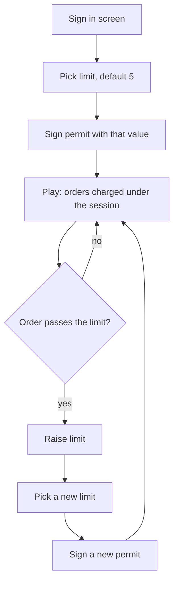

# Adjustable Spending Limit

| | |
|---|---|
| **Version** | 1.0 |
| **Status** | Draft |
| **Date Created** | 2026-11-18 |
| **Last Updated** | 2026-11-18 |

| Version | Date | Change |
|---|---|---|
| 1.0 | 2026-11-18 | Initial draft from the owner's request: the player sets the spending limit; if 5 USDC is too small the player raises it to 10 and signs again. |

## 1. Problem Statement

The spending limit of a session is fixed at 5 USDC for everyone. The value comes from the backend variable `SESSION_CAP` (`backend/config/env.ts:27`), is put into the permit the player signs (`AuthService.ts:21`) and is checked again in `OrderService.ts:75`. The player cannot choose it, and when it is too small the only message is "Session spending limit reached, connect again".

The contracts already allow a free limit: `DuckWekVault` takes the cap of the session from the signed permit (`sessionCap[payer] = permit.value`, `DuckWekVault.sol:230` and `:265`), and the token enforces the same number as the allowance. No contract change is needed.

## 2. Definition of Done

1. At sign-in the player picks the limit: presets 5, 10, 25, 50 USDC or a typed amount. The default is 5.
2. The amount the player picked is the amount in the permit that is signed, the amount the backend checks, and the amount the Vault records as the session cap.
3. In the wallet panel the player sees the limit, how much is used, and a **Change limit** action.
4. Changing the limit asks for a new signature (a new permit) and replaces the previous session: the new limit is the amount available from that moment (it is not added to the old one), and the 24 hour validity restarts.
5. When an order would pass the limit, the app says so and offers **Raise limit**, which opens the same change flow. It does not say "connect again".
6. The limit has a lower bound of 1 USDC and an upper bound that is validated on the backend (decision D1).
7. No contract change; the existing testnet contracts are used as they are.

## 3. Feature Description

| Moment | What the player does | What happens |
|---|---|---|
| Sign in | picks a limit, taps Sign in | one signature on a permit with `value` = the limit |
| Playing | pays tickets, rent, parts | each order is charged under the session; the used amount grows |
| Limit too small | taps Raise limit (or Change limit in the wallet panel) | picks a new limit, signs a new permit; the next order submits it |
| Limit lowered | same flow with a smaller number | the new permit sets the allowance to the smaller number |

The new permit replaces the old one: the token sets the allowance to the new value, and the Vault resets the used amount to zero and records the new cap and deadline. A signed permit that was never submitted is superseded by the newest one (the backend always uses the latest).

## 4. Impacted Files

| File | Change | Reuse check |
|---|---|---|
| `backend/database/migrations/<new>_auth_nonce_session_cap.ts` | [NEW] adds `session_cap` (string, default `5000000`) to `auth_nonces` | The limit is a property of the session row that already holds the permit nonce, deadline and spent amount; no new table |
| `backend/app/Models/AuthNonce.ts` | [MODIFY] `session_cap` attribute | |
| `backend/app/Http/Requests/` (nonce request) and `app/DTOs/AuthNonceDTO.ts` | [MODIFY] optional `limit` (Joi: integer string, lower and upper bound) | Existing request and DTO of the nonce endpoint |
| `backend/app/Http/Services/Auth/AuthService.ts` | [MODIFY] the permit message uses the row's cap, not `env.sessionCap`; `verify` rebuilds the message from the stored cap | |
| `backend/app/Http/Services/Order/OrderService.ts` | [MODIFY] the limit check and `toPermitArg` use the session's cap | |
| `backend/app/Http/Services/Profile/ProfileService.ts` | [MODIFY] `/api/me` returns `session: { limit, spent, deadline }` (UNVERIFIED: the current shape of the session data in this response) | |
| `backend/config/env.ts` | [MODIFY] `SESSION_CAP` becomes the default and the upper bound source | |
| `frontend/http/auth/authApi.ts` | [MODIFY] `fetchNonce(address, limit)` | |
| `frontend/contexts/SessionContext.tsx` | [MODIFY] `signIn(signer, reviewFirst, limit)`; `changeLimit(limit)` | The sign flow already lives here |
| `frontend/components/play/Onboarding.tsx` | [MODIFY] limit picker on the Sign in screen | Same file as the Sign in screen |
| `frontend/components/play/Shell.tsx` | [MODIFY] wallet panel row with the limit, the used amount and Change limit; limit picker sheet | Same file as the wallet panel |
| `frontend/lib/types.ts` | [MODIFY] `Me.session` | |

## 5. Code Shape

- `AuthService.nonce(nonceInput)`: reads `nonceInput.limit` (default `env.sessionCap`), stores it in the row, and returns the typed data whose `message.value` is that limit.
- `AuthService.verify(verifyInput)`: rebuilds the message from `authNonce.session_cap`.
- `OrderService`: `if (BigInt(session.spent) + price > BigInt(session.session_cap)) throw new UnauthorizedException('Session spending limit reached')`, and `toPermitArg(BigInt(session.session_cap), deadline, signature)`.
- `SessionContext.changeLimit(limit: bigint): Promise<void>`: calls `signIn(signer, false, limit)`; responsibility: new permit with the chosen value, replacing the session.
- Call flow: picker, `fetchNonce(address, limit)`, wallet signs the permit, `verifySignature`, token replaced, `refresh`.
- Deleted: nothing.

## 6. UI/UX Changes (Lo-Fi)

```
Sign in to play                     Wallet panel
+------------------------+          +------------------------------+
| Spending limit         |          | Spending limit               |
| (5)(10)(25)(50)[ ___ ] |          | 3.20 of 10 USDC used         |
| Sign once. Free, 24 h. |          | [ Change limit ]             |
| [ Sign in ]            |          | [ Disconnect wallet ]        |
+------------------------+          +------------------------------+
```

When an order fails on the limit: the toast "Spending limit reached" with a **Raise limit** button. Copy is English.

## 7. Flowchart



## 8. Verification Plan

| # | Test | Resolves |
|---|---|---|
| V1 | Backend test: nonce with `limit` 10 USDC returns `message.value` 10000000; verify accepts the signature of that message | DoD 2 |
| V2 | E2E on staging: sign with 2 USDC, buy a 1 USDC part, then a 1 USDC room: the next 0.10 USDC order is refused by the limit | DoD 5 |
| V3 | E2E on staging: raise to 10, sign again, the same order succeeds; `Vault.sessionCap(payer)` reads 10000000 and `sessionSpent` restarts at zero | DoD 4 |
| V4 | Lower the limit to 1 and check that the token allowance reads 1 USDC after the next order | DoD 4 |
| V5 | Out of range values (0, 0.5, above the upper bound, text) are rejected with a validation message | DoD 6 |
| V6 | Browser test with the scripted wallet: picker, Change limit, Raise limit open the right flow and send exactly one signature each | DoD 1, 3, 5 |
| V7 | `/api/me` session shape and the migration on the staging database; the same migration is listed in the production cutover (plan 0013 A6) | UNVERIFIED items |

## 9. Decisions for the owner

- **D1:** the upper bound of the limit on the backend. The owner said "a million or 10k, the user is free", so the proposal is **1,000,000 USDC** as a sanity bound (the wallet balance is the real limit). A different number or no bound at all is the owner's call.
- **D2:** the meaning of a new limit: **the amount available from now on** (the token sets the allowance to the new value), not "added to what is left". Raising 5 to 10 after spending 3 gives 10 available, not 12.
